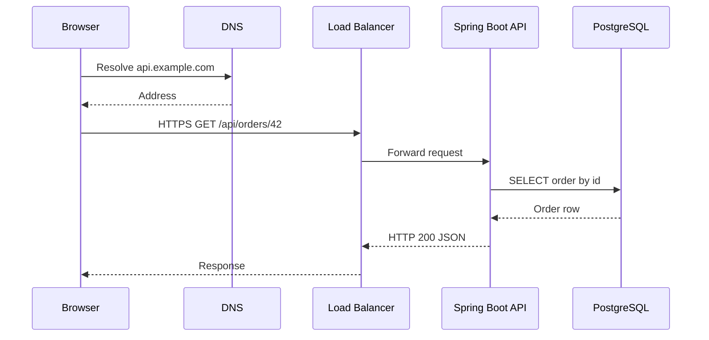
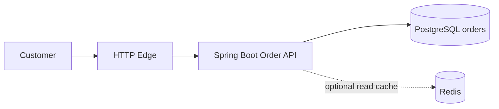

# Week 1 · Day 1 — Introduction to System Design Fundamentals

**Level:** Beginner → software-engineering interview | **Example stack:** Java, Spring Boot, PostgreSQL

## 1. Learning objectives
By the end, explain why system design matters; trace an HTTP request from user to database; distinguish HLD from LLD; identify functional versus non-functional requirements; define scaling, latency, throughput, availability and reliability; and sketch a system with justified components.

## 2. What is system design?
System design turns a problem statement into an **implementable architecture**: what each component owns, how they communicate, where data is stored, how to handle failure, and what trade-offs you accept.

Writing `@RestController` solves a local code problem. Designing a production backend also asks:
- How many requests will arrive per second, including traffic spikes?
- Should state live in a process, database, cache or durable log?
- What happens if a node dies while processing a request?
- Which operations require strong correctness versus eventually consistent reporting?
- How will developers deploy, monitor, debug and change the software?

There is no universally “best” architecture: a small internal ticketing app should not default to a globally distributed microservices platform.

**Mental model:** requirements → assumptions → APIs and data → HLD → bottlenecks/failure analysis → LLD → validate with measurements.

## 3. High-Level Design (HLD) versus Low-Level Design (LLD)
| HLD | LLD |
|---|---|
| Components, boundaries, data flow | Classes, interfaces, schema, method behavior |
| How does the whole system work? | How does one component implement its responsibility? |
| Load balancer, API replicas, PostgreSQL | `LinkController`, `LinkService`, `LinkRepository` |
| Scaling, consistency, cost and failures | Validation, algorithms, exception handling, unit tests |
| Communication with teams/architects | Implementation guide and code review |

For a URL shortener, HLD says “redirect service looks up a code in an indexed database, optionally through a cache.” LLD says “`LinkService.resolve(code)` loads the mapping, checks expiry, and returns the destination or throws a domain error.”

## 4. HTTP request lifecycle

DNS lookup can be cached; TLS may terminate at the edge; a load balancer is optional in the smallest deployment. The backend should validate input, authorize the caller, perform domain logic and return a meaningful HTTP status.

### Common building blocks
| Component | Job | Pitfall |
|---|---|---|
| Client | Send requests and render responses | Poor handling of retries and timeouts |
| Reverse proxy/load balancer | Route traffic across healthy instances | Single instance is a new single point of failure |
| API server | Validate and implement business rules | Storing sessions in local RAM complicates scaling |
| Database | Durable source of truth | Slow queries, locks, limited connection count |
| Cache (optional) | Speed up repeated reads | Stale data and invalidation |
| Queue/broker (optional) | Decouple background work | Duplicate delivery and eventual consistency |
| Monitoring | Reveal latency, errors and saturation | Missing traces or unhelpful alerts |

## 5. Requirements: what vs how well
**Functional requirements (FR):** actions users can perform: register, create a short link, redirect from a short code, view an order.

**Non-functional requirements (NFR):** measurable qualities: 99.9% monthly availability; p95 redirect latency below an agreed threshold; capacity at peak load; durability; auditability; privacy; operational budget.

“Fast” is vague. “p95 of successful redirect requests under 100 ms measured at the service boundary at 1,000 requests/second” is testable (sample targets, not promises).

**Constraint** examples: must run on existing PostgreSQL, one engineering team, launch in four weeks, limited budget.

## 6. Key vocabulary and real trade-offs
- **Scalability:** handle more load without violating important requirements. Scale *up* (larger instance) or *out* (more instances).
- **Latency:** request time, often measured in milliseconds. p99 measures the slowest 1% threshold.
- **Throughput:** completed operations per unit time, e.g. requests/second.
- **Availability:** fraction of time a service is usable. 99.9% over 365 days allows about 8.76 hours of downtime, ignoring SLA exclusions.
- **Reliability:** sustained correct behavior over time; a service can respond quickly while returning wrong data.
- **Consistency:** what reads may observe during concurrent writes or replication lag.
- **Durability:** committed data survives restarts/failures.
- **Cost:** server resources, managed services, developer time and operational overhead.

## 7. Worked case: simple e-commerce order lookup

**Functional:** GET order by ID; verify it belongs to authenticated user. **NFR:** define response-time targets, peak load, availability and data retention. Start with one service and a relational database. Add Redis only after demonstrating frequent repeat reads or database pressure.

### Example API contract
```http
GET /api/orders/42
Authorization: Bearer <token>

HTTP/1.1 200 OK
Content-Type: application/json

{"id":42,"status":"CONFIRMED","amount":1250}
```
Consider `404` for a missing order, `403` for an unauthorized access where policy permits disclosure, and `503` for temporary dependency outages. Exact security behavior depends on threat model.

## 8. Java/Spring Boot design sketch
```java
@RestController
@RequestMapping("/api/orders")
class OrderController {
    private final OrderService orders;
    OrderController(OrderService orders) { this.orders = orders; }

    @GetMapping("/{id}")
    OrderResponse find(@PathVariable long id, Authentication auth) {
        return orders.findOwnedBy(id, auth.getName());
    }
}
```
The controller remains thin; the service verifies ownership and uses a repository. LLD can define exceptions and response DTOs, while the HLD covers how the service is deployed.

## 9. Common mistakes
1. Start drawing Kafka, Redis and Kubernetes without understanding scale.
2. Confuse availability with correctness or durability.
3. Specify only happy-path flows and ignore failures.
4. Ignore peak traffic and tail latency.
5. Treat HLD as a diagram rather than documented trade-offs.
6. Share internal entities directly in public APIs.

## 10. Interview questions with revision answers
**Q: Why system design if the application already works?** A: Working at small scale doesn't establish resilience, maintainability, security or performance under growth.

**Q: Explain HLD versus LLD.** A: HLD specifies topology, ownership and interactions; LLD describes classes, algorithms and contracts inside components.

**Q: Is a load balancer always necessary?** A: No; add it to distribute instances, health-check targets or centralize edge behavior when the requirements justify it.

**Q: Latency versus throughput?** A: Latency is per-request duration; throughput is completed work per time unit. They influence each other under saturation.

**Q: What's your first step in an interview?** A: Clarify core user journeys and measurable constraints, then state scope and assumptions.

## 11. Hands-on assignment
Design a **basic shopping order lookup**: two FRs, five NFRs, one Mermaid HLD, GET order API, PostgreSQL schema fields, error cases, and one cost/performance trade-off. Explain it in five minutes without notes.

## 12. Quick self-test (try before checking notes)
1. Name three concerns not visible in a controller method.
2. Would adding a cache automatically improve correctness?
3. How is p99 different from average latency?
4. When might you prefer a modular monolith?
5. How will you know whether your NFR is met?

**Completion:** [ ] Definitions [ ] Diagram [ ] Assignment [ ] Interview explanation.
