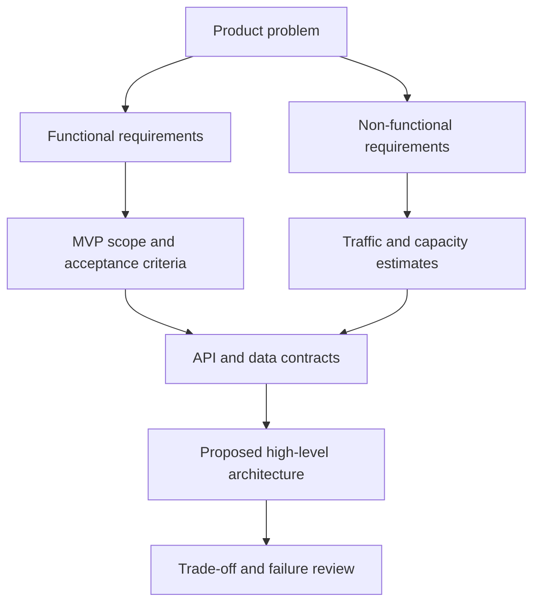

# Week 1 · Day 2 — Requirements Gathering for System Design

**Central lesson:** Design the right system before optimizing or scaling it.

## 1. The interview and engineering workflow
1. Understand users and business outcome.
2. Identify primary actions (functional requirements).
3. Ask what success means (measurable non-functional requirements).
4. Define constraints and explicit out-of-scope features.
5. Make capacity assumptions and validate them.
6. Prioritize an MVP.
7. Only then select APIs, data model and architecture.

A requirement is useful when a developer can implement it and a tester can tell whether it is satisfied.

## 2. Functional requirements (FR)
FRs describe **what** users and systems can do. For a URL shortener:
- User submits a valid long URL; service returns a unique short URL.
- Visiting a valid short URL redirects to its stored destination.
- Optional: custom alias, expiry, per-user links and analytics.
- Define negative flows: invalid scheme, duplicate alias, unknown code, expired link, disabled link.

For an e-commerce system, examples are browse products, add items to cart, place order, reserve stock and process payment. Do **not** assume every feature belongs in v1.

Write user stories: “As a customer, I want to create a short link so I can share a long address.” Pair with acceptance criteria:
- Valid `https://` input returns 201 and a code.
- An unused custom alias works, an occupied alias returns a conflict.
- A recognized active code redirects.
- Unknown/expired codes produce defined responses.

## 3. Non-functional requirements (NFR)
| Area | Interview question | Example measurable target |
|---|---|---|
| Traffic | Users, requests/day, peak multiplier? | 1M new links/day, 100M redirects/day |
| Latency | Which operation and percentile? | redirect p95 < 100 ms at service edge |
| Availability | What downtime is acceptable? | 99.9% measured monthly |
| Durability | Can committed links be lost? | restore strategy and backup schedule |
| Consistency | Can analytics lag? | links immediately readable after create; analytics may lag |
| Security | What abuse must be prevented? | validate schemes, rate-limit creation |
| Cost | What are budget and team constraints? | single region with managed PostgreSQL initially |
| Observability | How detect failures? | error-rate, latency and DB saturation metrics |

These are illustrative targets, not facts about a production service.

## 4. Scope and prioritization
Classify items as **Must**, **Should**, **Could**, **Won't (for now)**. A URL shortener MVP may require create+redirect+uniqueness and exclude global distribution or rich analytics. Over-designing out-of-scope features wastes interview time and engineering resources.

Trade-offs reveal constraints: strong consistency for code ownership, but eventual consistency for aggregate click counts; redirect availability versus fresh abuse-blocking information; personalized features versus anonymous simplicity.

## 5. Constraints, assumptions, and ambiguity
A constraint is a hard limit, such as “only PostgreSQL allowed.” An assumption is an uncertain hypothesis, such as “reads are 100× writes.” Keep them separate.

Useful clarifying questions:
1. Is this public or internal? Anonymous or authenticated?
2. What is peak traffic and read/write ratio?
3. Are custom aliases supported? Must codes never be reused?
4. Are there expirations or deletions? Should redirects be cacheable?
5. Is analytics a hard requirement? What freshness is expected?
6. Single region or global, and with what latency targets?
7. What abuse/security controls are required?

## 6. A worked requirements sheet
**Problem:** build a shareable URL shortener.

**Scope:** valid HTTP(S) URLs; autogenerated codes; redirect by code; expiry optional.

**APIs (draft):**
```http
POST /api/links
Content-Type: application/json
{"longUrl":"https://example.com/articles/123"}

HTTP/1.1 201 Created
{"code":"Ab92xK","shortUrl":"https://s.example/Ab92xK"}

GET /Ab92xK
HTTP/1.1 302 Found
Location: https://example.com/articles/123
```

**Data constraints:** code unique, destination nonempty, created timestamp, nullable expiry. HTTP 409 for custom-code conflict; HTTP 404 or 410 for missing/expired links based on product semantics. Validate destination schemes to avoid unsafe redirects to non-HTTP schemes.

**Proposed capacity assumptions:** 1M new links/day; 100M redirects/day; traffic can spike 5–10× average. Use those to estimate reads/writes on Day 3.

## 7. Translate requirements to architecture

E.g., **instant visibility after creating a link** constrains replicas/caching: read from the authoritative store or maintain suitable consistency guarantees. **Analytics can be delayed** enables asynchronous processing.

## 8. Java implementation considerations
```java
record CreateLinkRequest(
    @NotBlank @Size(max = 2048) String longUrl,
    Instant expiresAt
) {}
record CreateLinkResponse(String code, String shortUrl) {}
```
DTO bean validation is only a first layer: validate URI parsing, scheme, hostname policy, time range, and alias uniqueness in service/database; enforce rate limits separately. Never rely solely on controller validation for business invariants.

## 9. Requirements mistakes and fixes
- “Millions of users”: specify request rates and access distribution.
- “Low latency”: specify operation, percentile, load and measurement point.
- “No downtime”: ask for a realistic SLA and failure-domain design.
- “Strong consistency for everything”: decide which flows need it.
- “Implement analytics, accounts, expiry, custom aliases now”: ask which are mandatory.
- “Assume database size without data retention”: define lifetime and growth.

## 10. Interview questions with answers
**How do you gather requirements?** Start with personas, user journeys and acceptance criteria, then scale/security/availability and constraints.

**What is the difference between FR and NFR?** FR describes a supported behavior; NFR constrains its quality.

**How do you handle missing details?** Ask high-impact questions, state a reasonable assumption, document how results change if it is wrong.

**Why prioritize?** It prevents complexity unrelated to MVP success.

**How does consistency change design?** A create-then-read requirement may forbid serving that read from a lagging replica.

## 11. Assignment
Write requirements for a helpdesk ticket system (create, view, assign, close) with six acceptance criteria, six measurable NFRs, two constraints and three out-of-scope items. Compare with URL shortener requirements.

**Knowledge check:** (1) FR vs NFR? (2) Why p95? (3) What is out of scope? (4) Two ambiguity questions? (5) One choice changed by consistency?

**Completion:** [ ] FRs [ ] NFRs [ ] Scope [ ] Acceptance tests [ ] Mock-interview explanation.
