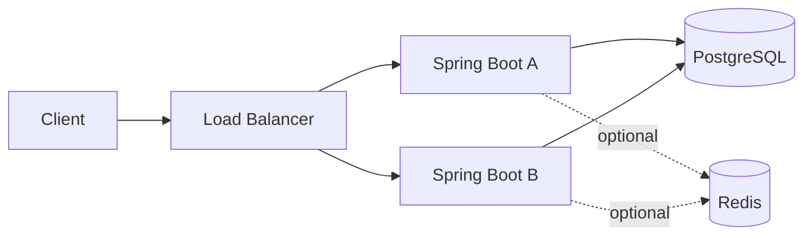
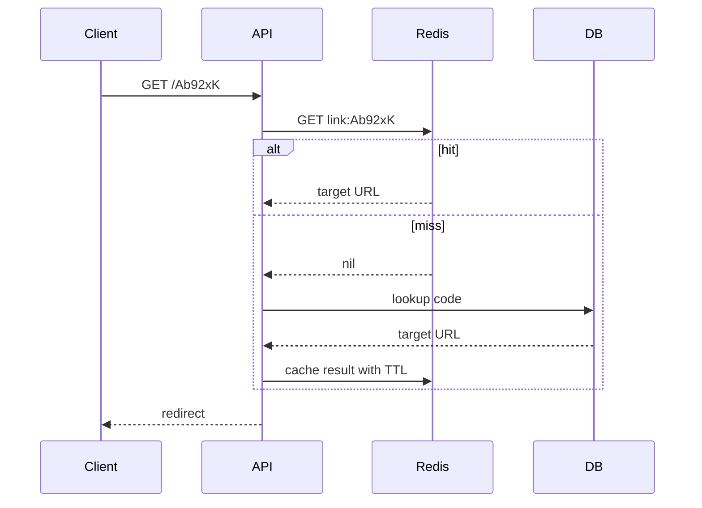

# Week 1 — Day 3: Scalability and Performance Fundamentals

## Learning objectives
Explain scaling up vs scaling out, latency vs throughput, concurrency, percentile measurements, back-of-envelope estimates, bottlenecks, and caching. Design and test a small horizontally scalable backend.

## 1. Scalability from first principles
A system is scalable when it can serve increased workload while meeting measurable performance and reliability objectives. Being scalable does not mean every request is instantly fast.

**Vertical scaling** adds CPU/RAM/IO capacity to one machine: simplest change, but capacity and fault-tolerance limits remain. **Horizontal scaling** adds machines or processes: more flexibility but requires load balancing and shared-state coordination.

| Dimension | Vertical | Horizontal |
|---|---|---|
| Change | Bigger machine | More instances |
| Complexity | Lower initially | State, networking, monitoring |
| Limits | Hardware maximum | Shared dependencies |
| Availability | One node can still fail | Replicas can provide redundancy |

## 2. Metrics that matter
- **Latency:** request duration, e.g. 80ms.
- **Throughput:** completed requests/second (RPS).
- **Concurrency:** in-flight work at one time.
- **p50/p95/p99:** latency thresholds within which 50/95/99% of measured requests fall. Averages hide slow tails.
- **CPU utilization and saturation:** high demand may cause growing queues and tail latency.
- **Little's Law:** Average in-flight requests L = completion rate λ × average response time W for a stable system. At 200 RPS and 0.15 seconds, average concurrency is roughly 30.

## 3. Capacity estimation walkthrough
Hypothetical short-link product: 1 million new links/day and 100 million redirects/day.

- Average creates = 1,000,000/86,400 ≈ **11.6 writes/sec**.
- Average redirects = 100,000,000/86,400 ≈ **1,157 reads/sec**.
- A 6× peak means ≈ **6,944 peak redirect RPS**, before extra headroom.
- Read-to-write ratio = **100:1**.
- At an estimated 300 bytes per link including metadata/index allowance, raw daily storage ≈ 300 MB, yearly ≈ 109.5 GB before replicas/backups. That byte estimate is an assumption to validate, not measured data.
- If response payload averages 500 bytes, 100M/day means about 50 GB/day payload excluding headers, retries and network overhead.

Never guess server count solely from daily active users: measure sustainable throughput per instance and include DB/service bottlenecks.

## 4. Stateless API servers
A stateless Spring Boot service should not depend on the next request landing on the same instance. Store durable state in PostgreSQL; use shared session storage or validated tokens when applicable.



Two application replicas do not remove the database as a single bottleneck or guarantee high availability.

## 5. Database performance
- Add selective indexes for frequent WHERE clauses.
- Examine plans with `EXPLAIN ANALYZE`, not assumptions.
- Keep transactions short; avoid N+1 ORM queries.
- Connection pools must be sized across **all** app replicas: 10 instances × 30 connections = 300 possible database connections.
- A replica can distribute reads, but replication lag may violate read-after-write expectations.

```sql
CREATE UNIQUE INDEX idx_links_code ON links (code);
EXPLAIN ANALYZE SELECT destination_url FROM links WHERE code='Ab92xK';
```

## 6. Cache-aside
Read from Redis using code key; on a miss fetch from indexed PostgreSQL; fill Redis with bounded TTL. Invalidate or expire data when URLs are deleted or expire. Redis outage should not silently destroy authoritative state.



**Pitfalls:** stale results, stampede when hot key expires, hot key concentration, wrong TTL, caching missing entries indefinitely.

## 7. Java/Spring Boot service layer
```java
@Service
class LinkResolver {
    private final LinkRepository repository;
    LinkResolver(LinkRepository repository) { this.repository = repository; }

    @Transactional(readOnly = true)
    public URI resolve(String code) {
        Link link = repository.findByCode(code)
            .orElseThrow(LinkNotFoundException::new);
        if (link.getExpiresAt() != null &&
            !link.getExpiresAt().isAfter(Instant.now())) {
            throw new LinkExpiredException();
        }
        return URI.create(link.getDestinationUrl());
    }
}
```
Assumes `LinkRepository.findByCode` and the domain exceptions exist. Read-only transaction hints are not performance benchmarks.

## 8. Testing a scaling hypothesis
1. Define test workload, hardware, sample dataset, request mix and duration.
2. Warm JVM/JIT/caches consistently.
3. Use k6 or JMeter to record RPS, p50/p95/p99, errors.
4. Correlate with CPU, GC, PostgreSQL slow queries and connection pools.
5. Change **one variable** (index, cache or replicas) per run.
6. Compare results only at similar traffic patterns.

## Interview answers
**Why does p99 matter?** It reveals poor experience at the tail of the distribution.

**Can app replicas fix a slow DB?** Not by themselves; they may increase query pressure.

**When should you use Redis?** When measured repeated reads make caching beneficial and the data's freshness policy is understood.

**Scale up vs scale out?** Bigger individual machines vs more instances; both face different limits.

**What is an overload symptom?** Rising queue time, p99, errors and saturation as demand approaches capacity.

## Assignment
For 2M active users at 20 requests/user/day and peak 8× average, calculate average/peak RPS, estimate concurrency at 200ms average latency, draw an architecture with two replicas, and identify a DB bottleneck.

## Review checklist
- [ ] Define latency, throughput, concurrency and percentiles
- [ ] Explain vertical and horizontal scaling
- [ ] Calculate RPS with assumptions
- [ ] Explain how cache invalidation works
- [ ] Describe a repeatable performance test
