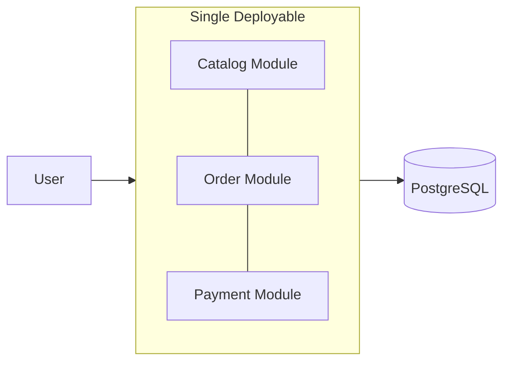
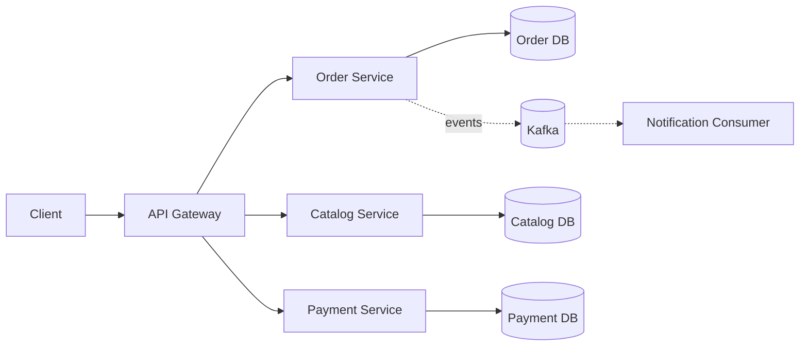
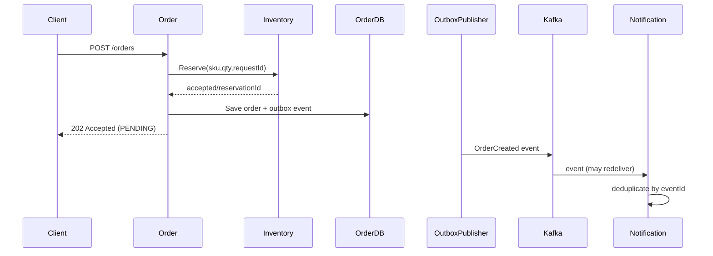

# Week 1 — Day 4: Monolith vs Microservices

## Learning outcomes
Compare monolith, modular monolith and microservices; select service boundaries; explain database ownership; identify distributed-monolith anti-patterns; understand REST/event communication, partial failures, and transactions.

## 1. Definitions
- **Monolith:** one deployable application containing the business capabilities. A monolith can still have excellent internal modularity.
- **Modular monolith:** single deployment with explicit modules, interfaces and boundaries; a practical default for many teams.
- **Microservices:** independently deployable capabilities, each owning its behavior and data contracts, communicating through networked APIs or events.

The word *micro* refers to a focused business responsibility, not necessarily a tiny codebase or a service per table.

## 2. Architecture diagrams




## 3. Trade-off comparison
| Feature | Modular monolith | Microservices |
|---|---|---|
| Deployment | One release unit | Independent releases possible |
| Calls | Primarily in-process | Network timeouts and partial failures |
| Data consistency | Easier single-DB ACID transactions | Sagas/events for cross-service workflows |
| Debugging | Simpler local stack | Distributed logs, metrics, traces |
| Scaling | Scale whole application | Scale particular capabilities |
| Team autonomy | Shared deployment coordination | High when boundaries and ownership are mature |
| Operations | Usually cheaper/simpler | Infrastructure and security overhead |

**Rule:** Do not split a system simply because it might have many users. A stateless monolith can run behind a load balancer and scale significantly.

## 4. Service boundaries
Model business **capabilities**: Order, Inventory, Payment, Catalog, Notification. Domain-driven design uses **bounded contexts**: a coherent meaning and set of rules within a boundary. Group related invariants together, not one network service for every database entity.

One service owns writes to its domain data. “Database per service” usually means **logical ownership**; separate physical database servers are not necessarily required on day one, but multiple services must not freely update one another's tables.

## 5. The distributed monolith
Signs:
- All services have to deploy together.
- Services share mutable tables.
- A user request performs long synchronous chains.
- Contract changes break many consumers.
- Distributed calls exist without independent ownership.

A dangerous path: Order → Inventory → Pricing → Payment, each waiting on the next. Even if individual services are “highly available”, compounded network failures can hurt whole-request reliability.

## 6. Communication patterns
**REST/gRPC:** immediate response when required, but caller bears remote latency. Define timeouts, authentication, error mapping, and idempotency.

**Kafka/event-driven:** publisher records an event for later consumption; supports fan-out and buffering but delivery may duplicate and processing is eventually consistent.


A transactional outbox writes business state and an outgoing-event record in one DB transaction; a separate dispatcher/CDC publishes to Kafka. It prevents lost *intent* to publish but still needs duplicate-safe consumers.

## 7. Cross-service correctness
Inside one relational transaction, database updates can commit atomically. Across two service-owned databases, partial failure is normal.

Consider: money was charged, but inventory reservation fails. Choose explicit order states and compensate (refund/reverse charge) or pursue a defined recovery path. Never assume distributed execution is atomic.

## 8. Java design and deferred decomposition
```java
public interface InventoryPort {
    Reservation reserve(String sku, int quantity, String requestId);
}
public record Reservation(boolean accepted, String reservationId) {}

@Service
class OrderService {
    private final InventoryPort inventory;
    OrderService(InventoryPort inventory) { this.inventory = inventory; }

    public Reservation requestReservation(String sku, int qty, String key) {
        return inventory.reserve(sku, qty, key);
    }
}
```
The port can be implemented by a local module now, then a properly configured HTTP adapter later. This avoids tying domain logic to deployment topology.

## 9. How to choose for a real project
Prefer modular monolith when the team is small, domain is evolving, releases are coordinated, and infrastructure budget is limited. Consider microservices when ownership boundaries are stable, scaling/release independence has a demonstrated payoff, and the organization can run secure networking, CI/CD, observability and on-call.

## 10. Interview Q&A
**Why microservices?** Independent deployment, capability ownership, targeted scaling; at a distributed-systems cost.

**Can monoliths scale horizontally?** Yes if instances are sufficiently stateless and shared dependencies scale.

**What is a bounded context?** A domain ownership boundary where concepts and invariants have coherent meaning.

**What is the distributed monolith problem?** Distributed operational cost with tight coupling and lockstep releases.

**How do microservices share data?** Through documented APIs/events/read models, not arbitrary cross-service table writes.

**When use Kafka instead of REST?** When asynchronous processing, buffering, fan-out or independent timing is valuable.

## Assignment
Design an order system first as a modular monolith, then as four services. Identify deployment, data ownership, coupling, partial failures, logging, security and consistency trade-offs. Recommend one for a five-person team and explain why.

## Knowledge check
1. Monolith vs modular monolith?
2. Name two microservices disadvantages.
3. Why is service-per-table risky?
4. What makes network calls unreliable?
5. How would you recover after payment succeeds but inventory fails?

## Completion
- [ ] Draw both architectures
- [ ] Define bounded contexts
- [ ] Explain communication options
- [ ] Describe one saga compensation
- [ ] Answer interview questions aloud
