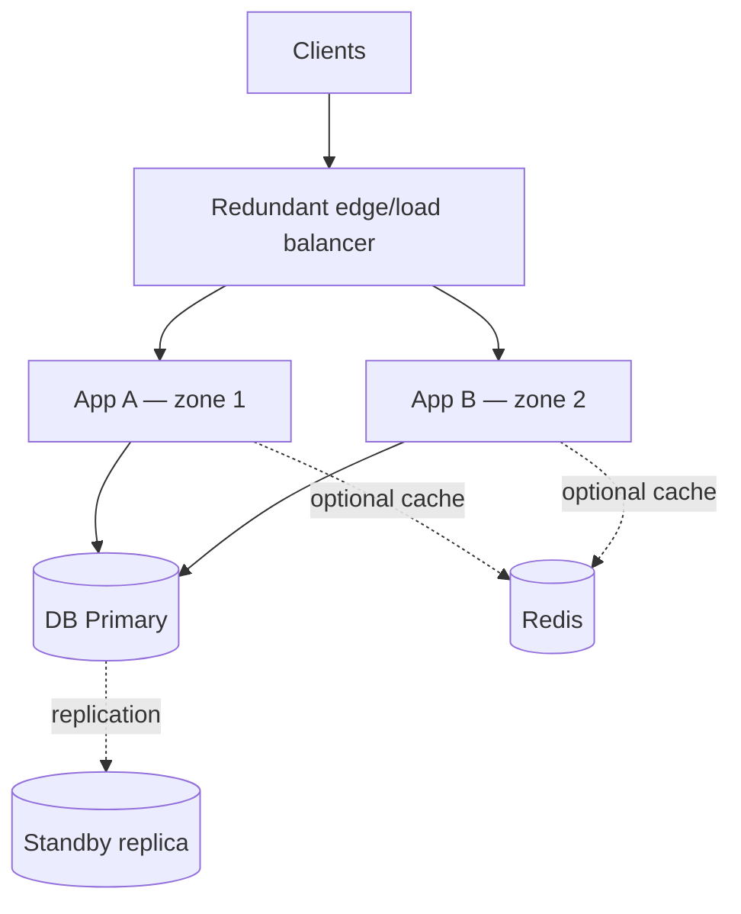

# Week 1 — Day 5: Availability and Reliability

**Goal:** Distinguish availability, reliability, durability and fault tolerance; reason about failure domains, replication, recovery, monitoring and graceful degradation.

## 1. Definitions
- **Availability:** how often the service is usable over a defined measurement period.
- **Reliability:** probability the service performs correctly over a period or set of operations.
- **Durability:** whether committed data remains available after crashes/disasters.
- **Fault tolerance:** ability to continue useful operation despite component failure.
- **Resilience:** ability to withstand, adapt to and recover from failure.
- **MTTR (mean time to restore/repair):** average time to recover; lower is generally better.
- **MTBF (mean time between failures):** a reliability statistic that depends on a clear failure definition.

An API returning HTTP 200 with incorrect order amounts may look available while failing correctness. A healthy database replica may still be stale.

## 2. Availability calculations
A simplified formula is `availability = uptime / (uptime + downtime)`. For a hypothetical 30-day month (43,200 minutes):

| Target | Approx allowed downtime per 30 days |
|---|---|
| 99% | 432 minutes = 7.2 hours |
| 99.9% | 43.2 minutes |
| 99.95% | 21.6 minutes |
| 99.99% | 4.32 minutes |

Annual 99.9% is about 8.76 hours/year. Real SLAs specify exclusions, covered components, and calculation windows.

**Availability dependencies:** a request that *requires* several independent serial dependencies will be unavailable when any required one is unavailable. As an illustrative approximation, three independent services each at 99.9% availability yield `0.999³ ≈ 99.7003%` for the combined path. Real-world failures are often correlated, so this is a simplification.

## 3. Single points of failure and redundancy
A single API instance, PostgreSQL primary, load balancer, DNS provider or network path can break service. Redundancy should cross actual failure domains: different instances on one host do not survive host failure; different zones reduce some localized risks.



This diagram proposes redundancy; a real HA PostgreSQL deployment requires fencing/leader election, failover routing and application reconnection. Redis availability depends on its topology.

## 4. Failover versus backup
**Replication** copies data to another node to increase read capacity or recover faster. It can replicate accidental deletes and corruption too. **Backups** preserve point-in-time history to recover from deletion, corruption or disasters. Practice restoration, because an untested backup is not a proven recovery plan.

**RPO (recovery point objective):** acceptable data loss, e.g. 5 minutes.
**RTO (recovery time objective):** acceptable outage duration, e.g. 30 minutes.
These are business objectives, not automatically guaranteed by architecture.

**Replica lag:** asynchronous replicas may serve stale results after recent writes. Use primary reads or documented read-after-write controls for workflows requiring fresh state.

## 5. Health checks and traffic routing
**Liveness:** is the process alive enough to avoid restart? Avoid making liveness dependent on every downstream system, which can cause restart storms.

**Readiness:** should the instance receive traffic? May depend on essential startup/dependency state; keep probes stable to avoid thrashing.

**Graceful shutdown:** stop taking new requests, complete bounded in-flight work and close connections; handle termination timeouts.

Spring Boot example:
```yaml
management:
  endpoints:
    web:
      exposure:
        include: health,info,prometheus
  endpoint:
    health:
      probes:
        enabled: true
```
Protect sensitive actuator endpoints in production. Prometheus endpoint availability depends on adding the appropriate Micrometer registry.

## 6. Handling partial failures
| Failure | Customer impact | Responsible response |
|---|---|---|
| One API instance crashes | Some requests interrupted | LB removes unhealthy node; safe client retry where applicable |
| DB primary fails | Writes blocked until recovery | Report temporary failure; perform controlled failover |
| Cache unavailable | Higher DB load/latency | Fall back to authoritative DB with rate controls |
| Kafka unavailable | Async side effects delayed | Durable outbox/backlog, alerting, recovery |
| Downstream service slow | Queue buildup, timeout | Set deadlines, circuit breaker, bounded retries |
| Zone outage | Capacity lost | Spread replicas across zones; test residual capacity |

## 7. Retry safety and idempotency
Blindly retrying a successful-but-timed-out payment can double-charge a customer. Use **idempotency keys**, a uniquely constrained request record, and a stable outcome for repeated requests.

```java
public record CreatePaymentRequest(String orderId, BigDecimal amount) {}

@PostMapping("/payments")
ResponseEntity<PaymentResponse> create(
        @RequestHeader("Idempotency-Key") String key,
        @RequestBody @Valid CreatePaymentRequest request) {
    return ResponseEntity.ok(paymentService.createOrFetch(key, request));
}
```
Implementation must persist key+request identity+status atomically and reject reuse with a different payload; the controller annotation alone does not provide idempotency.

Use bounded retries for transient errors, exponential backoff and jitter. Never retry irrecoverable validation errors; be cautious with non-idempotent writes.

## 8. Observability and SLOs
A useful operational view tracks:
1. **Traffic:** requests/sec and user journeys.
2. **Errors:** request failure fraction, including timeouts.
3. **Latency:** p50/p95/p99 distributions.
4. **Saturation:** CPU, memory, thread/connection pools, queue backlog, DB wait.
5. **Dependency health:** DB replication lag, cache miss rate, broker lag.

An SLO could be “99.9% of legitimate redirect requests succeed over 30 days”; define what counts as valid traffic and success. Alert on user impact, not every transient CPU spike.

## 9. Incident scenario
**Symptom:** p99 redirect latency grows and 5xx errors spike.

Investigate: request rate and error breakdown → API thread/connection pools → DB response time → replication/readiness → recent deployments. If Redis failed, DB reads may surge; fallback without rate controls can worsen the incident.

Mitigation may include circuit breakers, disabling nonessential work, reducing traffic via rate limiting, rolling back a problematic deployment, and restoring DB capacity. Document cause, timeline and prevention after the incident.

## 10. Interview revision with answers
**Availability vs reliability?** Availability is service usability over time; reliability is correct behavior.

**Why aren't replicas a backup?** Replication may propagate accidental deletion and corruption.

**What is the single point of failure in an API + one PostgreSQL instance?** The database remains one even with multiple API replicas.

**How do you avoid retry storms?** Bounded retries with jitter, timeouts, budgets and circuit breaking; coordinate retry layers.

**What does failover cost?** Detection time, interrupted requests, transient errors, potential lag, and operational complexity.

**How should a cache outage behave?** Usually degrade performance and fall back safely to DB without corrupting source-of-truth data.

## 11. Hands-on task
Build a failure-mode table for a Spring Boot order API: API crash, DB outage, payment timeout, cache outage, and message-broker outage. For each, explain detection, user response, data correctness, recovery, and one alert. Calculate downtime budgets for 99.9% and 99.99%.

## 12. Knowledge check
1. Can a highly available service return incorrect data?
2. Why is a backup different from a replica?
3. Define RTO and RPO.
4. Why can retries amplify failure?
5. What happens to a two-replica API when its sole database fails?

## Completion checklist
- [ ] Availability math
- [ ] Failure-domain diagram
- [ ] Recovery/backup distinction
- [ ] Retry/idempotency explanation
- [ ] Incident response practice
