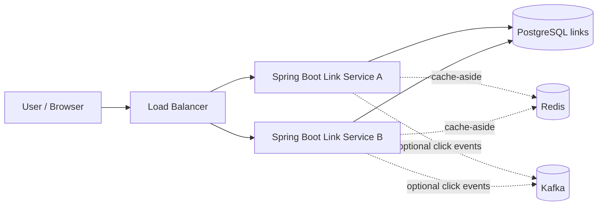
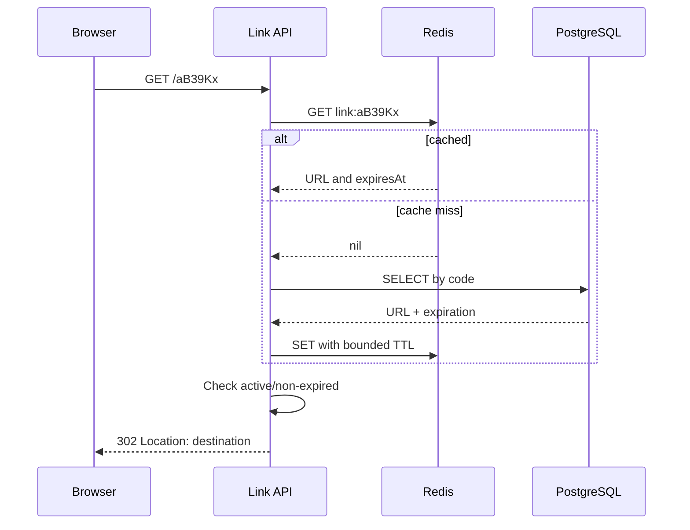

# Week 1 — Day 6: Design a URL Shortener (End-to-End HLD + LLD)

**Goal:** Apply Week 1 concepts in a genuine system-design interview, from requirements through APIs, schema, key generation, consistency, scaling and failure recovery.

## 1. Interview clarification
Ask first:
1. Do users create short links anonymously?
2. Are custom aliases and expiration supported?
3. How many links/day and redirects/day?
4. Must newly created links be immediately readable?
5. Are analytics and branded domains required?
6. What availability/latency targets and region constraints apply?

**MVP:** create a short link; redirect by code; handle unknown/expired codes. Leave rich analytics, accounts and multi-region writes out of scope unless requested.

## 2. Functional & non-functional requirements
**FR:** generate unique code for a valid HTTP(S) destination; retrieve/redirect; optionally allow expiry and custom aliases.

**NFR example:** redirects significantly outnumber creates, target p95 below an agreed threshold, committed mappings durable, high read availability, unique codes, safe URL validation and rate limits. Define measurable SLOs with the interviewer.

## 3. Back-of-envelope estimate
Assume (not actual observed traffic):
- 1M creates/day → 11.6 average writes/sec.
- 100M redirects/day → 1,157 average reads/sec.
- 6× peak → 6,944 peak read RPS.
- If estimated durable row+index footprint is 300 bytes, ≈ 300MB/day or 109.5GB/year for new links before backups/replicas.

Traffic estimates strongly suggest indexing reads first; caching or replicas may follow after load testing.

## 4. High-level architecture


**Initial deployment:** one Spring Boot service with PostgreSQL. Add more API instances and Redis when benchmarks/requirements support them. Kafka for analytics is optional, not essential to redirects.

## 5. API contract and HTTP semantics
```http
POST /api/links
Content-Type: application/json
{"longUrl":"https://example.org/articles/architecture","expiresAt":null}
```
```http
HTTP/1.1 201 Created
Content-Type: application/json
{"code":"aB39Kx","shortUrl":"https://s.example/aB39Kx"}
```
```http
GET /aB39Kx
HTTP/1.1 302 Found
Location: https://example.org/articles/architecture
```

Use `302` for a redirect that you may change/track; `301` can be heavily cached by clients/proxies, which may not match editable or expiring links. Choose based on semantics and measured behavior.

**Errors:** `400` malformed/unsupported URL; `409` custom alias conflict; `404` unknown code; `410` explicitly expired/deleted link if your public contract distinguishes it; `429` creation rate limit; `503` temporarily unavailable dependencies.

## 6. Data model
```sql
CREATE TABLE links (
    code VARCHAR(16) PRIMARY KEY,
    destination_url TEXT NOT NULL,
    created_at TIMESTAMPTZ NOT NULL DEFAULT NOW(),
    expires_at TIMESTAMPTZ NULL
);
CREATE INDEX idx_links_expires_at ON links(expires_at);
```
Primary key `code` already creates a unique index in PostgreSQL; do not add a redundant identical index. Expiry index is useful only if you implement batch cleanup and verify query plans. Consider `owner_id`, `disabled_at`, `created_by` only if product requirements call for them.

## 7. Generating short codes
**Option A: random Base62.** Character alphabet [a-zA-Z0-9], code length 7. Total theoretical namespace `62^7 ≈ 3.52 trillion` distinct codes. Collisions still occur under random generation; use cryptographically secure random generation if codes are intended to be hard to guess, and always enforce uniqueness in DB.

**Option B: encode unique numeric ID in Base62.** Collision-free for unique IDs, but predictable codes can reveal issuance order or simplify enumeration. ID allocation becomes part of design.

### Collision handling
Generate → INSERT with unique primary key → if a **code collision** occurs, generate and retry a bounded number of times. Make sure you distinguish a unique-code collision from other DB errors; do not infinitely retry during an outage.

## 8. Redirect request sequence


If cache is unavailable, use bounded fallback to DB while monitoring database load; when link is deleted/disabled, define cache invalidation guarantees. Never trust a cached mapping that violates a hard expiration boundary.

## 9. Java + Spring Boot implementation sketch
```java
public record CreateLinkRequest(
    @NotBlank String longUrl, Instant expiresAt
) {}
public record CreateLinkResponse(String code, URI shortUrl) {}

@RestController
class LinkController {
    private final LinkService service;
    LinkController(LinkService service) { this.service = service; }

    @PostMapping("/api/links")
    ResponseEntity<CreateLinkResponse> create(
            @Valid @RequestBody CreateLinkRequest request) {
        CreateLinkResponse result = service.create(request);
        return ResponseEntity.status(HttpStatus.CREATED).body(result);
    }

    @GetMapping("/{code}")
    ResponseEntity<Void> redirect(@PathVariable String code) {
        URI destination = service.resolve(code);
        return ResponseEntity.status(HttpStatus.FOUND)
            .location(destination).build();
    }
}
```

The service must actually:
- parse the URL and check `http`/`https` schemes, hostname and abuse policy;
- generate a code, persist it with DB uniqueness and bounded collision retries;
- reject missing/expired/disabled links;
- return a configured short-domain base URI;
- validate expiration before caching or redirect.

Imports, DTO validation dependencies, JPA entities and exception handlers are intentionally left for the coding assignment.

## 10. Security and misuse
A short-link generator can be abused for phishing, malicious redirects or link enumeration. Enforce scheme allowlist, input size limits, creation rate limits, reporting/disable workflow and suitable audit logs. Avoid logging sensitive destination query strings unnecessarily. If your backend **fetches** destinations (e.g. preview generation), validate against SSRF and internal IP ranges; pure redirect and server-side fetching are different risk models.

## 11. Analytics as optional async side effect
Do not block core redirect correctness on writing one database row for every click. Emit click events to a queue/broker, batch/aggregate, and accept eventual counts—**only** if analytics is in scope. If analytics pipeline fails, decide whether to preserve redirects and tolerate delayed counts.

## 12. Scaling path and failure analysis
| Problem | Solution to evaluate | Trade-off |
|---|---|---|
| High redirect QPS | More stateless API replicas | DB may bottleneck |
| Repeated popular codes | Cache-aside in Redis | Invalidation and stale data |
| DB read bottleneck | Indexes, query optimization, read replicas | Replica lag |
| Code collision | Unique PK + bounded retry | Slight additional write latency |
| Cache outage | Safe DB fallback | Risk of DB overload |
| DB outage | DB failover/restore strategy | Interrupted creates/misses |
| Deleted or expired link | Check authoritative state/TTL policy | Cache consistency |
| Hot traffic spike | Rate limiting and capacity headroom | Some requests rejected |

**Availability:** keeping cached redirects working during a database outage may be possible for known, non-revoked codes, but can violate deletion/expiry rules; document the business trade-off.

## 13. Interview discussion (sample model answers)
**Why PostgreSQL?** Unique constraints, transactional durability and indexed code lookups fit MVP data needs.

**Why not MongoDB?** It could work; SQL simplicity and transaction semantics are useful here. Choose based on operational context, not fashion.

**How do codes stay unique?** Database primary key plus collision-aware algorithm.

**Can redirects be strongly consistent?** Yes when querying authoritative data, but cache/replica reads may be stale; define expectations.

**When do you shard?** After evidence that a single database + indexes + replicas/partitioning cannot satisfy constraints; shard key design and rebalancing add complexity.

**Why 302 instead of 301?** Potential changes, expiry, and analytics behavior can make aggressive permanent caching undesirable.

## 14. Hands-on deliverables
1. Write HLD and both API contracts.
2. Implement `Link` entity, repository and two endpoints.
3. Add unique-code collision handling with a bounded retry count.
4. Test create→redirect; unknown/expired/malformed URL; collision; simultaneous creates.
5. Add rate limiting/validation concept and metrics.
6. Write down bottlenecks and how to verify each with data.

## 15. Knowledge check
1. What is the difference between a code-generation algorithm and a uniqueness guarantee?
2. How would `301` affect editable short links?
3. Why might Redis serve stale destinations?
4. What do you do when PostgreSQL fails but Redis is healthy?
5. Where does a short-link abuse prevention policy belong?

**Completed:** [ ] HLD [ ] API [ ] Schema [ ] Security [ ] Failure scenarios [ ] Interview explanation.
