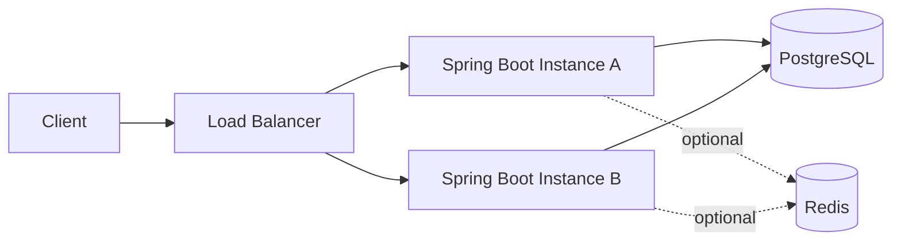

# Week 1 — Day 7: Revision and Mock System Design Interview

**Goal:** Consolidate Days 1–6 and practice explaining decisions clearly under interview pressure.

## 1. Week 1 revision map

| Day | Topic | What you should confidently explain |
|---|---|---|
| 1 | Introduction to System Design | System design, HLD/LLD, major components, requirements and trade-offs |
| 2 | Requirements Gathering | Functional/non-functional requirements, MVP, measurable SLOs and assumptions |
| 3 | Scalability and Performance | Horizontal/vertical scaling, RPS, latency percentiles, bottlenecks and caching |
| 4 | Monolith vs Microservices | Deployment boundaries, modular monolith, service ownership and distributed failure |
| 5 | Availability and Reliability | Availability budget, redundancy, failover, backups, RTO/RPO and retries |
| 6 | URL Shortener | Code uniqueness, API design, schema, scaling, expiry and redirects |

This is a revision lesson created to complete the seven-day study sequence.

## 2. Step-by-step interview framework

**0–5 minutes — Clarify requirements.** Who uses the system? What features are essential? Do users need custom aliases, expiry, analytics and deletion?

**5–10 minutes — State assumptions and estimate capacity.** Ask for or propose traffic, peak multiplier, read/write ratio, latency targets and data retention.

**10–18 minutes — Draw a minimum viable architecture.** Start with client → load balancer → Spring Boot API → PostgreSQL. Add Redis, replicas and Kafka only if requirements justify them.

**18–25 minutes — Define API contracts and schema.** Design request/response bodies, errors and uniqueness constraints. Clarify why specific data fields and indexes exist.

**25–32 minutes — Scaling and resilience.** Explain horizontal replicas, database pressure, connection pools, cache invalidation, health checks and failure modes.

**32–38 minutes — Deep dive.** Analyze collision handling, stale cache data, 301 vs 302, security/abuse, and failure recovery.

**38–40 minutes — Summarize.** State major trade-offs, missing measurements and the next scaling change you would evaluate.

## 3. Complete worked example: URL shortener

### Requirements
- Create a short URL from a valid HTTPS/HTTP destination.
- Redirect visitors of an active short code.
- Optionally support expiry and user-defined alias.
- Preserve stored mappings durably, enforce unique codes and protect against abuse.
- Define redirect latency and availability requirements rather than claiming arbitrary guarantees.

### Capacity exercise

Assumptions: 1M link creations/day, 100M redirects/day, 6× peak redirect traffic, average estimated storage 300 bytes/link.

```text
Average creates/s   = 1,000,000 / 86,400 = 11.57
Average redirects/s = 100,000,000 / 86,400 = 1,157.41
Peak redirects/s    = 1,157.41 × 6 ≈ 6,944
New stored bytes/day = 1,000,000 × 300 ≈ 300MB (decimal)
New bytes/year       ≈ 109.5GB before replication/backups
```

These are planning approximations. Actual load, record size and capacity must be measured.

### High-level architecture



**Design reasoning:** One indexed relational datastore establishes code uniqueness and durable mapping storage. Stateless API replicas handle more traffic; an optional cache reduces repeated lookup load, with data freshness trade-offs.

### API design

```http
POST /api/links
Content-Type: application/json

{"longUrl":"https://example.com/article/123"}

HTTP/1.1 201 Created
Content-Type: application/json

{"code":"T9aZx1","shortUrl":"https://s.example/T9aZx1"}
```

```http
GET /T9aZx1

HTTP/1.1 302 Found
Location: https://example.com/article/123
```

### Storage

```sql
CREATE TABLE links (
    code VARCHAR(16) PRIMARY KEY,
    destination_url TEXT NOT NULL,
    created_at TIMESTAMPTZ NOT NULL DEFAULT NOW(),
    expires_at TIMESTAMPTZ
);
```

PostgreSQL's primary-key constraint already ensures unique codes and creates an index. Generation algorithms can still collide: handle unique-constraint collisions using bounded retries.

## 4. Failure scenarios and interview answers

| Scenario | Expected behavior | Trade-off |
|---|---|---|
| Unknown code | Return defined 404 response | Avoid leaking sensitive existence information |
| Expired code | Return 404 or 410 according to API policy | Cache must honor expiry |
| Random code collision | Unique constraint rejects duplicate; bounded retry | Slight write latency |
| Redis unavailable | Fall back to PostgreSQL where safe | More database load |
| PostgreSQL unavailable | Report a controlled error or fail over | Temporary impact possible |
| Sudden traffic spike | Scale replicas, apply rate limits and monitor saturation | Limited downstream capacity |
| Malicious links | Validate schemes, rate-limit and provide abuse handling | Extra complexity |

## 5. Important conceptual distinctions

**HLD vs LLD:** HLD addresses components and deployment/data flows; LLD covers code-level implementation, classes, methods and algorithms.

**Latency vs throughput:** Latency is the duration of one request; throughput is how many operations complete per second.

**Scalability vs availability:** Handling additional load is not the same as continuing service after hardware failure.

**Availability vs reliability:** A system may respond frequently but return incorrect outcomes.

**Monolith vs microservices:** Microservices provide more deployment independence when domain boundaries justify distributed complexity; a modular monolith is often the simpler initial design.

**Replication vs backup:** Replicas enable alternate serving/recovery; backups provide retained recovery points against deletion/corruption.

## 6. Interview question bank

1. Why do we study system design rather than only coding?
2. How do you gather and prioritize requirements?
3. When would you choose a modular monolith over microservices?
4. Why do p95 and p99 latency matter?
5. How do you estimate average and peak requests per second?
6. What makes a service horizontally scalable?
7. Why might adding API replicas not improve performance?
8. How does a database index change URL-lookup performance?
9. Why is a database uniqueness constraint needed even with random codes?
10. When is Redis useful and what problems does it introduce?
11. How do short links behave after expiry/deletion?
12. What changes when traffic increases 100×?
13. What is a single point of failure?
14. Why aren't read replicas equivalent to backups?
15. How do you explain trade-offs in a 40-minute interview?

## 7. Hands-on mock assessment

1. Draw the URL shortener in Mermaid without consulting notes.
2. Explain every component and whether it is mandatory for version 1.
3. Calculate RPS from the sample workload and justify your peak multiplier.
4. Design Java controller/service/repository boundaries for create and redirect.
5. Write tests for create, resolve, unknown, expiry and code collision.
6. Explain one potential outage and its mitigation.
7. Record a 5–10 minute spoken architecture walkthrough.
8. List three improvements based on feedback.

### Scoring rubric (20 points)
| Criterion | Maximum |
|---|---:|
| Requirements and scope | 4 |
| Architecture and data/API correctness | 5 |
| Capacity estimation and scalability | 4 |
| Reliability, security and failures | 4 |
| Communication and trade-offs | 3 |

**Readiness:** 16–20 = strong foundation; 12–15 = revise weak areas; below 12 = repeat fundamentals and practice.

## 8. Completion checklist
- [ ] All six previous days revised
- [ ] Workload calculations completed
- [ ] URL shortener architecture redrawn
- [ ] API and schema explained
- [ ] Five failure scenarios answered
- [ ] Mock interview completed
- [ ] Improvement notes recorded

**Next:** Week 2 — Networking and Web Architecture.
