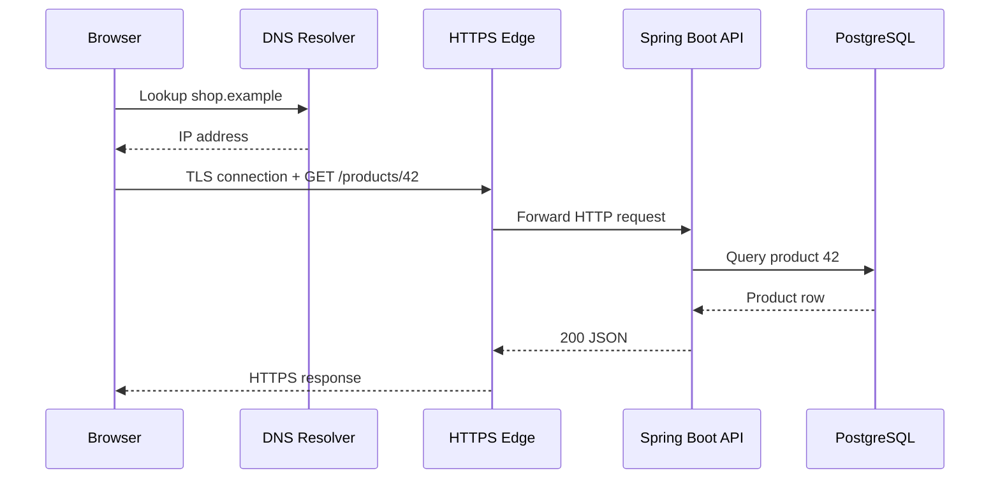

# Week 2 · Day 1 — Internet and Client–Server Architecture

> **Detailed engineering study notes** · Java / Spring Boot / interviews

## Learning goal
Understand what actually happens between a browser, an API, a service, and the network before choosing frameworks or infrastructure.

## Detailed concepts
### 1. What is the internet?

The **internet** is a network of independent networks that exchange packets using Internet Protocol (IP). A **web application** uses protocols such as HTTP over this infrastructure. The internet is not the same as the World Wide Web: web pages are an application of the internet. Each host communicates using network addresses and endpoints. Routers forward IP packets between networks; a client talks to a server by targeting an IP address plus a port, typically after resolving a hostname.

### 2. Client–server architecture and roles

A **client** starts a request (browser, mobile app, CLI or backend service). A **server** listens for connections and provides a service. A common three-tier architecture has (1) presentation/UI, (2) application/business layer, and (3) database/storage. A reverse proxy may sit in front of application servers. Not every tier needs a separate machine. Keep business rules on the server, authenticate and authorize each sensitive request, and treat client-side validation as usability rather than enforcement.

### 3. IP addresses, ports and sockets

IPv4 addresses such as 192.0.2.10 and IPv6 addresses identify network endpoints (examples use documentation ranges). Ports identify processes/services within a host. Typical HTTPS uses TCP port 443, HTTP port 80, PostgreSQL port 5432. A **socket** refers to a communication endpoint; a TCP connection is commonly identified by source/destination IPs and ports together. Private IPs may be translated via NAT before reaching public services. A domain name is a human-friendly identifier, not a replacement for IP routing.

### 4. What happens when a URL is opened?

For `https://shop.example/products/42`, the browser parses URL scheme/host/path, resolves hostname to an address (potentially from cache), establishes a transport connection (TCP for HTTP/1.1 or HTTP/2, typically QUIC/UDP for HTTP/3), negotiates TLS for HTTPS, sends an HTTP request, and receives a status, headers and body. Caches and intermediaries can change the precise path. The browser parses HTML/CSS/JavaScript and may issue additional requests. Don't equate a DNS lookup with an HTTP request.

### 5. Layers and responsibilities

At a simplified level: application protocols (HTTP) describe messages; transport protocols (TCP/UDP/QUIC) move data between endpoints; IP routes packets; link/network interfaces transmit frames. OSI is a conceptual 7-layer model useful for diagnosis, while TCP/IP is closer to practical internet layering. Example: if DNS fails, the application may never discover an address; if TCP cannot connect, the server may be unreachable; if HTTP returns 401, connectivity worked but authentication failed.

### 6. Connection and request state

HTTP is a request/response protocol; TCP connections can be reused for multiple HTTP requests. HTTP/2 multiplexes streams over a connection. **Stateless HTTP** means the server need not inherently remember prior requests; an application can maintain logical sessions via cookies or tokens. Connection state and application session state are different concepts. Timeouts must be configured for connection setup, reading responses and overall request deadlines.

### 7. Walkthrough: Spring Boot order lookup

Request: `GET /api/orders/42`. A proxy forwards it to a Spring Boot controller, the service checks caller access, JPA fetches from PostgreSQL, and the server returns JSON plus a suitable HTTP status. If the order is absent, 404; if caller lacks authorization, policy may return 403 or conceal its existence; database unavailability can return 503. Avoid exposing stack traces. Instrument where time is spent: DNS, connect, TLS, proxy, app, DB.

### 8. When this matters in interviews

Always narrate **request flow** before jumping to microservices. Explain where TLS terminates, where identity is checked, who owns data, and where latency is introduced. Differentiate **network round-trip time** from application processing time. Be prepared to diagnose “it works on localhost but not from another host”: local interface binding, firewall, DNS, NAT, container networking or incorrect port mapping.

## Architecture / protocol flow


**Interpretation:** Walk through each arrow, identify the network boundary, and explain what can fail. The diagram illustrates a typical flow rather than a universal deployment configuration.

## Java / Spring Boot example
```java
// Example: thin HTTP layer and a domain service
@RestController
@RequestMapping("/api/products")
class ProductController {
    private final ProductService service;
    ProductController(ProductService service) { this.service = service; }

    @GetMapping("/{id}")
    ProductDto get(@PathVariable long id) {
        return service.findById(id); // service maps missing product to 404
    }
}
```

**Implementation notes:** Examples are teaching excerpts; add imports, dependencies, configuration, security, exception mapping, and tests in an actual project. Never claim unexecuted code was tested.

## Hands-on assignment
Draw the path for opening a product detail page. Label hostname resolution, TLS, port, proxy, controller, service and database. Run `nslookup example.com`, `curl -v https://example.com`, and your own Spring Boot endpoint; note the distinct phases without pasting private credentials into logs.

### Acceptance criteria
- [ ] Explain how the design meets functional requirements
- [ ] Include at least two failure scenarios and expected status/errors
- [ ] Draw or adapt the architecture diagram without notes
- [ ] Write or describe repeatable tests
- [ ] Document one meaningful architectural trade-off

## Interview revision — answer aloud
1. Is the internet the same as the web?
2. What does a port identify?
3. What is the role of DNS?
4. What happens before an HTTPS request reaches Spring Boot?
5. How is a TCP connection different from an application session?

## Five-question self-check
1. Explain today's core problem in your own words.
2. What trade-off does the main design choice introduce?
3. Where can a network or dependency failure occur?
4. What could change at 10× load?
5. How would you verify correct behavior with a test or metric?

**Progress:** [ ] Read [ ] Diagram [ ] Practical exercise [ ] Interview answers [ ] Review
