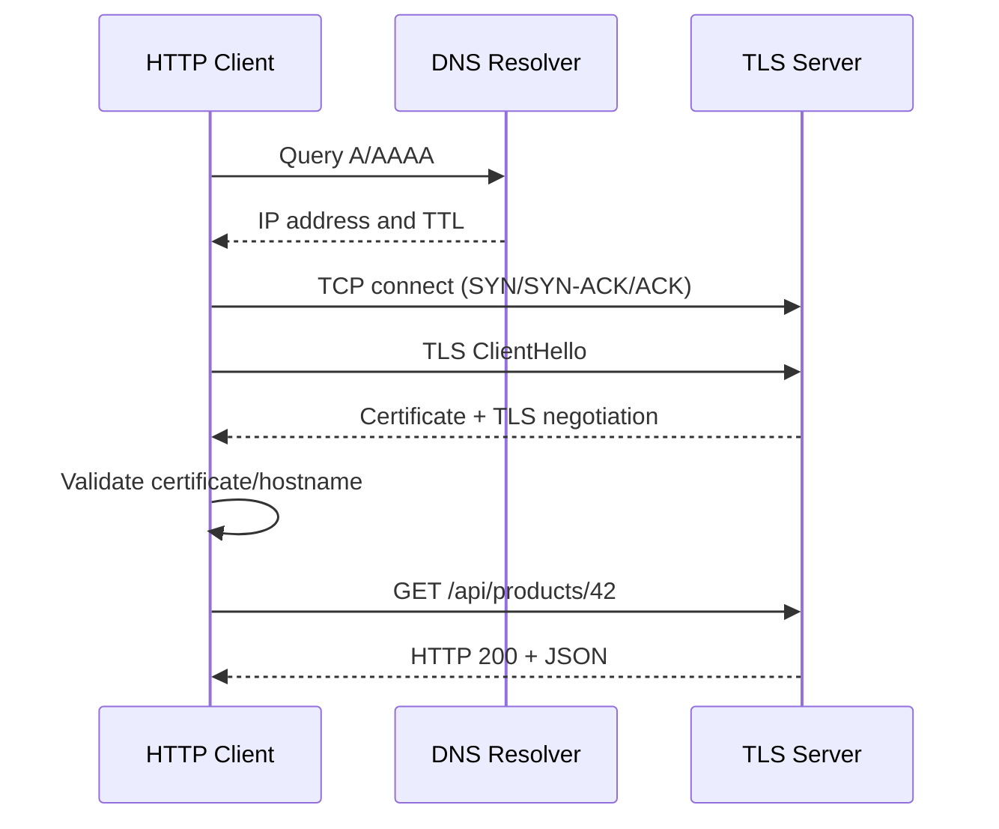

# Week 2 · Day 2 — DNS, TCP, UDP, HTTP, HTTPS and TLS

> **Detailed engineering study notes** · Java / Spring Boot / interviews

## Learning goal
Trace a complete HTTP transaction and choose protocols using correctness, latency and operational constraints.

## Detailed concepts
### 1. DNS resolution

DNS maps domain names to records such as **A** (IPv4), **AAAA** (IPv6), **CNAME** (alias), **MX** (mail) and **TXT**. Resolution may involve client/OS cache, recursive resolver, root/TLD and authoritative nameservers. TTL affects caching; changing a DNS record does not instantly update every cached resolver. DNS helps find service addresses, but isn't generally a health-aware load balancer by itself.

### 2. TCP fundamentals

TCP offers an ordered, reliable byte stream with retransmissions, flow control and congestion control. Connection establishment traditionally uses SYN → SYN-ACK → ACK. A connection can fail during setup, become slow because of loss or congestion, or terminate unexpectedly. TCP's “reliable” means data stream delivery semantics, **not** exactly-once execution of a server's business transaction. TCP operates on bytes, not application message boundaries.

### 3. UDP and QUIC

UDP is connectionless and preserves datagram boundaries but does not itself guarantee delivery, ordering or retransmission. DNS commonly uses UDP (and TCP when needed). QUIC runs over UDP and implements encrypted connection/stream management and reliability for HTTP/3. Choose protocols based on application needs—do not claim UDP is always faster or suitable for financial updates without higher-layer correctness mechanisms.

### 4. HTTP request and response

HTTP has **methods**, a target URI, headers, and sometimes a body. The response carries status, headers, and body. Common methods: GET read, POST create/action, PUT full replacement (idempotent by contract), PATCH partial modification (not automatically idempotent), DELETE resource removal (idempotent by intended semantics). Status families: 2xx success; 3xx redirect; 4xx client-related; 5xx server-related failures.

### 5. HTTP/1.1, HTTP/2 and HTTP/3

HTTP/1.1 supports persistent connections but can suffer head-of-line blocking in request handling; HTTP/2 multiplexes streams over a TCP connection and compresses headers; HTTP/3 runs over QUIC and avoids TCP-level head-of-line blocking between QUIC streams. Real performance depends on network, configuration and intermediaries. A Spring Boot app behind a proxy may speak different HTTP versions to client and upstream.

### 6. TLS and HTTPS

HTTPS is HTTP protected by TLS. During TLS setup, client and server negotiate cryptographic parameters, the server presents a certificate, and the client validates hostname and trust chain. TLS protects data in transit against passive observation and tampering under its trust model. Terminating TLS at a load balancer means the segment from proxy to app needs a separately considered security policy; do not assume it is encrypted automatically.

### 7. Cookies, caching and connection reuse

HTTP headers control caching (`Cache-Control`, `ETag`, `If-None-Match`) and cookies (`Set-Cookie`, `Cookie`). `304 Not Modified` lets clients reuse stored representations. Connection pooling reduces repeated connection setup but requires resource limits, idle eviction and timeouts. Cache control is separate from authentication and authorization.

### 8. Network failures, timeouts and retries

A timeout is an engineering decision, not proof the remote service did nothing. A POST can succeed server-side even when the client times out waiting for the response. Retry only when safe, with bounded attempts, backoff/jitter and idempotency keys for sensitive state changes. Diagnose separately DNS failure, TLS certificate failure, connection refused/reset, gateway timeout and HTTP 500.

## Architecture / protocol flow


**Interpretation:** Walk through each arrow, identify the network boundary, and explain what can fail. The diagram illustrates a typical flow rather than a universal deployment configuration.

## Java / Spring Boot example
```java
// Explicit Java HTTP timeouts (Java 21)
HttpClient client = HttpClient.newBuilder()
    .connectTimeout(Duration.ofSeconds(2))
    .build();
HttpRequest request = HttpRequest.newBuilder()
    .uri(URI.create("https://example.com/api/products/42"))
    .timeout(Duration.ofSeconds(5))
    .GET()
    .build();
HttpResponse<String> response =
    client.send(request, HttpResponse.BodyHandlers.ofString());
System.out.println(response.statusCode());
```

**Implementation notes:** Examples are teaching excerpts; add imports, dependencies, configuration, security, exception mapping, and tests in an actual project. Never claim unexecuted code was tested.

## Hands-on assignment
Use `curl -I`, `curl -v`, `nslookup` (or `dig`) against a public test domain and a locally running API. Record DNS record type, HTTP method/status/headers and the role of TLS. Explain how a client would behave on timeout versus 429 versus 503.

### Acceptance criteria
- [ ] Explain how the design meets functional requirements
- [ ] Include at least two failure scenarios and expected status/errors
- [ ] Draw or adapt the architecture diagram without notes
- [ ] Write or describe repeatable tests
- [ ] Document one meaningful architectural trade-off

## Interview revision — answer aloud
1. TCP versus UDP: what is actually guaranteed?
2. Why doesn't TCP reliability guarantee no duplicate payment?
3. What is DNS TTL?
4. How does HTTPS protect requests?
5. Explain 401, 403, 404, 429 and 503.

## Five-question self-check
1. Explain today's core problem in your own words.
2. What trade-off does the main design choice introduce?
3. Where can a network or dependency failure occur?
4. What could change at 10× load?
5. How would you verify correct behavior with a test or metric?

**Progress:** [ ] Read [ ] Diagram [ ] Practical exercise [ ] Interview answers [ ] Review
