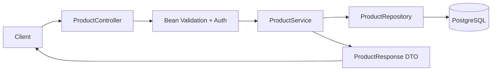

# Week 2 · Day 3 — REST API Design, HTTP Methods, Status Codes and Pagination

> **Detailed engineering study notes** · Java / Spring Boot / interviews

## Learning goal
Turn backend resources and business rules into predictable HTTP contracts with safe errors, versioning and testing.

## Detailed concepts
### 1. REST resources and uniform interfaces

A REST-style API exposes **resources** through URIs and HTTP semantics: `/api/products`, `/api/products/{id}`, `/api/orders/{id}`. Use nouns for resources; an explicit action endpoint may be appropriate for operations that are not naturally CRUD. Separate your external DTO/API contract from JPA entities. A well-designed API must also handle negative paths, ownership and concurrency.

### 2. Methods, safety and idempotency

`GET` is safe and idempotent (should not mutate business state), `PUT` is idempotent if replacing resource state, `DELETE` is intended to be idempotent even if response status changes, while `POST` isn't generally idempotent without a business design. `PATCH` can be idempotent depending on its patch semantics. HTTP idempotency is about intended effect, not necessarily identical responses.

### 3. Status codes that convey meaning

Use `200 OK` for normal GET; `201 Created` with `Location` for resource creation; `202 Accepted` when asynchronous work has been accepted but not completed; `204 No Content` for a successful no-body operation; `400` malformed input; `401` unauthenticated; `403` forbidden; `404` missing; `409` conflict; `422` semantically invalid request where appropriate; `429` rate-limited; `500` unexpected server error; `503` temporary unavailability.

### 4. Validation, DTOs and error responses

Validate data at multiple layers: syntactic fields in controller DTOs, domain invariants in services, uniqueness/foreign-key constraints in the database. Never return stack traces to users. A machine-readable error includes a stable code, clear message, request/correlation ID and validation-field details. RFC 9457 Problem Details is one supported error representation; choose a consistent format rather than mixing ad hoc error shapes.

### 5. Pagination, filtering and sorting

Large `GET /products` results require bounded responses. **Offset pagination** (`page=2&size=20`) is simple but slow/unstable on very large changing datasets. **Cursor/keyset pagination** uses ordered keys and a cursor for more stable large feeds; requires deterministic ordering. Validate maximum page size and allowed sort/filter fields; index popular filter paths.

### 6. Versioning and compatibility

Avoid frequent breaking contract changes. Adding optional response fields is often compatible, but clients can still fail if strict decoding is used. For breaking changes consider `/v2/`, compatible media types or evolution behind new endpoints. Document deprecation and run contract tests. Never expose DB primary keys or internal model structures without considering enumeration/security.

### 7. Concurrency, idempotency and consistency

Two clients may update the same product. Use optimistic locking/version fields or conditional requests (`ETag`, `If-Match`) where suitable. For payment/order creation, store a client-supplied idempotency key and response/status atomically. HTTP timeouts do not reveal whether a write was committed. Treat authorization checks as mandatory on every resource lookup.

### 8. OpenAPI and API tests

Document method/path, request and response DTOs, status codes, auth scopes, pagination and examples. Test successful operations, invalid input, unauthenticated callers, wrong-owner access, missing records, duplicates and race conditions. Spring MockMvc covers controller behavior; Testcontainers can validate database constraints and persistence.

## Architecture / protocol flow


**Interpretation:** Walk through each arrow, identify the network boundary, and explain what can fail. The diagram illustrates a typical flow rather than a universal deployment configuration.

## Java / Spring Boot example
```java
record CreateProductRequest(
    @NotBlank String name,
    @NotNull @Positive BigDecimal price
) {}
record ProductResponse(Long id, String name, BigDecimal price) {}

@RestController
@RequestMapping("/api/products")
class ProductController {
    private final ProductService service;
    ProductController(ProductService service) { this.service = service; }

    @PostMapping
    ResponseEntity<ProductResponse> create(
            @Valid @RequestBody CreateProductRequest request) {
        ProductResponse result = service.create(request);
        return ResponseEntity.created(
            URI.create("/api/products/" + result.id())).body(result);
    }

    @GetMapping("/{id}")
    ProductResponse find(@PathVariable long id) {
        return service.find(id);
    }
}
// ProductService and error handling are separate layers.
```

**Implementation notes:** Examples are teaching excerpts; add imports, dependencies, configuration, security, exception mapping, and tests in an actual project. Never claim unexecuted code was tested.

## Hands-on assignment
Design and implement a Product Catalog REST API with POST /api/products, GET /api/products/{id}, GET /api/products?size=20, PATCH /api/products/{id}, DELETE /api/products/{id}. Define validation, 4xx/5xx errors, ownership policy, pagination and at least 6 MockMvc integration cases.

### Acceptance criteria
- [ ] Explain how the design meets functional requirements
- [ ] Include at least two failure scenarios and expected status/errors
- [ ] Draw or adapt the architecture diagram without notes
- [ ] Write or describe repeatable tests
- [ ] Document one meaningful architectural trade-off

## Interview revision — answer aloud
1. What makes GET safe?
2. PUT versus PATCH and idempotency?
3. When use 201 versus 202?
4. Offset vs cursor pagination?
5. How would you prevent two updates from silently overwriting each other?

## Five-question self-check
1. Explain today's core problem in your own words.
2. What trade-off does the main design choice introduce?
3. Where can a network or dependency failure occur?
4. What could change at 10× load?
5. How would you verify correct behavior with a test or metric?

**Progress:** [ ] Read [ ] Diagram [ ] Practical exercise [ ] Interview answers [ ] Review
