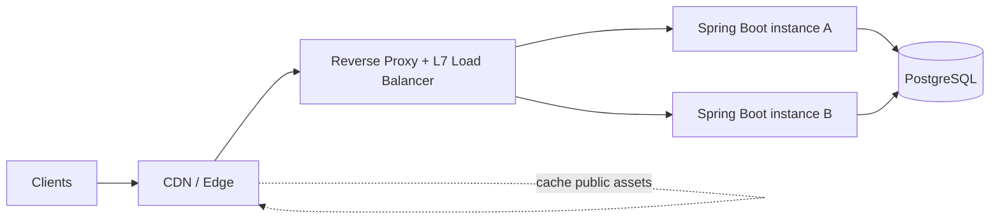

# Week 2 · Day 4 — Reverse Proxies, Load Balancers and CDNs

> Detailed backend engineering revision chapter | Networking and Web Architecture

## Objectives
By the end, explain the foundational concepts, apply them to a Java/Spring Boot system, discuss alternatives and partial failures, and defend the choice in a system design interview.

## Detailed study notes
### 1. Forward proxy versus reverse proxy

A forward proxy is used on behalf of clients, for example enterprise egress or filtering. A **reverse proxy** receives external traffic on behalf of backend servers, terminates TLS when configured, routes requests, adds headers, enforces size limits, and hides internal network topology. Nginx, Envoy, and cloud load balancers can act as reverse proxies. One machine acting as a proxy is itself a failure risk unless the edge is redundant.

### 2. Layer 4 versus Layer 7 load balancing

**L4** load balancing uses transport properties such as IP/port/connection and generally does not interpret application paths. **L7** can route on HTTP host, method, path, headers and cookies, enabling '/api/*' versus '/assets/*' routing. L7 requires HTTP awareness and may terminate TLS. Do not say L4 always means higher performance: workload, implementation and TLS topology matter.

### 3. Common load-balancing algorithms

Round robin rotates among healthy endpoints; weighted round robin distributes according to configured capacity; least connections prefers nodes with fewer open connections; consistent hashing reduces key remapping and can be useful for affinity. Algorithms cannot compensate for a slow shared database or unhealthy upstream logic. Good health-check routing and limits matter as much as the algorithm.

### 4. Health checks, readiness and connection draining

**Liveness** answers whether process recovery/restart may be needed; **readiness** answers whether new traffic should go to the instance. Graceful shutdown stops accepting new connections and allows bounded in-flight work to finish. A load balancer should avoid sending requests to unavailable or draining instances. Don't make liveness checks overly sensitive to transient dependency failures.

### 5. CDN fundamentals

A Content Delivery Network has distributed edge locations that can cache public static assets and, when correctly configured, suitable HTTP responses. A cache hit can reduce origin load and user latency. A cache miss forwards to origin; content may be stale until TTL or invalidation. Avoid caching personalized data across users without properly partitioned cache keys and appropriate 'private/no-store' directives.

### 6. HTTP caching controls

'Cache-Control: public, max-age=3600' may permit shared caching for one hour; 'private' limits shared cache use; 'no-store' instructs caches not to store the representation. 'ETag' plus 'If-None-Match' enables conditional GETs and 304 responses. CDN cache keys can include path/query/headers; an incorrect key can leak or mix personalized content. Think carefully about cookies and Authorization.

### 7. TLS termination and forwarded headers

When TLS terminates at the gateway, the application may receive internal HTTP traffic. Trust 'X-Forwarded-For' or 'Forwarded' only from a trusted proxy; never accept arbitrary client-supplied headers as identity. Configure trusted proxy hops and forwarded protocol/host handling, otherwise redirect URIs, IP rate limits and security logs can be wrong. Encrypt downstream traffic when your threat model requires it.

### 8. Failures, costs and decision process

If the reverse proxy fails, traffic can become unreachable even with healthy APIs. If a CDN serves stale HTML/API responses, users may observe incorrect state. If sticky sessions pin traffic to an unhealthy node, reliability suffers. Begin with a managed edge or simple reverse proxy, add multiple application instances, and assess CDN value based on geographic users, cacheability and cost.

## Diagram: system flow


Explain every arrow and trust boundary, and identify at least two failure points.

## Implementation example
```nginx
# Illustrative Nginx config; adapt to your actual environment
upstream catalog_api {
    server catalog-a:8080;
    server catalog-b:8080;
}
server {
    listen 80;
    location /api/ {
        proxy_pass http://catalog_api;
        proxy_set_header Host $host;
        proxy_set_header X-Forwarded-Proto $scheme;
    }
}
# In production configure HTTPS termination and trusted forwarding correctly.
```

*Examples are educational excerpts, not a claim of a runnable or tested repository application. Add compatible dependencies, imports, exception handling and tests when implementing.*

## Practical assignment
Run two Spring Boot application instances on different ports and route requests through Nginx or a comparable proxy. Add '/health' readiness checks, stop one instance, observe errors during transition, and describe how a redundant edge would improve recovery. Design cache headers for public images versus private order details.

### Verification checklist
- [ ] Requirements and assumptions clearly documented
- [ ] Diagram explains all components and data flow
- [ ] At least two failure scenarios and safe responses described
- [ ] Relevant Java/config or API contract included
- [ ] Tests or reproducible verification procedure specified

## Interview questions
1. Forward proxy versus reverse proxy?
2. L4 versus L7 load balancing?
3. What happens when the sole load balancer dies?
4. How does CDN invalidation differ from database cache invalidation?
5. Why is trusting arbitrary X-Forwarded-For dangerous?

## Five-question knowledge check (answer without notes)
1. What problem does today's primary technique solve?
2. What are its most important trade-offs?
3. What happens when a dependent component fails?
4. How would you keep the design secure?
5. How would you validate behavior and performance?

## Progress
- [ ] Read and summarize chapter
- [ ] Recreate diagram
- [ ] Complete practical assignment
- [ ] Answer interview questions aloud
- [ ] Document one improvement
