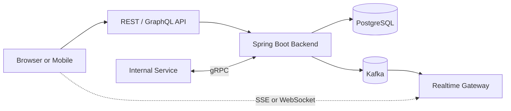

# Week 2 · Day 6 — GraphQL, gRPC, WebSockets and Server-Sent Events

> Detailed backend engineering revision chapter | Networking and Web Architecture

## Objectives
By the end, explain the foundational concepts, apply them to a Java/Spring Boot system, discuss alternatives and partial failures, and defend the choice in a system design interview.

## Detailed study notes
### 1. REST as baseline

REST-style HTTP APIs are excellent for widely interoperable resource operations; HTTP tooling, caches, browsers and observability are mature. They may require multiple client round trips or return more fields than some clients need. Do not assume alternatives are always more efficient or 'modern'.

### 2. GraphQL principles

GraphQL exposes a typed schema and lets clients request specified fields across domain objects. Queries read data, mutations change state, and subscriptions may deliver updates through supported transports. Clients gain flexibility but servers need query depth/complexity limits, authorization on fields and objects, batching/DataLoader to avoid N+1, caching strategy and operational observability.

### 3. gRPC fundamentals

gRPC uses Protocol Buffers service contracts and commonly HTTP/2 transport, supporting unary and various streaming call shapes. It is useful for controlled service-to-service communication where generated typed clients and efficient serialization matter. Browser support often needs gRPC-Web or proxying. gRPC still requires timeouts/deadlines, auth, tracing, compatibility discipline and retry safety.

### 4. WebSockets

WebSockets establish a long-lived, full-duplex connection, often via an HTTP Upgrade handshake on HTTP/1.1 (other mechanisms exist). Both parties can send messages independently. Useful for bidirectional chat and interactive collaboration. Costs include connection management, heartbeats, authentication renewal, fan-out, backpressure and reconnect behavior.

### 5. Server-Sent Events (SSE)

SSE streams one-way **server-to-browser** text events over HTTP using 'text/event-stream'; browsers commonly use EventSource. It is simpler than WebSockets for server-driven progress or notifications. Client-to-server messages still require normal HTTP requests. Expect reconnections, proxies with buffering/timeouts, event IDs and replay/resumption design if messages matter.

### 6. Polling, long polling and streaming choices

Periodic polling is simplest and can be sufficient for infrequent changes; long polling holds requests open awaiting updates; SSE is one-way push; WebSocket is bidirectional persistent communication; gRPC streaming serves typed service communication. Choose based on update frequency, bidirectionality, infrastructure, support and failure semantics.

### 7. Realtime system architecture

For many users, one node cannot broadcast all updates from memory when clients connect across replicas. Use a broker/pub-sub or consistent routing strategy, maintain authorized subscription channels, and decide whether delivery is best effort or resumable. A WebSocket/SSE connection alone does not guarantee durable delivery or exactly-once event processing.

### 8. Compatibility, load balancing and testing

GraphQL evolves through schema deprecation; gRPC Protobuf field numbers must remain stable and backward-compatible; WebSockets/SSE require keep-alive and recovery policies. Test disconnect/reconnect, slow consumers, unauthorized subscriptions, message size limits and overload. Log IDs and timings without dumping sensitive message content.

## Diagram: system flow


Explain every arrow and trust boundary, and identify at least two failure points.

## Implementation example
```java
// Minimal SSE example using Spring MVC
@GetMapping(path = "/api/updates", produces = MediaType.TEXT_EVENT_STREAM_VALUE)
public SseEmitter updates() {
    SseEmitter emitter = new SseEmitter(30_000L);
    // Register emitter with a managed publisher, handle onCompletion,
    // onTimeout and onError, and remove it to avoid resource leaks.
    return emitter;
}
// Production use also needs auth, connection limits and heartbeats.
```

*Examples are educational excerpts, not a claim of a runnable or tested repository application. Add compatible dependencies, imports, exception handling and tests when implementing.*

## Practical assignment
Design live shipment-status updates. Compare polling every 10 seconds with SSE and WebSocket. Choose one, draw an architecture that supports multiple API instances, and define reconnect behavior, auth, heartbeat, and what happens when an event is missed. Compare with a gRPC backend-to-backend delivery-status API.

### Verification checklist
- [ ] Requirements and assumptions clearly documented
- [ ] Diagram explains all components and data flow
- [ ] At least two failure scenarios and safe responses described
- [ ] Relevant Java/config or API contract included
- [ ] Tests or reproducible verification procedure specified

## Interview questions
1. When is GraphQL a better fit than REST?
2. gRPC versus REST trade-offs?
3. SSE versus WebSocket?
4. Can WebSockets guarantee events never get lost?
5. How does a realtime server scale to many connections?

## Five-question knowledge check (answer without notes)
1. What problem does today's primary technique solve?
2. What are its most important trade-offs?
3. What happens when a dependent component fails?
4. How would you keep the design secure?
5. How would you validate behavior and performance?

## Progress
- [ ] Read and summarize chapter
- [ ] Recreate diagram
- [ ] Complete practical assignment
- [ ] Answer interview questions aloud
- [ ] Document one improvement
