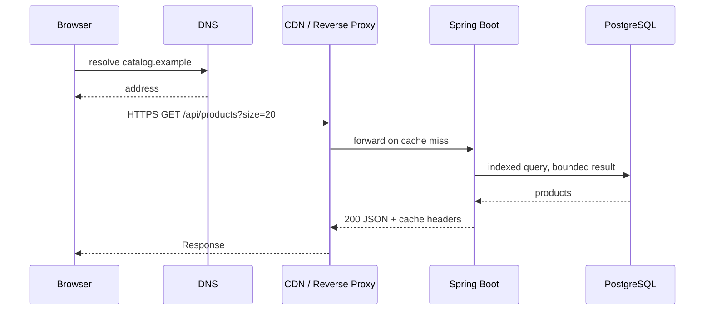

# Week 2 · Day 7 — Week 2 Revision, Production Debugging and Mock Interview

> Detailed backend engineering revision chapter | Networking and Web Architecture

## Objectives
By the end, explain the foundational concepts, apply them to a Java/Spring Boot system, discuss alternatives and partial failures, and defend the choice in a system design interview.

## Detailed study notes
### 1. Review the request lifecycle

Start with a typed URL. Explain DNS lookup/cache; establishing TCP+TLS for HTTP/1.1 or HTTP/2 (or QUIC for HTTP/3); request method/URI/headers; CDN or reverse proxy; load balancer; Spring Boot controller/service; database; response status; client rendering. State which layers may be cached, encrypted or load-balanced.

### 2. HTTP and API design review

Review methods (safe/idempotent), status codes, content negotiation, caching headers, API DTO validation, bounded pagination, optimistic concurrency, authentication and consistent error formats. Example: create a product with POST → 201 + Location; missing product GET → 404; invalid input → 400/422 according to contract; unauthenticated → 401.

### 3. Network infrastructure review

Explain L4 vs L7, reverse versus forward proxy, load-balancer health checks, CDN cache keys, cache-control, TLS termination and trusted forwarded headers. Check where the single points of failure remain and how to avoid leaking a private response through shared caches.

### 4. Authentication and authorization review

Describe session cookie lifecycle versus signed JWT verification, OAuth2 versus OIDC, role/scope versus ownership checks, CSRF and CORS. A valid token alone does not authorize accessing another user's data. Sensitive credentials must be omitted from logs and error bodies.

### 5. Communication protocol decision guide

Use REST for common CRUD and broad client compatibility; GraphQL for flexible composite reads with query controls; gRPC for typed controlled inter-service RPC; SSE for server-to-browser updates; WebSockets for bidirectional realtime traffic. Choose based on concrete requirements; do not mix them by default.

### 6. Mock system design — Product Catalog API

Requirements: browse/list products, view product details, admin creates/updates products; authenticated owner/admin routes; pagination/filtering; suitable public caching; no caching of private admin data. Proposed HLD: browser → CDN → reverse proxy/load balancer → Spring Boot catalog API replicas → PostgreSQL, with an optional cache. Design create/list/detail APIs, indexing, error contracts and access policy.

### 7. Debugging drills

Case A: users see TLS certificate warning—inspect certificate chain, hostname and edge. Case B: GET returns 502—proxy cannot get valid upstream response; check service health and networking. Case C: high p99—inspect proxy, DB connections and query plans. Case D: users sometimes read another user's cached response—inspect cache key and Cache-Control immediately. Case E: events missing after reconnect—define event replay rather than assuming persistent sockets are durable.

### 8. Interview communication rubric

First clarify requirements (5 min), outline capacity and SLOs (5 min), draw architecture and request flow (10 min), define APIs/data (10 min), discuss security/failures/scaling (10 min). Explain trade-offs at each step. Prefer a correct, simple solution over a diagram filled with unrelated technologies.

## Diagram: system flow


Explain every arrow and trust boundary, and identify at least two failure points.

## Implementation example
```text
// Revision checklist: expected API behavior
// POST /api/products       -> 201 Created + Location
// GET /api/products/{id}  -> 200 or 404
// GET /api/products       -> 200 + bounded pagination
// PATCH /api/products/{id}-> 200/204 or 409 on conflicts
// Unauthorized caller     -> 401 / 403 per situation
// Health check            -> reflect readiness to serve traffic
```

*Examples are educational excerpts, not a claim of a runnable or tested repository application. Add compatible dependencies, imports, exception handling and tests when implementing.*

## Practical assignment
Complete a 40-minute mock interview: design a scalable Product Catalog API with public browsing, authenticated admin modification and status streaming for bulk import. Produce an architecture diagram, API contracts, database fields/indexes, CDN rules, auth/ownership model, pagination and at least five failure scenarios. Write three improvements after review.

### Verification checklist
- [ ] Requirements and assumptions clearly documented
- [ ] Diagram explains all components and data flow
- [ ] At least two failure scenarios and safe responses described
- [ ] Relevant Java/config or API contract included
- [ ] Tests or reproducible verification procedure specified

## Interview questions
1. Trace a browser request end to end.
2. Explain 502 vs 503 vs 504.
3. How should an API version and paginate?
4. When would SSE be better than WebSocket?
5. How do you protect a user's orders from another signed-in user?

## Five-question knowledge check (answer without notes)
1. What problem does today's primary technique solve?
2. What are its most important trade-offs?
3. What happens when a dependent component fails?
4. How would you keep the design secure?
5. How would you validate behavior and performance?

## Progress
- [ ] Read and summarize chapter
- [ ] Recreate diagram
- [ ] Complete practical assignment
- [ ] Answer interview questions aloud
- [ ] Document one improvement
