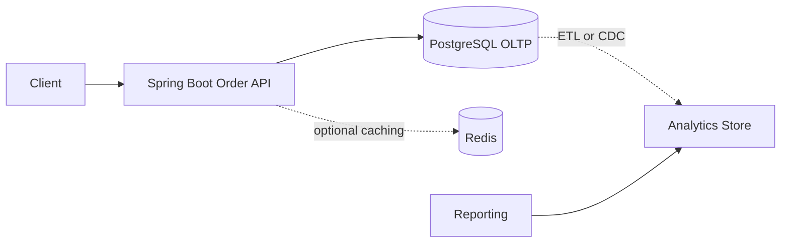

# Week 3 · Day 1 — Database Fundamentals, SQL vs NoSQL, and Storage Choices

**Track:** Database Design and Storage Fundamentals · Java/Spring Boot/PostgreSQL · Interview revision

## Learning goals
Understand the foundations from first principles; apply them to a backend, articulate real trade-offs, and defend decisions during a system-design interview.

## Detailed study notes
### 1. Why databases exist

A database offers durable data storage, query interfaces, concurrency control and recovery. Distinguish **database** (stored data and management engine), **DBMS** (software managing data), **schema** (structure and constraints), and **storage engine** (persistence mechanism). Data is not durable because it merely exists in application memory; durability depends on committed writes, write-ahead logging, persistence configuration, backups and recovery.

### 2. Relational model and SQL

Relational databases organize tuples (rows) and attributes (columns) into tables with keys and constraints. SQL provides declarative querying: specify **what** records to retrieve rather than how to walk them. PostgreSQL is suitable for structured relationships, complex queries and transactional business invariants. Joins let a query combine orders, customers and line items by relational keys. Foreign keys enforce selected referential rules.

### 3. NoSQL families are different

Document stores (MongoDB) support flexible document-oriented access; key–value stores (Redis) are effective for fast lookups/cache state; wide-column systems support certain large distributed access patterns; graph databases specialize in relationship traversal. “NoSQL” is not one consistency or scaling model. Investigate each engine’s actual query, transaction, indexing and replication capabilities rather than assuming all NoSQL stores lack ACID.

### 4. SQL versus NoSQL decision framework

Start with **access patterns, data relationships, transaction invariants, consistency needs, distribution needs, operational burden, cost and expertise**. An e-commerce order service with transactional stock reservations naturally fits relational models. A highly denormalized product document may fit a document store if it is routinely read and updated together. Redis as a cache is not automatically the authoritative data store.

### 5. OLTP and OLAP

Online Transaction Processing (OLTP) handles short, concurrent transactional reads/writes. Online Analytical Processing (OLAP) supports large scans, aggregations and historical analysis. Mixing large reports with latency-sensitive operational queries can hurt production response times. Common patterns include read replicas, change data capture, separate analytics stores and materialized aggregates.

### 6. Storage basics

DB engines coordinate memory caches, persistent files, logs, indexes and background maintenance. In PostgreSQL, a transaction logs changes to WAL to support crash recovery; MVCC helps readers and writers work concurrently by maintaining tuple versions. A checkpoint is not a substitute for a backup. Storage options matter for latency, durability and failure recovery.

### 7. Consistency and data correctness

Database constraints are executable business safeguards: primary keys, foreign keys, unique constraints, NOT NULL and CHECK. Application validation improves error messages, but the DB must enforce invariants under concurrency. Example: two simultaneous users claiming the same coupon code cannot both succeed if `coupon_code` has a unique constraint.

### 8. Architecture selection

Prefer the simplest technology that meets the actual workload. Multiple databases introduce operational complexity: backups, monitoring, schema evolution and data synchronization. “Polyglot persistence” is a useful technique only when each added store solves a justified requirement.

## Architecture / modeling diagram


*Diagram is a conceptual example; explain ownership, constraints and failure behavior rather than blindly replicating components.*

## SQL / implementation walkthrough
```sql
CREATE TABLE customers (
    id BIGINT GENERATED ALWAYS AS IDENTITY PRIMARY KEY,
    email TEXT NOT NULL UNIQUE
);
CREATE TABLE orders (
    id BIGINT GENERATED ALWAYS AS IDENTITY PRIMARY KEY,
    customer_id BIGINT NOT NULL REFERENCES customers(id),
    status VARCHAR(20) NOT NULL
);
SELECT o.id, c.email
FROM orders o JOIN customers c ON c.id = o.customer_id
WHERE o.status = 'CREATED';
```

**Implementation notes:** Review your schema before executing DDL in an existing database. Example fragments are for study; ensure referenced tables, transaction branches and test data exist. They are not proof of a successfully executed program.

## Hands-on assignment
Model customers and orders in PostgreSQL, insert sample data, demonstrate a foreign-key violation, and explain where Redis might fit without becoming the system of record.

### Acceptance criteria
- [ ] Identify functional and non-functional requirements
- [ ] Explain at least two storage or correctness trade-offs
- [ ] Write and reason through practical SQL or Java behavior
- [ ] Sketch the diagram from memory
- [ ] Describe at least two failure/concurrency scenarios

## Interview questions
1. What makes a database different from an in-memory map?
2. Which workload calls for OLTP rather than OLAP?
3. When is document storage a better fit?
4. Are all NoSQL databases eventually consistent?
5. Why should database constraints supplement validation?

## Five-question knowledge check
1. Explain the major concept in your own words.
2. What business invariant or performance goal does it address?
3. What can fail under concurrency or increased load?
4. When would an alternative design be more appropriate?
5. What data would you measure before optimizing?

## Daily completion
- [ ] Theory [ ] Diagram [ ] SQL/implementation [ ] Assignment [ ] Interview revision
