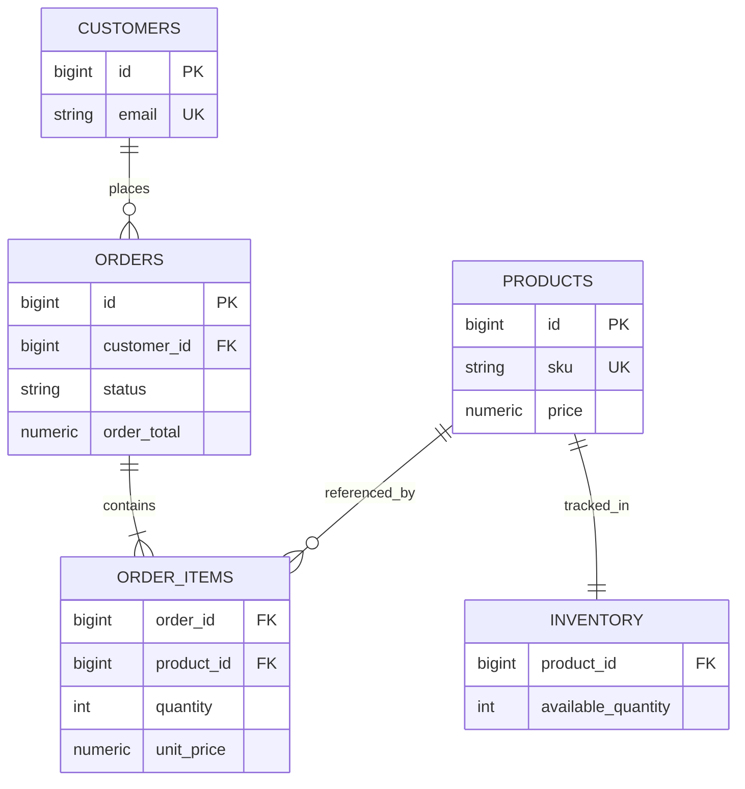

# Week 3 · Day 2 — Data Modeling, Normalization, and Schema Design

**Track:** Database Design and Storage Fundamentals · Java/Spring Boot/PostgreSQL · Interview revision

## Learning goals
Understand the foundations from first principles; apply them to a backend, articulate real trade-offs, and defend decisions during a system-design interview.

## Detailed study notes
### 1. Start from use cases

Entity modeling begins with operations: create customer, browse products, place order, view order history, reserve inventory. Write example queries first. Entities include Customer, Product, Order, OrderItem and Inventory; relationships include one customer to many orders and one order to many line items. The same “product” may have a different data model in catalog and checkout contexts.

### 2. Keys and integrity

A **primary key** uniquely identifies a row; a **foreign key** enforces a reference to another row; a **candidate key** could uniquely identify records; an **alternate key** is a candidate not selected as primary. Use stable identifiers. Indexing and key choice influence write cost and locality. Unique constraints protect natural identifiers such as `email` or `sku` where domain rules demand it.

### 3. First Normal Form (1NF)

Fields contain values appropriate for the relational column/domain rather than repeated groups packed into one field. Storing comma-delimited product IDs in `orders.product_ids` complicates joins, updates and constraints. Use an `order_items` table instead. PostgreSQL JSON/array fields can still be valid for suitable access patterns; normalization is a design decision, not an absolute ban.

### 4. Second and Third Normal Forms

2NF removes partial functional dependencies on part of a composite candidate key (assuming 1NF). 3NF removes problematic non-key dependencies in a relation, reducing anomalies. Example: do not redundantly store the customer's **current** address in every editable order row unless intentional. Conversely, a historical **shipping address snapshot** belongs on the order to preserve what was used at purchase time.

### 5. Denormalization and trade-offs

Denormalization intentionally duplicates/aggregates data for read performance. It reduces join cost but introduces update paths and consistency risk. A stored `order_total` might be necessary as a historical monetary fact, with carefully enforced accounting rules, rather than recalculating from current product prices.

### 6. Schema design for money and time

Use `NUMERIC(p,s)` for exact monetary amounts instead of binary floating-point. Store timestamps with an explicit timezone strategy (e.g., `timestamptz` in PostgreSQL); agree on currency and rounding. Set NOT NULL/defaults only where domain semantics are clear. Use CHECK constraints for nonnegative quantities and enumerated permitted states where appropriate.

### 7. Schema evolution

In production, use versioned migrations (Flyway/Liquibase), backward-compatible expand-and-contract changes, and safe backfills. Adding a required field to a large hot table can have locking/backfill implications. Deploy readers that tolerate old/new shapes, migrate, then tighten constraints after validation.

### 8. Data ownership and API DTOs

JPA entities represent persistence design; public DTOs represent an API contract. Don't expose entity graphs with lazy-loading proxies as JSON. For microservices, each service owns its schema and publishes APIs/events for consumers. Cross-service foreign keys usually aren't viable across separately owned databases.

## Architecture / modeling diagram


*Diagram is a conceptual example; explain ownership, constraints and failure behavior rather than blindly replicating components.*

## SQL / implementation walkthrough
```sql
CREATE TABLE products (
  id BIGINT GENERATED ALWAYS AS IDENTITY PRIMARY KEY,
  sku TEXT NOT NULL UNIQUE,
  name TEXT NOT NULL,
  price NUMERIC(12,2) NOT NULL CHECK (price >= 0)
);
CREATE TABLE orders (
  id BIGINT GENERATED ALWAYS AS IDENTITY PRIMARY KEY,
  customer_id BIGINT NOT NULL REFERENCES customers(id),
  created_at TIMESTAMPTZ NOT NULL DEFAULT now(),
  order_total NUMERIC(12,2) NOT NULL CHECK (order_total >= 0)
);
CREATE TABLE order_items (
  order_id BIGINT NOT NULL REFERENCES orders(id),
  product_id BIGINT NOT NULL REFERENCES products(id),
  quantity INT NOT NULL CHECK (quantity > 0),
  unit_price NUMERIC(12,2) NOT NULL CHECK (unit_price >= 0),
  PRIMARY KEY(order_id, product_id)
);
```

**Implementation notes:** Review your schema before executing DDL in an existing database. Example fragments are for study; ensure referenced tables, transaction branches and test data exist. They are not proof of a successfully executed program.

## Hands-on assignment
Design a 5-table e-commerce schema and sample insert/query statements. Identify functional dependencies, a duplication anomaly, why historical unit_price is captured, and a safe migration for a newly required field.

### Acceptance criteria
- [ ] Identify functional and non-functional requirements
- [ ] Explain at least two storage or correctness trade-offs
- [ ] Write and reason through practical SQL or Java behavior
- [ ] Sketch the diagram from memory
- [ ] Describe at least two failure/concurrency scenarios

## Interview questions
1. What do primary and foreign keys guarantee?
2. Why is storing comma-separated product IDs problematic?
3. Explain 2NF and 3NF with an example.
4. When would intentional denormalization help?
5. Why use NUMERIC for money and UTC-aware timestamps?

## Five-question knowledge check
1. Explain the major concept in your own words.
2. What business invariant or performance goal does it address?
3. What can fail under concurrency or increased load?
4. When would an alternative design be more appropriate?
5. What data would you measure before optimizing?

## Daily completion
- [ ] Theory [ ] Diagram [ ] SQL/implementation [ ] Assignment [ ] Interview revision
