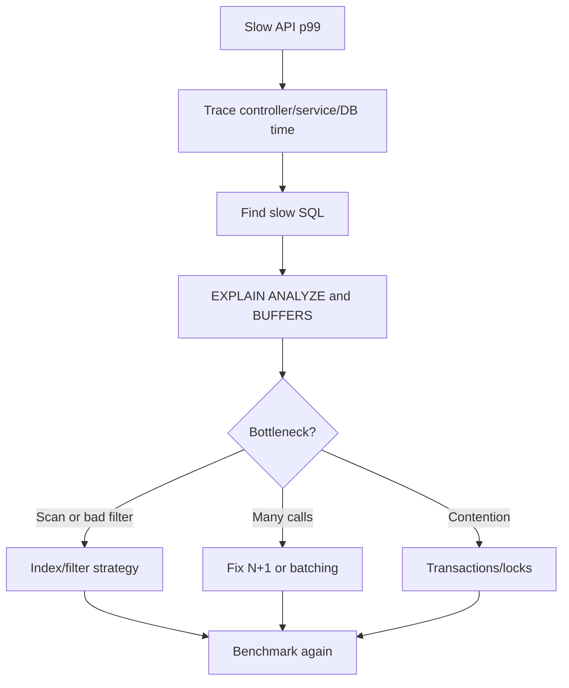

# Week 3 · Day 3 — Indexing, Query Plans, and Performance Optimization

**Track:** Database Design and Storage Fundamentals · Java/Spring Boot/PostgreSQL · Interview revision

## Learning goals
Understand the foundations from first principles; apply them to a backend, articulate real trade-offs, and defend decisions during a system-design interview.

## Detailed study notes
### 1. What an index does

An index is an auxiliary structure for finding rows efficiently. PostgreSQL B-tree indexes help equality, range and ordered lookups, subject to operator and query shape. Indexes are not free: they consume storage and slow writes/updates because structures must be maintained. Sequential scans may be faster on small tables or queries returning a large fraction of rows.

### 2. Primary, composite, unique and covering indexes

A primary key creates a uniqueness-enforcing index. A composite index on `(customer_id, created_at DESC)` can support `WHERE customer_id = ? ORDER BY created_at DESC LIMIT ?`. Column order matters: queries filtering on the leftmost prefix often benefit most. PostgreSQL `INCLUDE` stores non-key columns to enable potential index-only scans when visibility rules permit; it does not make every query index-only.

### 3. EXPLAIN and EXPLAIN ANALYZE

`EXPLAIN` shows optimizer estimates and planned operations; `EXPLAIN ANALYZE` executes the query and reports actual timing/row counts. Compare estimated and actual cardinalities, sequential scans, index scans, joins, sorts, loops, buffers and IO. Running ANALYZE on mutating SQL **executes the mutation** unless safely wrapped/rolled back: use caution on production data.

### 4. Selectivity and sargability

An index is useful when it narrows rows enough to reduce work. Expressions on indexed columns can prevent ordinary index use, e.g. `LOWER(email) = 'x'` without a matching expression index. Use suitable expression/partial indexes or normalize search input. Avoid `SELECT *` when clients need only a few columns.

### 5. N+1 queries in JPA/Hibernate

An order list query may inadvertently trigger one SQL query per order to fetch its items, creating N+1 database round trips. Diagnose with SQL logs and query counts; use targeted fetch joins, DTO projections, entity graphs or batching. Eager loading everything can be equally problematic and cause cartesian-result explosion.

### 6. Pagination strategies

Offset pagination is easy (`LIMIT 20 OFFSET 10000`) but large offsets can scan/skip many rows and unstable ordering leads to duplicates/misses during inserts. Keyset pagination (`WHERE (created_at,id) < (?,?) ORDER BY created_at DESC,id DESC LIMIT 20`) can be more efficient and stable with matching indexes, provided sort keys and cursor semantics are well-defined.

### 7. Joins, aggregates and query rewrites

Join order and cardinality affect plans; selective filters and suitable indexes help. Aggregate queries may require scans/sorts/hashes; consider precomputed aggregates or read models only when necessary. Analyze actual workload patterns, vacuum/analyze statistics and database settings before adding indexes indiscriminately.

### 8. Performance investigation workflow

Start with measured p95/p99 endpoint latency, identify slow SQL and DB wait events, run EXPLAIN (ANALYZE, BUFFERS) on realistic data, inspect index and row estimates, change one factor, re-measure under representative concurrency. Tune connection pools across all replicas. Don't confuse application-level throughput with a query's single-run elapsed time.

## Architecture / modeling diagram


*Diagram is a conceptual example; explain ownership, constraints and failure behavior rather than blindly replicating components.*

## SQL / implementation walkthrough
```sql
CREATE INDEX idx_orders_customer_recent
  ON orders(customer_id, created_at DESC, id DESC);

EXPLAIN (ANALYZE, BUFFERS)
SELECT id, created_at, order_total
FROM orders
WHERE customer_id = 42
ORDER BY created_at DESC, id DESC
LIMIT 20;

-- Keyset page after a cursor value:
SELECT id, created_at, order_total
FROM orders
WHERE customer_id = 42
  AND (created_at, id) < ('2026-09-01T10:00:00Z'::timestamptz, 9000)
ORDER BY created_at DESC, id DESC
LIMIT 20;
```

**Implementation notes:** Review your schema before executing DDL in an existing database. Example fragments are for study; ensure referenced tables, transaction branches and test data exist. They are not proof of a successfully executed program.

## Hands-on assignment
Create at least 10,000 sample order rows, run EXPLAIN ANALYZE before and after an appropriate composite index, record planner choices and timings, and demonstrate a JPA N+1 scenario plus one corrective query strategy.

### Acceptance criteria
- [ ] Identify functional and non-functional requirements
- [ ] Explain at least two storage or correctness trade-offs
- [ ] Write and reason through practical SQL or Java behavior
- [ ] Sketch the diagram from memory
- [ ] Describe at least two failure/concurrency scenarios

## Interview questions
1. Why won't every query use an index?
2. How does composite index order matter?
3. Explain EXPLAIN versus EXPLAIN ANALYZE.
4. What is the ORM N+1 problem?
5. Why can keyset pagination beat large OFFSET values?

## Five-question knowledge check
1. Explain the major concept in your own words.
2. What business invariant or performance goal does it address?
3. What can fail under concurrency or increased load?
4. When would an alternative design be more appropriate?
5. What data would you measure before optimizing?

## Daily completion
- [ ] Theory [ ] Diagram [ ] SQL/implementation [ ] Assignment [ ] Interview revision
