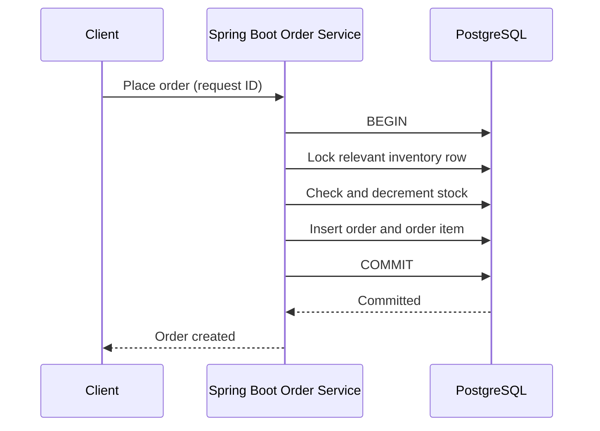

# Week 3 · Day 4 — Transactions, ACID, Locking, and Isolation Levels

**Track:** Database Design and Storage Fundamentals · Java/Spring Boot/PostgreSQL · Interview revision

## Learning goals
Understand the foundations from first principles; apply them to a backend, articulate real trade-offs, and defend decisions during a system-design interview.

## Detailed study notes
### 1. Transaction lifecycle and ACID

A database transaction groups operations with defined commit or rollback behavior. **Atomicity**: all-or-nothing within transaction. **Consistency**: constraints/invariants preserved under correct application logic. **Isolation**: concurrent executions constrained by an isolation model. **Durability**: committed changes survive eligible failures according to durability configuration. ACID does not automatically enforce every business invariant.

### 2. Money transfer walkthrough

Transfer ₹500 from A to B: check business rules, subtract from A, add to B, commit together. Without a transaction, a crash after debit may lose credit. Include balance checks and lock/concurrency behavior to avoid overdraw. Transaction boundaries should not include slow network calls when avoidable.

### 3. Isolation anomalies

**Dirty read:** see uncommitted data. **Non-repeatable read:** repeated row read sees a different committed value. **Phantom:** re-executed predicate finds a changed set of rows. **Lost update:** one writer overwrites another's changes; prevention depends on locking/versioning and the database. **Write skew:** two concurrent transactions read a shared condition then modify different rows, violating a cross-row invariant.

### 4. Isolation levels and PostgreSQL specifics

SQL standard names READ UNCOMMITTED, READ COMMITTED, REPEATABLE READ, SERIALIZABLE. PostgreSQL treats READ UNCOMMITTED as READ COMMITTED, and its REPEATABLE READ provides snapshot isolation (preventing some anomalies beyond SQL minimums). PostgreSQL SERIALIZABLE may abort a transaction with a serialization failure; the application must safely retry the entire transaction where appropriate.

### 5. MVCC and row locks

Multi-version concurrency control lets readers observe snapshots and limits some reader/writer blocking. `SELECT ... FOR UPDATE` locks selected rows to serialize critical updates; this can increase contention and create deadlocks if lock order differs. Use short transactions and consistent lock acquisition order.

### 6. Optimistic locking

For low-contention updates, include a version column and update only if the version still matches. A zero-row update signals an optimistic conflict: respond with a suitable error or retry carefully. Spring Data JPA's `@Version` helps detect lost updates. It does not solve arbitrary cross-service distributed transactions.

### 7. Deadlocks and retry policy

A deadlock happens when transactions wait in a cycle; the DB breaks it by aborting one participant. Retry only retryable failures with bounds/backoff, and keep business effects idempotent where appropriate. Long-running DB transactions holding locks amplify latency and failure modes.

### 8. Distributed workflow distinction

A local PostgreSQL transaction cannot atomically commit a payment provider response and Kafka publication. Use a state machine, transactional outbox and idempotent consumer or a saga with compensation. Document intermediate states such as PENDING, CONFIRMED and FAILED, and the recovery approach after partial completion.

## Architecture / modeling diagram


*Diagram is a conceptual example; explain ownership, constraints and failure behavior rather than blindly replicating components.*

## SQL / implementation walkthrough
```sql
BEGIN;
SELECT available_quantity
FROM inventory WHERE product_id = 101
FOR UPDATE;

UPDATE inventory
SET available_quantity = available_quantity - 2
WHERE product_id = 101 AND available_quantity >= 2;

-- Check exactly one row updated before creating order:
INSERT INTO orders(customer_id, order_total)
VALUES (5, 1500.00);
COMMIT;

-- In Spring Boot, put @Transactional on a service-level method
-- managing related repository changes, not around a remote payment call.
```

**Implementation notes:** Review your schema before executing DDL in an existing database. Example fragments are for study; ensure referenced tables, transaction branches and test data exist. They are not proof of a successfully executed program.

## Hands-on assignment
Simulate concurrent stock reservations with only one unit available; compare an unsafe read-then-update with an atomic conditional UPDATE or row lock. Demonstrate rollback, explain a deadlock, and distinguish local transaction correctness from payment workflow recovery.

### Acceptance criteria
- [ ] Identify functional and non-functional requirements
- [ ] Explain at least two storage or correctness trade-offs
- [ ] Write and reason through practical SQL or Java behavior
- [ ] Sketch the diagram from memory
- [ ] Describe at least two failure/concurrency scenarios

## Interview questions
1. What does each ACID property mean?
2. Dirty read versus phantom read?
3. Why can a transaction still suffer write skew?
4. How does @Version detect an optimistic conflict?
5. What should happen after a SERIALIZABLE retryable failure?

## Five-question knowledge check
1. Explain the major concept in your own words.
2. What business invariant or performance goal does it address?
3. What can fail under concurrency or increased load?
4. When would an alternative design be more appropriate?
5. What data would you measure before optimizing?

## Daily completion
- [ ] Theory [ ] Diagram [ ] SQL/implementation [ ] Assignment [ ] Interview revision
