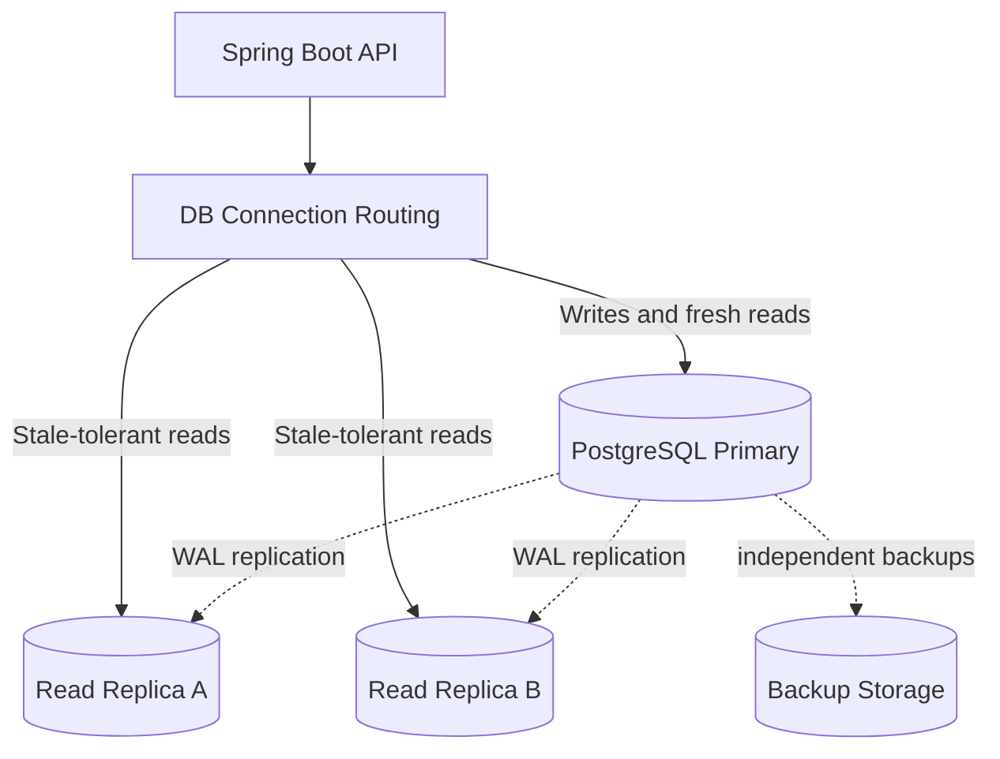

# Week 3 · Day 5 — Replication, Read Replicas, Failover, and High Availability

**Track:** Database Design and Storage Fundamentals · Java/Spring Boot/PostgreSQL · Interview revision

## Learning goals
Understand the foundations from first principles; apply them to a backend, articulate real trade-offs, and defend decisions during a system-design interview.

## Detailed study notes
### 1. Why replicate a database?

Replication copies changes to other nodes for high availability, recovery and potentially read scaling. A **primary** often accepts writes while replicas replay changes. Replication is not a substitute for backup: deletes, bugs and corruption can also propagate. Real HA requires monitoring, leader election/fencing, connection routing and recoverability—not merely starting another PostgreSQL process.

### 2. Synchronous versus asynchronous replication

With synchronous replication, configured acknowledgments can improve durability guarantees but increase write latency and reduce write availability under replica failure. Asynchronous replication allows lower write latency and independence but risks losing recently committed primary-only writes during failover. Exact guarantees depend on database configuration, commit settings and failure scenario.

### 3. Replica lag and stale reads

A query against a lagging replica may miss a write just committed on the primary. For create-then-read workflows, read from the primary, use session consistency techniques or wait for a required replay position where supported. Analytics/reporting may tolerate stale reads. Measure replication lag, not just 'replica healthy'.

### 4. Read scaling versus write scaling

Read replicas can spread appropriate reads, but all writes still flow through primary or a coordinated write topology. Long transactions, WAL throughput, poor queries and network latency can bottleneck replication. Read replicas are not a general solution for an overloaded write path.

### 5. Failover procedure and split brain

Failover detects a failed primary, elects/promotes an eligible replica and switches clients to it. If two nodes believe they are primary, divergent writes can occur (**split brain**). Fencing, consensus/coordinator rules and connection draining matter. Automatic failover is an operational system, not a magic `replica=true` configuration.

### 6. High availability versus disaster recovery

Availability deals with keeping a service usable across likely failures; disaster recovery deals with restoring service and data after serious incidents. **RTO** (recovery time objective) measures acceptable time to recover; **RPO** (recovery point objective) measures acceptable lost data window. Backups need regular restore testing and appropriate offsite/isolated retention.

### 7. Spring Boot read routing trade-offs

A transaction-aware data source router can send read-only queries to replicas, but it is easy to accidentally send read-after-write requests to lagging nodes. Read-only flags are hints, not universal guarantees. Avoid overcomplex routing until read workloads and consistency policies justify it.

### 8. Failure exercises

Discuss node failure, network partition, replication lag, storage-full, corrupt migration and accidental DELETE. For each, specify customer impact, detection, recovery, possible data loss and whether your SLA/SLO survives. Plan post-failover replica rebuilding and rollback strategies.

## Architecture / modeling diagram


*Diagram is a conceptual example; explain ownership, constraints and failure behavior rather than blindly replicating components.*

## SQL / implementation walkthrough
```sql
-- On the primary:
SHOW wal_level;
SHOW synchronous_commit;

-- Inspect replica replay/receive positions using appropriate
-- PostgreSQL version-specific monitoring views/functions.
-- Do not modify replication settings without a recovery plan.

-- Application policy example:
-- read-your-write order detail => primary
-- broad historical reporting => eligible replica
```

**Implementation notes:** Review your schema before executing DDL in an existing database. Example fragments are for study; ensure referenced tables, transaction branches and test data exist. They are not proof of a successfully executed program.

## Hands-on assignment
Design a PostgreSQL primary plus two read replicas. Define which API reads may be stale and which must read the primary; write a failover runbook with detection, promotion, rerouting, RPO/RTO targets and backup validation. Diagram a split-brain risk.

### Acceptance criteria
- [ ] Identify functional and non-functional requirements
- [ ] Explain at least two storage or correctness trade-offs
- [ ] Write and reason through practical SQL or Java behavior
- [ ] Sketch the diagram from memory
- [ ] Describe at least two failure/concurrency scenarios

## Interview questions
1. How do sync and async replication differ?
2. Why may read-after-write fail on a replica?
3. What is split brain?
4. Why isn't replication a backup?
5. What is RTO versus RPO?

## Five-question knowledge check
1. Explain the major concept in your own words.
2. What business invariant or performance goal does it address?
3. What can fail under concurrency or increased load?
4. When would an alternative design be more appropriate?
5. What data would you measure before optimizing?

## Daily completion
- [ ] Theory [ ] Diagram [ ] SQL/implementation [ ] Assignment [ ] Interview revision
