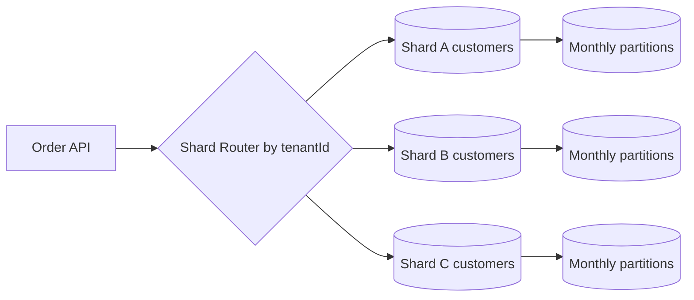

# Week 3 · Day 6 — Partitioning, Sharding, and Database Scalability

**Track:** Database Design and Storage Fundamentals · Java/Spring Boot/PostgreSQL · Interview revision

## Learning goals
Understand the foundations from first principles; apply them to a backend, articulate real trade-offs, and defend decisions during a system-design interview.

## Detailed study notes
### 1. Partitioning versus sharding

**Partitioning** divides a logical table into subsets, commonly still managed by one database system/cluster; PostgreSQL supports declarative range/list/hash partitioning. **Sharding** distributes data across separately managed databases or nodes. Partitioning helps retention, pruning and manageability; sharding adds routing, cross-shard joins, global uniqueness, rebalancing and operational complexity.

### 2. Partitioning methods

**Range** partitions are useful for time-series/orders by month, with easy lifecycle cleanup. **List** partitions isolate categories/regions. **Hash** distributes values across a fixed number of partitions. Query pruning works when filters align with the partition key. Poor partition-key choices can force queries across every partition and create hotspots.

### 3. Shard key selection

Choose a shard key from read/write access patterns, query locality and cardinality. For multi-tenant order data, `customer_id` or `tenant_id` may keep a user's records together, but one giant tenant can become a hot shard. Even distribution is not enough if frequently accessed records concentrate on one key.

### 4. Consistent hashing and rebalancing

Simple modulo routing (`hash(key) % N`) can move many keys when shard count changes. Consistent hashing minimizes key movement under topology changes, though practical virtual-node/rendezvous schemes still require careful metadata and migrations. Rebalancing must preserve write correctness and avoid dual-write inconsistencies.

### 5. Hot partitions and mitigation

Hotspots arise from sequential IDs, trending products, high-volume tenants or skewed keys. Techniques include better shard keys, controlled salting for append-heavy workloads, splitting hot tenants, batching or caching hot reads. Salting makes retrieval/aggregation harder; choose only after observing workload skew.

### 6. Cross-shard queries and transactions

Joins and aggregations across shards need scatter-gather, separate read models or application coordination. Atomic multi-shard transactions are harder than single-DB transactions and often require a business workflow. Global unique IDs can use UUIDs or ID allocators; uniqueness semantics must be guaranteed by design, not assumed.

### 7. When *not* to shard

First optimize queries/indexes, cache appropriate reads, tune connection pools, use partitioning/read replicas and consider vertical scaling. Sharding early can make operations and analytics far more expensive. Data volume alone does not establish a need to shard; measured throughput/latency and maintenance limits do.

### 8. Scaling strategy for orders

Begin with indexed PostgreSQL. Partition by creation time when retention and pruning support it; read replicas for stale-tolerant reports; use a warehouse for analytic scans. Only shard if a single primary's write/IO or operational ceiling is genuinely exceeded. Map correctness invariants (e.g., stock reservation) to a clear authoritative owner.

## Architecture / modeling diagram


*Diagram is a conceptual example; explain ownership, constraints and failure behavior rather than blindly replicating components.*

## SQL / implementation walkthrough
```sql
-- Example PostgreSQL range partitioning by order date.
-- PostgreSQL unique/primary constraints on partitioned tables
-- must include partition-key columns where required.
CREATE TABLE event_log (
    event_id BIGINT NOT NULL,
    occurred_at DATE NOT NULL,
    payload JSONB NOT NULL,
    PRIMARY KEY (event_id, occurred_at)
) PARTITION BY RANGE (occurred_at);

CREATE TABLE event_log_2026_10 PARTITION OF event_log
FOR VALUES FROM ('2026-10-01') TO ('2026-11-01');

EXPLAIN SELECT * FROM event_log
WHERE occurred_at >= '2026-10-01'
  AND occurred_at < '2026-11-01';
```

**Implementation notes:** Review your schema before executing DDL in an existing database. Example fragments are for study; ensure referenced tables, transaction branches and test data exist. They are not proof of a successfully executed program.

## Hands-on assignment
Design storage for 100M orders/year. Compare monthly partitioning, a single large indexed table and tenant-based sharding. State key/query assumptions; explain what happens when a single tenant is 50× larger, and demonstrate partition pruning with EXPLAIN.

### Acceptance criteria
- [ ] Identify functional and non-functional requirements
- [ ] Explain at least two storage or correctness trade-offs
- [ ] Write and reason through practical SQL or Java behavior
- [ ] Sketch the diagram from memory
- [ ] Describe at least two failure/concurrency scenarios

## Interview questions
1. Partitioning versus sharding?
2. How do you pick a shard key?
3. Why can hash modulo N cause costly rebalancing?
4. What makes a shard hot?
5. How do cross-shard transactions change your design?

## Five-question knowledge check
1. Explain the major concept in your own words.
2. What business invariant or performance goal does it address?
3. What can fail under concurrency or increased load?
4. When would an alternative design be more appropriate?
5. What data would you measure before optimizing?

## Daily completion
- [ ] Theory [ ] Diagram [ ] SQL/implementation [ ] Assignment [ ] Interview revision
