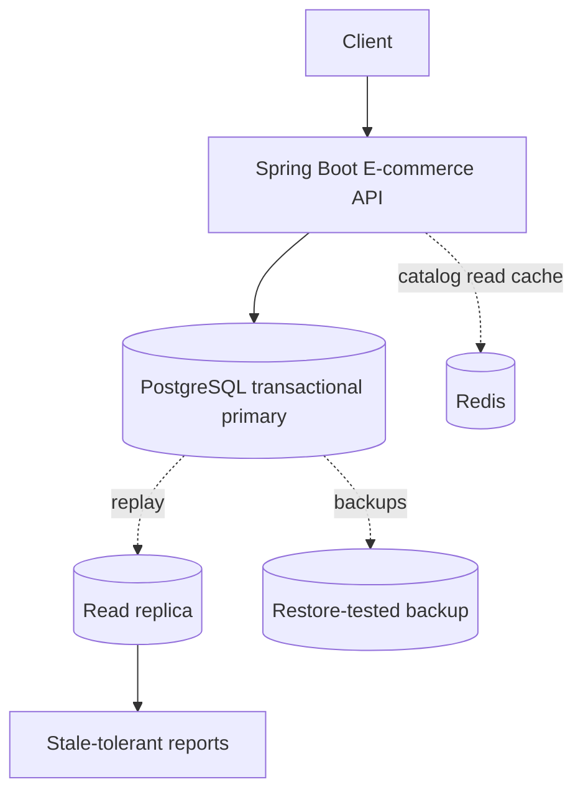

# Week 3 · Day 7 — Week 3 Revision and E-commerce Database Design Mock Interview

**Track:** Database Design and Storage Fundamentals · Java/Spring Boot/PostgreSQL · Interview revision

## Learning goals
Understand the foundations from first principles; apply them to a backend, articulate real trade-offs, and defend decisions during a system-design interview.

## Detailed study notes
### 1. Revision map

Day 1: SQL vs NoSQL and OLTP. Day 2: keys, normalization and schema. Day 3: indexes, query plans and pagination. Day 4: ACID, isolation, locking. Day 5: replication and high availability. Day 6: partitioning and sharding. Tie all six into one consistent business system rather than memorizing terms in isolation.

### 2. Interview problem and requirements

Design storage for an e-commerce platform: customers browse products, place orders, reserve inventory and see history. Define volume, read/write ratio, price history, consistency for stock/order writes, availability targets, retention and reporting freshness. Exclude real payment integration unless requested. Document assumptions up front.

### 3. HLD and ownership

Use Spring Boot Order API with PostgreSQL as authoritative transactional store; optional Redis for cacheable catalog lookups; optionally separate analytics workloads. If microservices exist, each service owns schema and communicates by APIs/events. Avoid direct writes into another team's tables.

### 4. Schema defense

Customers(id,email); Products(id,sku,name,price); Orders(id,customer_id,status,total,created_at); OrderItems(order_id,product_id,quantity,unit_price); Inventory(product_id,available_quantity). Explain historical price snapshot, unique constraints, foreign keys, precision, retention and migration strategy.

### 5. Index defense

Common workload: latest orders for a customer. Candidate index `(customer_id,created_at DESC,id DESC)` supports filtered keyset pagination. Verify with EXPLAIN ANALYZE under representative data. Avoid adding every conceivable index or claiming performance before measurement.

### 6. Correctness and concurrency

Two customers simultaneously purchasing the last item require an atomic conditional update or a lock-protected transaction; a prior SELECT alone cannot prevent overselling. An external payment side effect is not part of the same PostgreSQL transaction: use explicit state/recovery and idempotency.

### 7. Availability and scaling

Add read replicas for permissible stale reads, monitoring and tested backups, failover plan with RPO/RTO. Partition historical data by time where it improves maintenance. Shard only when workload requires distributed ownership and routing; explain hot tenants and cross-shard reporting costs.

### 8. Mock interview evaluation

Run a 40-minute session: 5 minutes scope, 5 estimates, 10 schema/API, 10 transactions/indexes, 5 replication/sharding, 5 trade-offs/failure modes. Assess correctness before scale. Finish by identifying which assumptions would change your architecture.

## Architecture / modeling diagram


*Diagram is a conceptual example; explain ownership, constraints and failure behavior rather than blindly replicating components.*

## SQL / implementation walkthrough
```sql
-- Reserve stock atomically and reject when no row was updated.
BEGIN;
UPDATE inventory
SET available_quantity = available_quantity - :qty
WHERE product_id = :productId
  AND available_quantity >= :qty;
-- Application must verify row count equals 1 before inserting order.
INSERT INTO orders(customer_id, order_total) VALUES (:customerId, :total);
COMMIT;

-- Interview warning: a successful UPDATE with rowCount=0
-- means no reservation; do not still insert the order.
```

**Implementation notes:** Review your schema before executing DDL in an existing database. Example fragments are for study; ensure referenced tables, transaction branches and test data exist. They are not proof of a successfully executed program.

## Hands-on assignment
Conduct a 40-minute mock interview for e-commerce storage. Produce requirements, ERD, indexes, one atomic reservation transaction, rollback scenario, read-replica policy and a partition-vs-shard decision. Write a one-page retrospective.

### Acceptance criteria
- [ ] Identify functional and non-functional requirements
- [ ] Explain at least two storage or correctness trade-offs
- [ ] Write and reason through practical SQL or Java behavior
- [ ] Sketch the diagram from memory
- [ ] Describe at least two failure/concurrency scenarios

## Interview questions
1. What database would you choose for transactional orders and why?
2. How would you prevent overselling?
3. When could a replica serve stale data?
4. What index would support latest customer orders?
5. How would you know it is time to shard?

## Five-question knowledge check
1. Explain the major concept in your own words.
2. What business invariant or performance goal does it address?
3. What can fail under concurrency or increased load?
4. When would an alternative design be more appropriate?
5. What data would you measure before optimizing?

## Daily completion
- [ ] Theory [ ] Diagram [ ] SQL/implementation [ ] Assignment [ ] Interview revision
