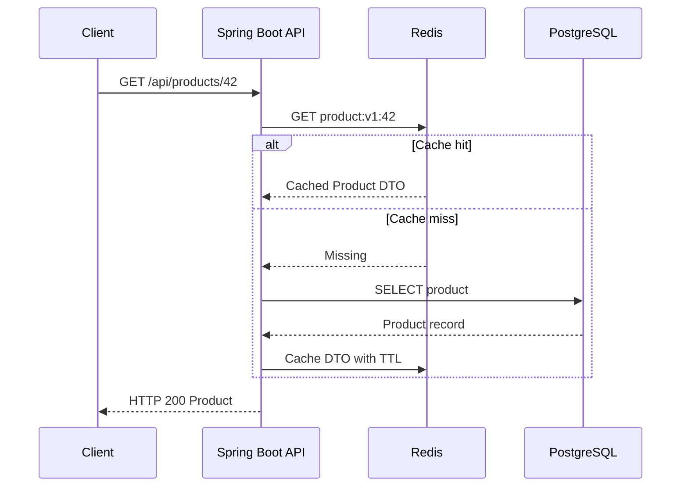

# Week 4 · Day 1 — Caching Fundamentals and Performance Bottlenecks

**Course:** System Design and Backend Engineering · **Track:** Caching & Performance Optimization · **Focus:** Java 21, Spring Boot, Redis, PostgreSQL

## Learning objectives
Explain every major concept from first principles, connect it to actual backend request flows, understand correctness and operational trade-offs, and defend design choices in system design interviews.

## Detailed study notes
### 1. What caching solves

Caching temporarily stores a reusable result closer to the consumer, so repeated requests avoid expensive work. A cache is an **optimization layer**, not automatically the authoritative source of truth. For example, product metadata might take 40 ms to retrieve from PostgreSQL but 2 ms from an in-memory cache under a specific benchmark; those are illustrations, not guaranteed latency values. Caches improve performance only when lookups are repeated and cache management costs are justified.

### 2. Latency, throughput and memory hierarchy

CPU cache, application heap, distributed caches, DB buffer pool, CDN, and browser HTTP cache occupy different positions in a latency and ownership hierarchy. A local memory cache removes a network hop but is isolated per process. A Redis cache adds network/serialization time but can be shared across multiple API replicas. A CDN can move public content geographically closer to clients. Choose by where the work and bottleneck really occur.

### 3. Cache hit, miss and hit ratio

A **hit** returns the sought value from cache; a **miss** requires another source, often a database. Hit ratio = hits / (hits + misses), measured over a defined window. A 90% hit ratio is useful only if the cached reads are a meaningful bottleneck. Suppose a cache hit takes 2 ms and a miss takes 50 ms including DB lookup; 90% hits yields an illustrative mean of 0.9×2+0.1×50=6.8 ms. Actual user latency includes other stages and tails.

### 4. Cacheability and workload patterns

Good candidates: product descriptions, public configuration, immutable assets, frequently viewed profiles with tolerated staleness, aggregated ranking data. Poor candidates: single-use values, rapidly changing money balances needing strict freshness, extremely high-cardinality reads with little repetition, and sensitive user data if cache keys/authorization are unsafe. Evaluate hot keys, update frequency, key cardinality, and data sensitivity.

### 5. The cost of a cache

Caches consume RAM, network resources and engineering effort. Wrong invalidation can return old stock prices or deleted records. Cold starts temporarily increase database load. Large cached objects increase memory use and serialization overhead. A cache outage may push all traffic to PostgreSQL. Think through correctness, TTL, eviction, stampede and fallback before declaring an architecture production-ready.

### 6. Cache-aside first principles

Under **cache-aside**, the app checks cache, fetches from DB on miss, then populates cache. The application controls key design and fallback. A write often updates the DB and invalidates or refreshes a cache key. Race conditions remain possible when a miss and a write interleave; exact freshness guarantees require deliberate design.

### 7. Performance investigation workflow

Measure API p50/p95/p99, throughput, DB latency, connection pool saturation, query plans and cache hit/miss counts. Optimize expensive SQL and indexes first where appropriate. Introduce cache only when repeatable measurements indicate it solves a real bottleneck. Record workload, instance size, dataset, warmup period and cache state for before/after tests.

### 8. Practical e-commerce example

GET /api/products/42 requests a stable catalog record: read from Redis by 'product:v1:42', fetch from PostgreSQL on miss, cache a DTO for a short bounded TTL, then return JSON. For stock reservations and payment correctness, keep transactional writes in PostgreSQL and avoid treating a possibly stale product cache as authorization to sell nonexistent stock.

## Architecture / process diagram


The diagram is illustrative. Explain components, when each can fail and which data source is authoritative. Do not assume every component is necessary for a small application.

## Java or infrastructure implementation
```java
// Cache-aside pseudocode to implement in a Spring service
public ProductDto getProduct(long id) {
    String key = "product:v1:" + id;
    ProductDto cached = cache.read(key);
    if (cached != null) return cached;
    Product product = repository.findById(id)
        .orElseThrow(ProductNotFoundException::new);
    ProductDto value = mapper.toDto(product);
    cache.write(key, value, Duration.ofMinutes(5));
    return value;
}
// Add serialization, consistent missing-value behavior and error handling.
```

**Important:** The example is educational; add required imports, dependencies, environment configuration, exception handlers and tests for a runnable project. The code has not been executed as part of these notes.

## Hands-on assignment
Build a table with at least 10 cached/non-cached operations of a product catalog. Identify which should use local cache, Redis, CDN, or no cache. Define expected freshness, TTL, key, failure fallback and how you would measure benefits.

### Acceptance criteria
- [ ] Document your traffic, latency and freshness assumptions.
- [ ] Specify cache keys, TTL and missing/invalid data behavior.
- [ ] Explain what happens when Redis or the database is unavailable.
- [ ] Design at least two tests and one measurable performance metric.
- [ ] Explain a correctness/performance trade-off.

## Five interview questions
1. What is a cache hit ratio and why is it not sufficient alone?
2. Local cache versus Redis versus CDN?
3. Can a cache improve throughput but hurt correctness?
4. What happens to the database when Redis fails?
5. Why should stock reservation not trust an old cache value?

## Interview revision answers — reasoning guide
- Define the problem and the authoritative datastore before proposing a cache.
- Distinguish measured benefits from hypothetical latency estimates.
- Describe freshness, invalidation, eviction, replication and crash behavior.
- Explain why adding memory or replicas is not a substitute for fixing wrong queries or business invariants.
- Give an alternative architecture and state when it is simpler.

## Knowledge check (attempt before reviewing)
1. What does today's main pattern optimize?
2. What new failure or stale-data case does it introduce?
3. How do you test cache-hit versus cache-miss paths?
4. Which operation must be handled in the authoritative database?
5. Under what circumstances would you remove this cache?

## Daily checklist
- [ ] Concepts revised
- [ ] Diagram redrawn
- [ ] Java/Redis example understood
- [ ] Practical assignment completed
- [ ] Interview questions answered

**Next:** Week 4 Day 2.
