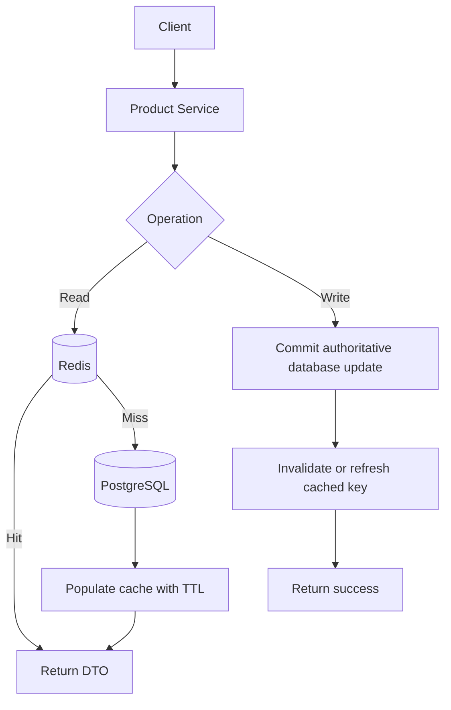

# Week 4 · Day 2 — Cache Layers, Cache-Aside, Read-Through, Write-Through and Write-Behind

**Course:** System Design and Backend Engineering · **Track:** Caching & Performance Optimization · **Focus:** Java 21, Spring Boot, Redis, PostgreSQL

## Learning objectives
Explain every major concept from first principles, connect it to actual backend request flows, understand correctness and operational trade-offs, and defend design choices in system design interviews.

## Detailed study notes
### 1. Caching layers

Browser caches follow HTTP cache directives and reuse representations. CDNs are shared edge caches for public content; application in-memory caches reduce local function/object computation; distributed Redis caches offer cross-instance sharing; databases themselves cache data/index pages. More layers can mean lower latency but greater invalidation complexity. Cache keys must uniquely identify the correct representation and permissions.

### 2. Cache-aside (lazy loading)

App checks cache, reads database on a miss, then fills cache. Pros: simple and caches only accessed data; cons: first miss is slower, misses can stampede, concurrent write/invalidation can create stale fills. Example: GET product detail. Use bounded TTL and explicit invalidation on important updates.

### 3. Read-through

A caching abstraction automatically reads through to the underlying data source when data is missing, keeping load logic near the cache provider/loader. Pros: centralized loading behavior; cons: abstraction setup, error handling, and first-miss latency. Read-through is a behavior/pattern, not a claim that standard Redis automatically connects to PostgreSQL.

### 4. Write-through

Writes go through cache logic and are synchronously persisted to the authoritative store as part of the write path design. The implementation must define atomicity and failure behavior: a write to Redis followed by a failed DB write is **not** an atomic successful write. Pros: fresher cache for new writes; cons: extra write latency and complexity. Prefer to document the DB commit and cache mutation order.

### 5. Write-behind / write-back

Application writes to cache or buffer first; persistence happens later. This can improve apparent write latency but introduces **data-loss risk** if buffer/cache fails before durable flush, ordering and consistency problems, and a more complex recovery path. Avoid write-behind for payments, core order integrity or inventory unless a deliberately engineered durable queue/log and reconciliation scheme protect invariants.

### 6. Write-around

Write directly to authoritative storage and let later reads populate the cache. Avoids filling cache with never-read writes; first read after a write will miss. Often suitable for write-heavy and rarely reread records. Data staleness depends on invalidating any old copies.

### 7. TTL, cache keys and invalidation

Define deterministic namespaced keys, e.g. 'catalog:product:v2:42'. TTL is a bound on *time stored*, not an end-to-end freshness guarantee when writes and fill races occur. Versioned key namespaces help schema changes but create temporary duplicate footprint. Avoid embedding secrets or unescaped arbitrary user input in cache keys.

### 8. Pattern comparison and selection

Use cache-aside for many Spring Boot read cases; read-through when the caching framework supplies loaders; write-through only with rigorously defined synchronous DB correctness; write-behind for workloads that can tolerate delay/loss or have durable buffering; write-around for infrequently reread writes. Always discuss operational behavior on Redis restart, network partition and partial write failure.

## Architecture / process diagram


The diagram is illustrative. Explain components, when each can fail and which data source is authoritative. Do not assume every component is necessary for a small application.

## Java or infrastructure implementation
```java
// Simplified Spring service: database first, invalidate cached read
@Transactional
public ProductDto updatePrice(long id, BigDecimal price) {
    if (price.signum() < 0) throw new IllegalArgumentException();
    Product product = repository.findById(id)
        .orElseThrow(ProductNotFoundException::new);
    product.setPrice(price);
    return mapper.toDto(repository.save(product));
}
// An AFTER_COMMIT event/listener can invalidate Redis.
// Don't evict before a DB transaction commits and assume consistency.
```

**Important:** The example is educational; add required imports, dependencies, environment configuration, exception handlers and tests for a runnable project. The code has not been executed as part of these notes.

## Hands-on assignment
Create a comparison matrix for five patterns including read path, write path, data durability, complexity, and when appropriate. Design product price edits using DB-first update plus after-commit cache invalidation. Explain the crash window after commit but before invalidation.

### Acceptance criteria
- [ ] Document your traffic, latency and freshness assumptions.
- [ ] Specify cache keys, TTL and missing/invalid data behavior.
- [ ] Explain what happens when Redis or the database is unavailable.
- [ ] Design at least two tests and one measurable performance metric.
- [ ] Explain a correctness/performance trade-off.

## Five interview questions
1. Cache-aside vs read-through?
2. Why is write-behind risky for payments?
3. What does cache-aside do on a cold start?
4. When choose write-around?
5. Why is TTL not a full consistency guarantee?

## Interview revision answers — reasoning guide
- Define the problem and the authoritative datastore before proposing a cache.
- Distinguish measured benefits from hypothetical latency estimates.
- Describe freshness, invalidation, eviction, replication and crash behavior.
- Explain why adding memory or replicas is not a substitute for fixing wrong queries or business invariants.
- Give an alternative architecture and state when it is simpler.

## Knowledge check (attempt before reviewing)
1. What does today's main pattern optimize?
2. What new failure or stale-data case does it introduce?
3. How do you test cache-hit versus cache-miss paths?
4. Which operation must be handled in the authoritative database?
5. Under what circumstances would you remove this cache?

## Daily checklist
- [ ] Concepts revised
- [ ] Diagram redrawn
- [ ] Java/Redis example understood
- [ ] Practical assignment completed
- [ ] Interview questions answered

**Next:** Week 4 Day 3.
