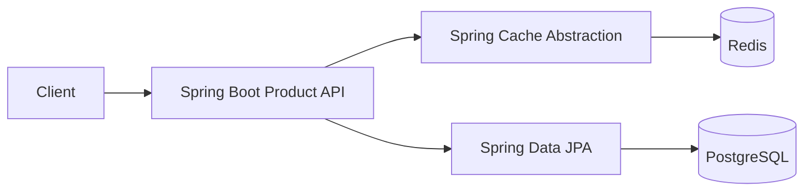

# Week 4 · Day 3 — Redis Fundamentals, Data Types and Spring Boot Integration

**Course:** System Design and Backend Engineering · **Track:** Caching & Performance Optimization · **Focus:** Java 21, Spring Boot, Redis, PostgreSQL

## Learning objectives
Explain every major concept from first principles, connect it to actual backend request flows, understand correctness and operational trade-offs, and defend design choices in system design interviews.

## Detailed study notes
### 1. Redis architecture and persistence

Redis is an in-memory data store supporting efficient key-oriented commands, TTLs and multiple data structures. Network and single-threaded command-execution details vary by version/operations; do not assume all Redis work is strictly single-threaded. Persistence choices include RDB snapshots and AOF logs, which have different durability, restart, write-amplification and recovery characteristics. A Redis cache should be treated as expendable unless deliberately configured and verified otherwise.

### 2. Data structures with examples

Strings store simple values/serialized DTOs; hashes represent small objects/maps; lists offer ordered sequences; sets represent unique members; sorted sets maintain a score order and are useful for rankings; streams provide append-only stream semantics with consumer-group features. Choose based on access pattern and atomicity needs. A sorted set is not automatically a durable distributed event bus equivalent to Kafka.

### 3. Useful Redis commands

`GET key`, `SET key value EX 300`, `DEL key`, `TTL key`, `HSET/HGET`, `SADD/SMEMBERS`, `ZADD/ZREVRANGE`. `SET key value NX EX seconds` is atomic for conditional insertion with expiry, useful for simple coordination patterns, but a distributed correctness protocol needs ownership tokens/clock and failure reasoning.

### 4. Spring Boot integration

Use Spring Data Redis with a compatible Lettuce driver and `RedisTemplate`, or use Spring Cache abstractions with `RedisCacheManager`. Configure serialization intentionally: key strings and JSON DTO values with known type handling. Avoid Java native deserialization from untrusted bytes and avoid storing credentials/token bodies in logs.

### 5. Spring @Cacheable / @CacheEvict

`@Cacheable(cacheNames="products", key="#id")` caches method results where Spring AOP proxy interception applies. Calls within the same instance to its own annotated method may bypass the proxy. `@CacheEvict` can remove a key after successful execution but transaction timing and concurrency races still need consideration. Use small TTLs and define negative caching behavior.

### 6. Connection pools, timeouts and failure mode

Set connection and command timeouts in client configuration and monitor connection count, memory, evictions, hit ratio and command latency. A Redis outage can drive fallback load onto the database; add rate limits and load shedding if needed. Redis Cloud and local Redis differ in networking, cost and security; never expose unauthenticated Redis directly to the public internet.

### 7. Key expiration and eviction

TTL expiry marks a key for automatic removal, often using passive/active expiration mechanisms; memory eviction under `maxmemory` is a separate mechanism. Policies such as allkeys-lru/allkeys-lfu/volatile-* affect which keys can be removed. Expiration timing is not a strict scheduled callback guarantee. Use application-level truth validation for critical expiry-sensitive business logic.

### 8. What not to cache

Protect private data with tenant/user-aware cache keys and strong authorization. Payment confirmations and stock decrements require authoritative transactional data; a cache hit cannot independently validate the current truth. Cached personal data requires retention, access controls and safe invalidation when permissions change.

## Architecture / process diagram


The diagram is illustrative. Explain components, when each can fail and which data source is authoritative. Do not assume every component is necessary for a small application.

## Java or infrastructure implementation
```java
@Service
public class ProductQueryService {
    private final ProductRepository repository;
    public ProductQueryService(ProductRepository repository) {
        this.repository = repository;
    }

    @Cacheable(cacheNames = "products", key = "#id")
    @Transactional(readOnly = true)
    public ProductDto find(long id) {
        Product entity = repository.findById(id)
            .orElseThrow(ProductNotFoundException::new);
        return new ProductDto(entity.getId(), entity.getName(),
                              entity.getPrice());
    }
}
// Enable @EnableCaching and configure RedisCacheManager TTL +
// JSON serialization. @Cacheable is proxy-based.
```

**Important:** The example is educational; add required imports, dependencies, environment configuration, exception handlers and tests for a runnable project. The code has not been executed as part of these notes.

## Hands-on assignment
Using Docker Compose, start Redis and PostgreSQL, connect a Spring Boot app with Spring Data Redis, implement GET product using @Cacheable, set a five-minute TTL, use redis-cli to inspect keys and demonstrate DB read count on cold/warm requests. Write an integration test using Testcontainers where possible.

### Acceptance criteria
- [ ] Document your traffic, latency and freshness assumptions.
- [ ] Specify cache keys, TTL and missing/invalid data behavior.
- [ ] Explain what happens when Redis or the database is unavailable.
- [ ] Design at least two tests and one measurable performance metric.
- [ ] Explain a correctness/performance trade-off.

## Five interview questions
1. Redis strings vs hashes vs sorted sets?
2. Redis RDB vs AOF?
3. Why can @Cacheable fail on self-invocation?
4. How do you avoid unsafe serialization?
5. How does eviction differ from TTL expiration?

## Interview revision answers — reasoning guide
- Define the problem and the authoritative datastore before proposing a cache.
- Distinguish measured benefits from hypothetical latency estimates.
- Describe freshness, invalidation, eviction, replication and crash behavior.
- Explain why adding memory or replicas is not a substitute for fixing wrong queries or business invariants.
- Give an alternative architecture and state when it is simpler.

## Knowledge check (attempt before reviewing)
1. What does today's main pattern optimize?
2. What new failure or stale-data case does it introduce?
3. How do you test cache-hit versus cache-miss paths?
4. Which operation must be handled in the authoritative database?
5. Under what circumstances would you remove this cache?

## Daily checklist
- [ ] Concepts revised
- [ ] Diagram redrawn
- [ ] Java/Redis example understood
- [ ] Practical assignment completed
- [ ] Interview questions answered

**Next:** Week 4 Day 4.
