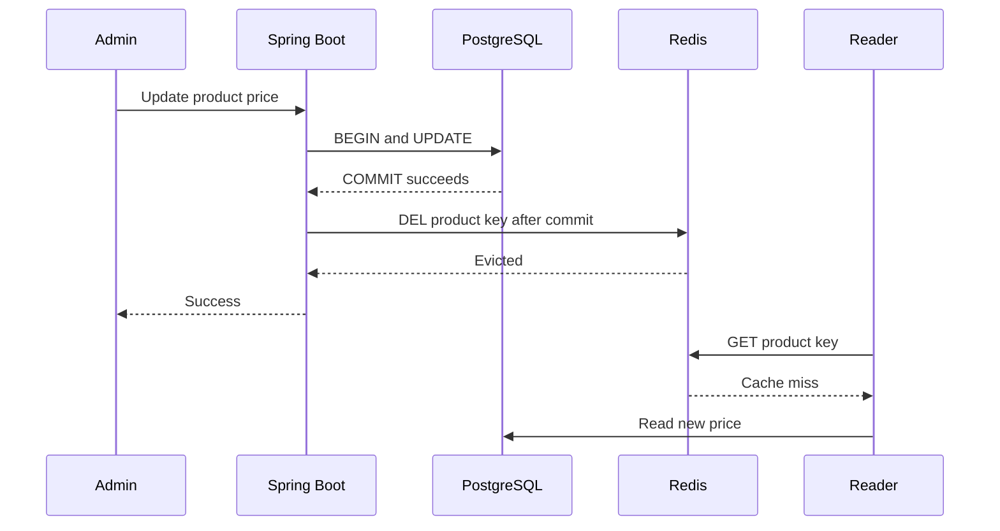

# Week 4 · Day 4 — Cache Invalidation, Consistency, and Stale Data

**Course:** System Design and Backend Engineering · **Topic:** Caching & Performance Optimization

## Learning objectives
Explain caching behavior from first principles, design correct cache keys and TTL/invalidation strategy, implement Spring Boot/Redis patterns responsibly, and prepare for production failures and interviews.

## Detailed study notes
### 1. Why invalidation is difficult

A database can be correct while a cache still returns a previous version. In a product catalog, a price edit can commit to PostgreSQL while Redis still holds the old product DTO. A cache is correct only relative to the **required freshness model**: catalog descriptions might tolerate brief staleness, but authorization state, stock reservation and payment confirmation may not. Define the correctness requirement before choosing an invalidation strategy.

### 2. TTL versus explicit invalidation

TTL deletes/invalidates old entries eventually (expiration behavior is not a real-time callback guarantee). A short TTL limits stale duration from the last write but increases misses and DB load. Explicit invalidation after writes can reduce staleness but introduces a failure window if DB commit succeeds and cache deletion fails. For hard freshness requirements, use the authoritative DB or a protocol enforcing version/ordering.

### 3. DB-first versus cache-first ordering

**Delete cache then commit DB:** a concurrent reader can miss, read the old DB value, and refill stale cache before the transaction commits. **Commit DB then delete cache:** a reader can fetch old data just before the commit and refill between commit and deletion. Both have races. An AFTER_COMMIT listener helps order work correctly but doesn't make the DB+Redis update atomic.

### 4. Double deletion and versioned values

A delayed second eviction can reduce some stale-fill windows, but is timing-sensitive and not a strict consistency guarantee. Versioning cached values, including a monotonic revision or updated timestamp in both authoritative state and cache payload, can help reject outdated updates/refreshes when designed correctly. A versioned key namespace is useful for schema rollout, not by itself a substitute for write-invalidation correctness.

### 5. Cache coherence across API replicas

Each Spring Boot instance may have an in-process Caffeine cache. Updating the DB on instance A doesn't automatically evict instance B's local cache. Solutions: shared Redis cache, pub/sub invalidation notifications (with loss-handling/TTL), time-limited local caches, or no local caching for sensitive data. Redis shared state makes invalidation easier but does not eliminate races.

### 6. Event-driven invalidation

A product-update event can instruct consumers to evict caches. With Kafka/CDC or a transactional outbox, event publication is more reliable relative to DB writes; propagation is still asynchronous. Consumers should handle duplicates and ordering, and a delayed event can evict a newly populated value. Correctness policies must explicitly allow lag or gate reads on version.

### 7. Negative caching and soft deletion

Caching a 404 briefly can protect DBs from repeated nonexistent-key queries, but creation soon afterward may be hidden until expiry. Deleted users/products may remain accessible if cached responses aren't invalidated; hard deletion, GDPR/privacy needs and permission changes require robust policies. Do not cache authorization results across users without context-aware keys and invalidation.

### 8. Failure-mode testing

Test write/read races, cache delete failures, Redis restarts, missed invalidation events and clock/TTL mismatches. Instrument cache age/version, stale result rate, DB fallback and key eviction. State explicitly which guarantees apply: eventual consistency is not necessarily suitable for inventory reservation or payment.

## Architecture / sequence diagram


**What to explain:** Which component is authoritative? Where is data temporarily cached? What fails when the network, cache, or database is unavailable? What level of consistency is promised?

## Practical Java / Spring example
```java
// Spring Data/Spring transaction conceptual pattern
@Transactional
public void updateProduct(long id, BigDecimal nextPrice) {
    Product p = repository.findById(id)
        .orElseThrow(ProductNotFoundException::new);
    p.setPrice(nextPrice);
    repository.save(p);
    events.publishEvent(new ProductChanged(id));
}

@TransactionalEventListener(phase = TransactionPhase.AFTER_COMMIT)
public void invalidate(ProductChanged event) {
    cacheManager.getCache("products").evict(event.productId());
}
// Caveat: Redis failure AFTER DB COMMIT may leave stale values.
// Use TTL and a durable retry/outbox if your freshness target needs it.
```

The snippet is an **educational example**, not verified production code. Integrate compatible dependencies, imports, service wiring and error handling, then implement automated tests before using it.

## Hands-on assignment
Build product editing with DB-first commit and after-commit eviction; demonstrate stale reads by intentionally skipping one eviction. Record and test at least two race-condition interleavings. Define policy for price/stock differences and include a fallback when Redis is unavailable.

### Definition of done
- [ ] Document the access pattern and non-functional requirements
- [ ] Explain the data correctness and staleness requirements
- [ ] Include a diagram and analyze two failure cases
- [ ] Provide a realistic verification/benchmark procedure
- [ ] Compare at least one alternative approach

## Interview questions
1. Why is cache invalidation hard?
2. Does evicting after DB commit guarantee strong consistency?
3. What can go wrong with double-delete?
4. What is negative caching and where does it hurt?
5. How would you invalidate per-instance local caches?

## Interview follow-up exercises
1. Explain your design to an interviewer in under five minutes.
2. Predict what changes under a traffic spike.
3. Describe a Redis outage and how to prevent database overload.
4. Explain a read/write cache consistency race.
5. Distinguish theoretical performance estimates from measured results.

## Revision checklist
- [ ] Definitions
- [ ] Architecture
- [ ] Implementation / SQL
- [ ] Performance and failure analysis
- [ ] Interview answers
- [ ] Assignment finished

**Next:** Week 4 Day 5.
