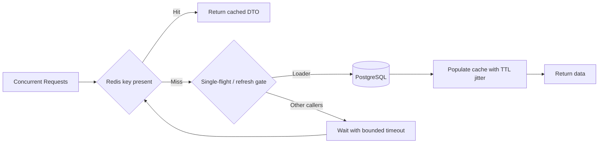

# Week 4 · Day 5 — Cache Stampede, Penetration, Hot Keys, and Eviction Policies

**Course:** System Design and Backend Engineering · **Topic:** Caching & Performance Optimization

## Learning objectives
Explain caching behavior from first principles, design correct cache keys and TTL/invalidation strategy, implement Spring Boot/Redis patterns responsibly, and prepare for production failures and interviews.

## Detailed study notes
### 1. Cache stampede (thundering herd)

When a popular key expires, many concurrent requests miss together and fetch the same record from PostgreSQL. One expired product entry under a flash sale can become thousands of identical DB queries. Solutions include **single-flight** deduplication in-process, a shared refresh lock with clear ownership/failure policy, randomized TTLs, proactive refresh, and serving bounded stale data when permitted.

### 2. TTL jitter

If 10,000 items are written simultaneously with an identical TTL, many may expire simultaneously. Jitter spreads expirations. Example: base 300 seconds + random 0–60 seconds per key. Jitter reduces synchronized misses but does not protect the single hottest key from stampede. Never add unbounded randomness that violates explicit business expiry.

### 3. Cache penetration

Requests target **keys that do not exist**, so every lookup misses and hits DB. A short negative-cache entry for not-found results can help; validate keys and rate-limit abusive clients; use a Bloom filter only if its false-positive properties and update/delete handling fit the workload. Don't turn temporary misses into permanent 404s when new objects may appear.

### 4. Cache avalanche

Many keys expire together, or Redis becomes unavailable, creating a broad DB traffic surge. Use expiry jitter, capacity headroom, circuit breaking/load shedding and graceful degradation. A circuit breaker that simply routes every cache failure to a weak DB can make the incident worse, so bound fallback concurrency.

### 5. Hot keys

A single celebrity profile or flash-sale SKU may receive huge read traffic even with a high overall cache hit rate. Redis server/partition capacity can bottleneck on one key. Consider short-lived local caching, request coalescing, CDN for public immutable content, data replication or specialized fan-out; but remember per-node caches introduce coherence challenges.

### 6. Eviction versus expiry

TTL decides how long a key should live. **Eviction** removes data because memory policy/pressure requires it. Redis maxmemory policy options include noeviction, allkeys-lru and allkeys-lfu; behavior depends on version/configuration, so verify. LRU prefers recently used keys; LFU favors frequently used ones. Evictions increase misses and can compromise workloads assuming cache residency.

### 7. Single-flight and locking caveats

A local synchronized loader only deduplicates calls within one JVM; ten app replicas can still all refresh. Redis SET NX EX is an atomic lease acquisition primitive, not a complete distributed lock correctness protocol. Avoid a lock whose holder can expire and still write stale data. Include ownership token, bounded wait/fallback and fencing/version strategy if business correctness depends on the lock.

### 8. Capacity planning and observation

Track hot-key distributions, memory usage, eviction count, keyspace misses, command latency and DB queries triggered by misses. Load-test cold start and Redis outage separately from warmed steady state. Tune DB pool, per-key concurrency and request limits; do not optimize solely for average latency.

## Architecture / sequence diagram


**What to explain:** Which component is authoritative? Where is data temporarily cached? What fails when the network, cache, or database is unavailable? What level of consistency is promised?

## Practical Java / Spring example
```java
// Illustration: one JVM's in-flight request coalescing.
// For multiple replicas, additional global coordination or a
// deliberately stale-tolerant design may be needed.
ConcurrentMap<String, CompletableFuture<ProductDto>> inFlight =
    new ConcurrentHashMap<>();

CompletableFuture<ProductDto> loadOnce(String key) {
    return inFlight.computeIfAbsent(key, k ->
        CompletableFuture.supplyAsync(() -> loadAndCache(k))
            .whenComplete((value, failure) -> inFlight.remove(k)));
}
// In production: bound executor/thread use, waits and exception handling.
// Avoid uncontrolled common-pool task creation under overload.
```

The snippet is an **educational example**, not verified production code. Integrate compatible dependencies, imports, service wiring and error handling, then implement automated tests before using it.

## Hands-on assignment
Simulate 100 simultaneous reads of an uncached product and measure DB query count. Add coalescing or TTL jitter and compare. Simulate requests for 1,000 nonexistent codes, define a safe short negative TTL, and test Redis unavailable under load.

### Definition of done
- [ ] Document the access pattern and non-functional requirements
- [ ] Explain the data correctness and staleness requirements
- [ ] Include a diagram and analyze two failure cases
- [ ] Provide a realistic verification/benchmark procedure
- [ ] Compare at least one alternative approach

## Interview questions
1. Cache stampede versus avalanche?
2. What does cache penetration mean?
3. When does TTL jitter help?
4. LRU versus LFU?
5. Why is a simple Redis lease not a complete correctness lock?

## Interview follow-up exercises
1. Explain your design to an interviewer in under five minutes.
2. Predict what changes under a traffic spike.
3. Describe a Redis outage and how to prevent database overload.
4. Explain a read/write cache consistency race.
5. Distinguish theoretical performance estimates from measured results.

## Revision checklist
- [ ] Definitions
- [ ] Architecture
- [ ] Implementation / SQL
- [ ] Performance and failure analysis
- [ ] Interview answers
- [ ] Assignment finished

**Next:** Week 4 Day 6.
