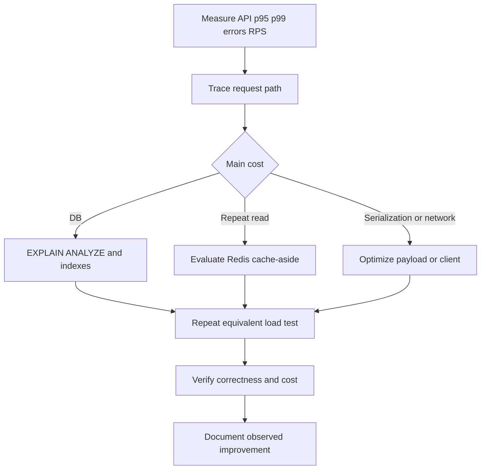

# Week 4 · Day 6 — Performance Optimization, Benchmarking, and Observability

**Course:** System Design and Backend Engineering · **Topic:** Caching & Performance Optimization

## Learning objectives
Explain caching behavior from first principles, design correct cache keys and TTL/invalidation strategy, implement Spring Boot/Redis patterns responsibly, and prepare for production failures and interviews.

## Detailed study notes
### 1. Define a performance budget

An API SLO should specify percentile, workload, error conditions, and measurement boundary. For example: hypothetical p95 below 200 ms at 500 RPS with a representative product dataset, excluding client network. Performance is not just latency: throughput, cost per request, resource saturation and correctness also matter. Averages hide slow tails and traffic-skewed cache misses.

### 2. Measure the full request path

Separate edge/proxy time, Spring controller and service processing, Redis round-trip, PostgreSQL query time, pool wait, serializer overhead and outbound calls. Micrometer timers and OpenTelemetry traces can help find the real bottleneck. A high Redis hit ratio is not useful if JSON serialization or lock contention dominates endpoint time.

### 3. Benchmark methodology

Use k6/JMeter/Gatling or an equivalent load tool. Fix hardware, dataset size, JVM flags, concurrency, request mix, warmup, test duration and cache state. Run baseline, then one controlled change. Record p50, p95, p99, error rate, RPS, CPU/heap/GC, DB connection wait and cache hit/miss. Repeat tests to detect noise rather than declaring victory after one run.

### 4. Cold versus warm cache

A warm Redis cache may make read requests fast but hide cold-start behavior and Redis restart risk. Test: cold miss workload, warmed read-heavy workload, 10% writes with invalidations, and Redis outage. Benchmark with realistic key popularity (Zipf-like hot products versus uniformly random keys). Random lookups may make caching ineffective even if the production workload has hot keys.

### 5. Database optimization before cache

Measure queries using PostgreSQL EXPLAIN ANALYZE, indexes, slow logs and JPA query counts. Fix N+1 ORM queries, missing selective indexes, overly broad SELECTs and long transactions. Adding Redis on top of bad query patterns can hide problems temporarily but make miss storms more damaging.

### 6. Caching and Spring observability

Spring Boot Actuator/Micrometer can expose HTTP request timers and cache metrics depending on enabled binders/cache provider. Prometheus can scrape metrics, Grafana can visualize them. Instrument cache miss rate, hits, evictions, Redis latency, PostgreSQL query volume and error/fallback counts with care not to label metrics by unbounded user IDs or raw cache keys (high-cardinality blowup).

### 7. Avoid unsafe optimization

Caching PII or authorization responses needs careful keys and invalidation. Never bypass primary-store stock checks for a few milliseconds. Validate stale-data tolerance explicitly. If the database outage triggers Redis fallback behavior, cap retries and requests to avoid cascading failures. Optimize useful outcomes, not benchmark score alone.

### 8. Practical tuning checklist

Sequence: define requirements → collect baseline and traces → identify top bottleneck → hypothesize fix → run controlled test → compare p95/p99/errors and resource use → review consistency/cost → document decision. Candidate changes: PostgreSQL index, DTO projection, N+1 fix, connection pooling, cache-aside, TTL tuning, compression or HTTP/CDN caching, async side effects.

## Architecture / sequence diagram


**What to explain:** Which component is authoritative? Where is data temporarily cached? What fails when the network, cache, or database is unavailable? What level of consistency is promised?

## Practical Java / Spring example
```java
// Conceptual Java timer using Micrometer
@Service
class CatalogService {
    private final MeterRegistry registry;
    CatalogService(MeterRegistry registry) { this.registry = registry; }

    ProductDto getMeasured(long id) {
        return registry.timer("catalog.product.lookup")
            .record(() -> getProduct(id));
    }

    ProductDto getProduct(long id) {
        // Query cache/DB using established correctness policy.
        throw new UnsupportedOperationException("Implement the service");
    }
}
// Avoid per-ID metric labels; add appropriate Actuator and registry config.
```

The snippet is an **educational example**, not verified production code. Integrate compatible dependencies, imports, service wiring and error handling, then implement automated tests before using it.

## Hands-on assignment
Create a repeatable load-test plan for GET /api/products/{id}. Compare uncached, cold cache, warm cache, 10% writes, and Redis-outage scenarios. Produce a benchmark table with measured numbers only, screenshots/commands and a paragraph explaining surprising results.

### Definition of done
- [ ] Document the access pattern and non-functional requirements
- [ ] Explain the data correctness and staleness requirements
- [ ] Include a diagram and analyze two failure cases
- [ ] Provide a realistic verification/benchmark procedure
- [ ] Compare at least one alternative approach

## Interview questions
1. Why measure p99 instead of only mean?
2. How can a 99% cache hit rate hide poor performance?
3. Why warm up the JVM?
4. What metrics reveal database saturation?
5. When is optimization not worth the operational complexity?

## Interview follow-up exercises
1. Explain your design to an interviewer in under five minutes.
2. Predict what changes under a traffic spike.
3. Describe a Redis outage and how to prevent database overload.
4. Explain a read/write cache consistency race.
5. Distinguish theoretical performance estimates from measured results.

## Revision checklist
- [ ] Definitions
- [ ] Architecture
- [ ] Implementation / SQL
- [ ] Performance and failure analysis
- [ ] Interview answers
- [ ] Assignment finished

**Next:** Week 4 Day 7.
