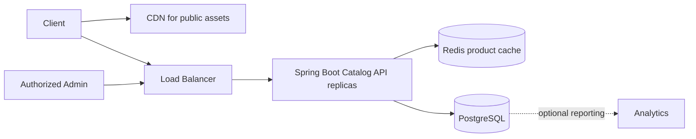

# Week 4 · Day 7 — Week 4 Revision, Redis Product Catalog Design, and Mock Interview

**Course:** System Design and Backend Engineering · **Topic:** Caching & Performance Optimization

## Learning objectives
Explain caching behavior from first principles, design correct cache keys and TTL/invalidation strategy, implement Spring Boot/Redis patterns responsibly, and prepare for production failures and interviews.

## Detailed study notes
### 1. Core concept revision

Revisit Day 1 caching purpose/metrics, Day 2 cache patterns, Day 3 Redis and Spring integration, Day 4 invalidation and coherence, Day 5 stampede/penetration/avalanche/hot keys, and Day 6 performance measurement. Explain each pattern without memorized slogans: draw the read/write paths, identify source of truth and define what breaks.

### 2. Mock design problem

Design a product catalog that serves frequent public product reads and allows authenticated admins to change product metadata/prices. Assume 2M DAU and 20 reads per DAU per day; explicitly calculate average RPS = 40M / 86,400 ≈ 463, plus a peak multiplier. Product price changes require defined freshness; checkout stock reservation must remain authoritative in transactional inventory storage.

### 3. Architecture and cache strategy

Proposed: CDN for public images; load balancer; stateless Spring Boot catalog API replicas; Redis for frequently accessed product DTOs; PostgreSQL as authoritative data store. Cache-aside for reads, DB-first commits with after-commit eviction plus TTL for writes. The design does not guarantee zero stale reads; discuss eventual freshness and remedies if the business requires stricter correctness.

### 4. Key schema and TTL

Use versioned keys such as 'catalog:product:v1:42'; choose TTL from allowed staleness and miss/eviction measurements, not habit. Partition cache keys by tenant/locale when representations differ. Avoid caching permission-sensitive data across users. Consider negative caching for unknown IDs with short TTL to reduce penetration while accounting for newly created products.

### 5. Fault injection plan

Simulate Redis process down, many simultaneous misses for one hot key, PostgreSQL slow queries, invalidation failure, cache key eviction, and a delayed product-update event. Decide expected HTTP status, safe fallback, user impact and alerting; never silently return wrong checkout availability.

### 6. Quantitative performance walkthrough

Compare a hypothetical cache hit of 3 ms and miss of 60 ms at 95% hit rate: mean cache-lookup-dependent cost ≈ 0.95×3 + 0.05×60 = 5.85 ms. This is not p95/p99, and it excludes application/edge costs. Track observed latency distributions and DB load under real request mixes. Benchmark before/after with the same dataset, hardware, time window and concurrency.

### 7. Mini project implementation roadmap

Create product table and GET/POST/PATCH endpoints (admin-only writes). Implement Redis cache with defined serializer and TTL. Add invalidation after successful DB commit. Write tests for cold vs warm read, DB updates, expiry, Redis unavailable, invalid input and authorization. Add Docker Compose and docs explaining measurement approach; do not claim implemented features unless the code/tests exist.

### 8. Mock interview answer rubric

Score requirements and assumptions (4), API/data correctness (4), cache pattern/freshness (4), failure handling (4), performance measurement (4): 20 total. Interview time: 5 minutes questions, 8 architecture, 10 detailed read/write flows, 7 performance, 5 failures, 5 trade-offs. A strong answer explains both where Redis helps and when not to use it.

## Architecture / sequence diagram


**What to explain:** Which component is authoritative? Where is data temporarily cached? What fails when the network, cache, or database is unavailable? What level of consistency is promised?

## Practical Java / Spring example
```java
// Interview pseudo-interface (not a complete implementation)
public interface CatalogService {
    ProductDto findById(long id);
    ProductDto updateProduct(long id, UpdateProductRequest request);
}
// get: cache-aside Redis -> PostgreSQL -> cache.
// update: authorized DB transaction -> after-commit eviction.
// checkout stock: authoritative inventory reservation, never only cache.
```

The snippet is an **educational example**, not verified production code. Integrate compatible dependencies, imports, service wiring and error handling, then implement automated tests before using it.

## Hands-on assignment
Run a full mock interview designing the Redis-backed product catalog. Deliver functional/non-functional requirements, realistic load estimate, HLD diagram, API/data model, cache keys/TTL, two write/read race timelines, Redis outage response, stampede protection plan, monitoring metrics and a test checklist.

### Definition of done
- [ ] Document the access pattern and non-functional requirements
- [ ] Explain the data correctness and staleness requirements
- [ ] Include a diagram and analyze two failure cases
- [ ] Provide a realistic verification/benchmark procedure
- [ ] Compare at least one alternative approach

## Interview questions
1. When should caching be avoided?
2. What is the most dangerous race in cache-aside?
3. How would you investigate a Redis hit-rate drop?
4. How do hot keys affect a clustered cache?
5. What must the checkout path do to guarantee inventory correctness?

## Interview follow-up exercises
1. Explain your design to an interviewer in under five minutes.
2. Predict what changes under a traffic spike.
3. Describe a Redis outage and how to prevent database overload.
4. Explain a read/write cache consistency race.
5. Distinguish theoretical performance estimates from measured results.

## Revision checklist
- [ ] Definitions
- [ ] Architecture
- [ ] Implementation / SQL
- [ ] Performance and failure analysis
- [ ] Interview answers
- [ ] Assignment finished

**Next:** Week 5 — Distributed Systems Fundamentals.
