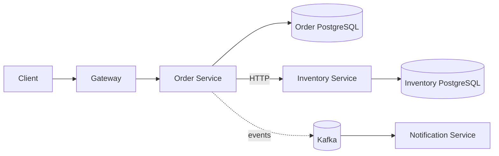

# Week 5 · Day 1 — Distributed Systems Fundamentals

**Detailed backend engineering notes** · Java 21 / Spring Boot / PostgreSQL / Kafka

## Learning objectives
Understand these concepts from first principles, defend the trade-offs, implement appropriate protections, and diagnose failures in a real order processing system.

## Concepts explained
### 1. What is a distributed system?

A distributed system is a set of autonomous computers or processes communicating through networks to accomplish a shared task. Each process owns CPU, memory and failure state. Remote service calls are not equivalent to local Java method calls: they can be slow, delayed, lost or duplicated. A caller can remain healthy while a dependency fails; this is a partial failure.

### 2. Why build distributed systems?

Scaling workload, isolation of failures and teams, independent deployments, geographic presence, and specialized storage can justify distribution. Costs include network latency, security, clock differences, replication conflicts, consistency and observability. Start with a modular monolith unless requirements justify complexity.

### 3. Fault types

Crash-stop: node fails and stays down; crash-recovery: it restarts with volatile state lost; omission: message never arrives; timing: request arrives too slowly; network partition: groups cannot communicate. A timeout is *ambiguous*: the remote operation may have committed but its response was lost.

### 4. Clocks and ordering

Wall-clock timestamps from independent nodes can drift and do not define a definitive causal order. Lamport logical clocks order causally related events but do not measure real elapsed time. For business ordering use database versions, sequence numbers and explicit event ordering as needed.

### 5. Request-chain reliability

An Order API calling Inventory then Payments adds network hops and latency. Each dependency introduces timeout and failure handling. Parallel fan-out can reduce critical-path time but increases load and complexity. Instrument p95/p99, downstream timing and error rates.

### 6. State ownership

A service-owned database can provide atomic local transactions, but two independent databases and a broker do not automatically share an ACID transaction. Use explicit business states, idempotent operations, transactional outbox or a compensating workflow.

### 7. Debugging distributed failures

Trace IDs, structured logs, metrics and dependency-health signals help follow one request. Test network cuts, slow downstreams, DB restarts and duplicate messages. Verify user-visible outcome and data correctness rather than only process liveness.

## Mermaid architecture / sequence diagram


Describe each arrow, the owner of authoritative state, the network boundary, and how failure changes the result.

## Java / Spring Boot sketch
```java
public OrderResult submit(CreateOrder request, String idempotencyKey) {
    // Validate intent; atomically store unique request ID + order.
    // A downstream timeout does not prove the request failed.
    // Reconcile ambiguous outcomes and return PENDING when needed.
    throw new UnsupportedOperationException("Implement workflow");
}
```

*Educational design sketch, not a tested implementation: complete imports, configuration, error handling, service logic and unit/integration tests before production.*

## Hands-on exercise
Sketch an Order–Inventory–Payment diagram. Identify eight potential partial failures. For each state whether the operation may already have happened, the API response, the durable record and how recovery proceeds.

### Acceptance criteria
- [ ] The required business invariant is explicit.
- [ ] At least two timeouts/partial failures are analyzed.
- [ ] Duplicate requests or events are handled appropriately.
- [ ] The architecture diagram matches the flow.
- [ ] Verification includes repeatable tests or fault injection.

## System design interview questions
1. Why is a remote call harder than a local method call?
2. What does partial failure mean?
3. Can a timeout establish that a payment was not charged?
4. How do clocks affect event ordering?
5. What should you instrument for a distributed request?

## Five-question knowledge check
1. What property does this approach guarantee, and under what assumptions?
2. What new latency or availability cost does it introduce?
3. What happens when the response is lost after success?
4. How would you observe the failure in logs/metrics/traces?
5. When is a simpler monolithic approach enough?

## Revision checklist
- [ ] Concepts understood
- [ ] Diagram redrawn
- [ ] Exercise attempted
- [ ] Interview questions answered
- [ ] Failure cases documented
