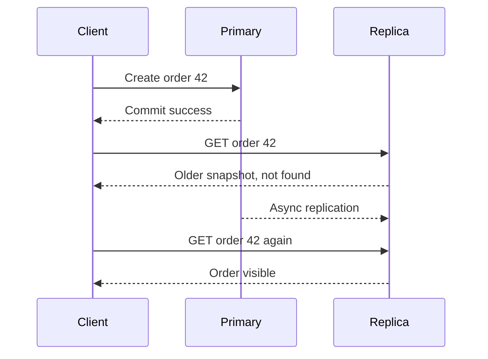

# Week 5 · Day 2 — Consistency Models and the CAP Theorem

**Detailed backend engineering notes** · Java 21 / Spring Boot / PostgreSQL / Kafka

## Learning objectives
Understand these concepts from first principles, defend the trade-offs, implement appropriate protections, and diagnose failures in a real order processing system.

## Concepts explained
### 1. Consistency models

Linearizability makes each operation appear atomic at one instant between start and finish while respecting real-time order. Sequential consistency provides one order preserving process program order, but not necessarily real time. Eventual consistency means replicas converge if writes stop and updates are delivered. Explain what users can actually observe rather than using labels without contracts.

### 2. Session guarantees

Read-your-writes ensures a client sees a just-completed write. Monotonic reads avoid a client observing older values after newer ones. Causal consistency respects dependencies between writes. Choose per business flow: orders need fresh confirmation; click analytics may lag.

### 3. CAP theorem precisely

Under a network partition, a replicated data service cannot guarantee both linearizable consistency and that every request to a nonfailed node eventually succeeds. CP designs may reject/block some requests to prevent conflicting state. AP approaches remain responsive with weaker consistency and require reconciliation. CAP availability is not the same as an uptime SLA.

### 4. PACELC and healthy networks

CAP focuses on partitions. PACELC additionally asks what latency-versus-consistency trade-offs exist when the network is not partitioned. Cross-region coordination can increase latency; serving a local replica may be fast but stale.

### 5. Replica lag

With asynchronous PostgreSQL replication, primary commit can precede replica replay. Reading from that replica just after creating an order may return no row. Read from primary or use a supported session/replication-position consistency mechanism when freshness is required.

### 6. Multi-writer conflicts

Last-write-wins can silently lose an update. Version vectors can recognize some concurrent histories. CRDTs can converge for appropriate operations, but are not a magic solution for inventory invariants, transfers or unique aliases.

### 7. Testing consistency

Simulate delayed replication and partitions. Verify whether create-then-read succeeds from the selected read path, whether contradictory writes are allowed, and whether reconciliation can recover without corrupting business invariants.

## Mermaid architecture / sequence diagram


Describe each arrow, the owner of authoritative state, the network boundary, and how failure changes the result.

## Java / Spring Boot sketch
```java
@Transactional(readOnly = true)
public OrderDto findFreshOrder(long id) {
    // Configure a primary data-source routing policy explicitly.
    // @Transactional(readOnly=true) alone does NOT guarantee it.
    return primaryOrderRepository.findById(id)
        .map(mapper::toDto)
        .orElseThrow(OrderNotFoundException::new);
}
```

*Educational design sketch, not a tested implementation: complete imports, configuration, error handling, service logic and unit/integration tests before production.*

## Hands-on exercise
Create a matrix for order confirmation, inventory reservation, analytics and notifications: required consistency, stale-read tolerance and consequence of violating it. Illustrate CAP behavior under a two-region network partition.

### Acceptance criteria
- [ ] The required business invariant is explicit.
- [ ] At least two timeouts/partial failures are analyzed.
- [ ] Duplicate requests or events are handled appropriately.
- [ ] The architecture diagram matches the flow.
- [ ] Verification includes repeatable tests or fault injection.

## System design interview questions
1. What is the exact premise of CAP?
2. How does linearizability differ from eventual consistency?
3. What is read-your-writes?
4. Can a healthy read replica return 404 after a successful create?
5. Why is last-write-wins unsuitable for some financial or inventory flows?

## Five-question knowledge check
1. What property does this approach guarantee, and under what assumptions?
2. What new latency or availability cost does it introduce?
3. What happens when the response is lost after success?
4. How would you observe the failure in logs/metrics/traces?
5. When is a simpler monolithic approach enough?

## Revision checklist
- [ ] Concepts understood
- [ ] Diagram redrawn
- [ ] Exercise attempted
- [ ] Interview questions answered
- [ ] Failure cases documented
