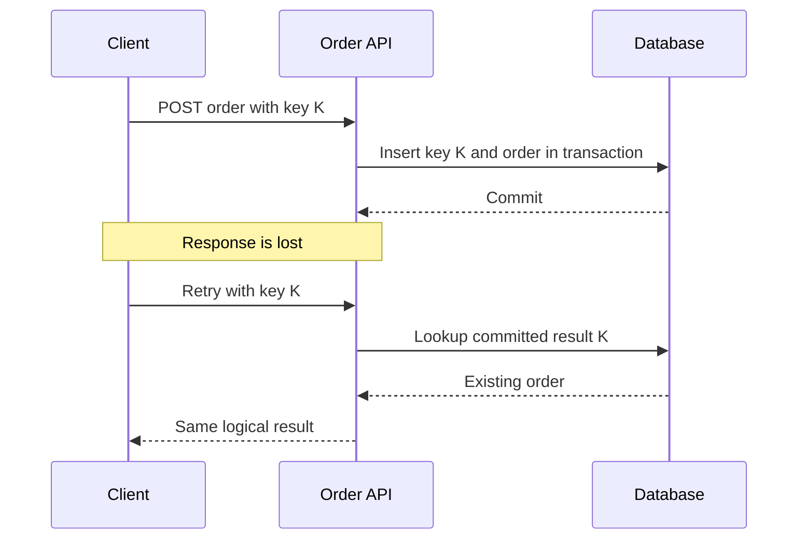

# Week 5 · Day 3 — Timeouts, Retries, Backoff and Idempotency

**Detailed backend engineering notes** · Java 21 / Spring Boot / PostgreSQL / Kafka

## Learning objectives
Understand these concepts from first principles, defend the trade-offs, implement appropriate protections, and diagnose failures in a real order processing system.

## Concepts explained
### 1. Timeout budgets

Set bounded connection time, response/read time and overall request deadline. A caller with a two-second deadline should not issue three separate five-second retries. Propagate remaining budgets to dependencies and avoid tying up threads/connections waiting forever.

### 2. Retry classifications

Transient connection failures and some 503/429 conditions may warrant retries. Invalid input, insufficient stock and authorization failures are not helped by retrying. A timed-out POST might have committed remotely. Retries for writes must preserve business correctness.

### 3. Exponential backoff and jitter

A backoff can use min(cap, base*2^attempt) plus random jitter. Jitter prevents synchronized clients from retrying simultaneously. Respect Retry-After where applicable. Apply total time/attempt budgets, concurrency caps and monitoring.

### 4. Retry amplification

If API retries Inventory three times and Inventory retries DB three times, one user action could cause nine downstream attempts. Retrying on multiple layers during overload can turn a localized failure into a cascading outage. Assign a clear retry owner.

### 5. Business idempotency

An idempotency key identifies one logical command, not one HTTP transmission. Store key, request fingerprint, outcome and durable status atomically under a unique constraint. Same key/same payload returns the previous outcome; same key/different payload should be rejected. A GET is HTTP-idempotent by intention; POST needs explicit handling.

### 6. Ambiguous outcomes

When a server commits an order but its response is lost, the client cannot infer the outcome from a timeout. A safe retry checks durable idempotency state rather than blindly creating a second order or payment. Persist pending work and reconcile partial outcomes.

### 7. Exactly-once caveat

Kafka transactions can coordinate some Kafka operations, not arbitrary databases, payment gateways and HTTP calls end-to-end. Aim for exactly-once business *effects* through idempotent consumers, durable state, uniqueness and reconciliation.

### 8. Testing

Send identical requests concurrently; drop a successful response; retry after process restart; reuse a key with a different payload. Count physical orders, reservations and charges. Assert one logical effect, bounded attempts and stable API responses.

## Mermaid architecture / sequence diagram


Describe each arrow, the owner of authoritative state, the network boundary, and how failure changes the result.

## Java / Spring Boot sketch
```java
@PostMapping("/api/orders")
public ResponseEntity<OrderDto> create(
        @RequestHeader("Idempotency-Key") String key,
        @RequestBody @Valid CreateOrder request) {
    return ResponseEntity.ok(orderService.createOrGet(key, request));
}
// Enforce a unique key + request fingerprint in PostgreSQL.
// Controller alone does not make an operation idempotent.
```

*Educational design sketch, not a tested implementation: complete imports, configuration, error handling, service logic and unit/integration tests before production.*

## Hands-on exercise
Build an idempotent Order API and test duplicate concurrent POST, lost response, bad key reuse, and timeout. Show a 2-second request deadline tree and explain where retries are allowed.

### Acceptance criteria
- [ ] The required business invariant is explicit.
- [ ] At least two timeouts/partial failures are analyzed.
- [ ] Duplicate requests or events are handled appropriately.
- [ ] The architecture diagram matches the flow.
- [ ] Verification includes repeatable tests or fault injection.

## System design interview questions
1. Does a timeout prove a remote write failed?
2. Why use exponential backoff and jitter?
3. How do nested retries amplify load?
4. How do you enforce idempotency against concurrent requests?
5. What limitations apply to Kafka exactly-once claims?

## Five-question knowledge check
1. What property does this approach guarantee, and under what assumptions?
2. What new latency or availability cost does it introduce?
3. What happens when the response is lost after success?
4. How would you observe the failure in logs/metrics/traces?
5. When is a simpler monolithic approach enough?

## Revision checklist
- [ ] Concepts understood
- [ ] Diagram redrawn
- [ ] Exercise attempted
- [ ] Interview questions answered
- [ ] Failure cases documented
