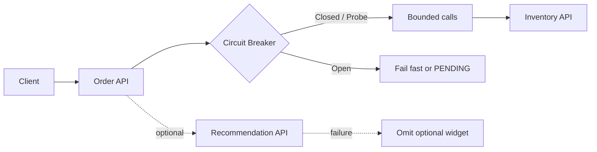

# Week 5 · Day 4 — Circuit Breakers, Bulkheads, Rate Limiting and Graceful Degradation

**System Design and Backend Engineering:** Distributed Systems Fundamentals · Java / Spring Boot / PostgreSQL / Kafka

## Learning objectives
Explain this subject at beginner and interview depth, identify business invariants, and design safe handling for failure, duplication, timeouts and overload.

## Detailed study notes
### 1. Cascading failures

When a dependency slows, upstream requests accumulate, exhausting worker threads, HTTP connections and memory. Timeouts limit individual waits, but too many calls may still saturate a service. Capacity protection needs concurrency limits, queues, rate limiting and load shedding, not just retry logic.

### 2. Circuit breaker

A breaker is CLOSED when requests pass; after a configured failure/slow-call threshold it transitions OPEN and fails requests fast. After a wait, HALF_OPEN allows limited probes; successes close it, failures reopen it. It does not repair the failing service; it protects callers and enables recovery. Configure monitored failure types and minimum sample size to avoid noisy tripping.

### 3. Bulkheads

A bulkhead isolates capacity per dependency or traffic class: e.g. separate semaphores/thread pools for recommendation calls and core checkout. If recommendation slows, it should not consume every request thread. Semaphore-style concurrency limits and thread-pool isolation are different implementation choices; choose based on blocking vs nonblocking work.

### 4. Rate limiting

A token bucket allows a bounded burst plus sustained refill rate; a leaky bucket smooths traffic; fixed/sliding windows count requests within windows. Apply limits per user/API key/tenant and sometimes globally. A rate limit should return 429 with an appropriate response and optionally Retry-After. Fairness and key selection matter.

### 5. Load shedding and backpressure

When queues grow without bound, latency and memory explode. Reject/slow some new requests, cap in-flight tasks, and propagate demand limits. Backpressure must exist across an async pipeline too: a Kafka queue can buffer but cannot produce unlimited downstream capacity.

### 6. Graceful degradation

Nonessential personalized recommendations can be omitted or served from an explicitly marked stale cache when dependency fails. Do NOT fabricate payment success, stock availability or user permissions. Business-critical operations should return a truthful pending/error state rather than a misleading fallback.

### 7. Resilience4j integration

Spring Boot can use Resilience4j annotations or programmatic decorators for circuit breakers, retries, rate limiters, bulkheads. Verify configuration and Spring AOP proxy behavior. Coordinate retry counts and timeout budgets so breaker and retry policies do not work against each other.

### 8. Fault testing

Simulate 5xx, timeouts, slow calls and connection failures. Assert OPEN/HALF_OPEN/CLOSED behavior, fallback correctness, bounded active calls and recovery. Measure rejection rates and whether overall p99 and availability improve without hiding errors.

## Architecture or sequence diagram


Discuss each arrow, where a request may be lost or delayed, and which component owns the authoritative state.

## Java / Spring Boot design
```java
@CircuitBreaker(name = "inventory", fallbackMethod = "inventoryFallback")
public StockResponse check(String sku) {
    return inventoryClient.check(sku);
}
public StockResponse inventoryFallback(String sku, Throwable t) {
    // Never claim stock is available when the check failed.
    throw new InventoryTemporarilyUnavailableException(t);
}
// Configure sliding window, thresholds, minimum calls and fallback.
// Use correct Resilience4j / Spring Boot compatible versions.
```

**Note:** The code is an educational excerpt, not a complete compiled or tested application. Provide imports, compatible dependencies, configuration, persistence rules, service behavior and automated tests in a real implementation.

## Hands-on assignment
Implement a failing Inventory mock with Resilience4j, set a bounded timeout and breaker, demonstrate breaker opening and half-open probes. Add a separate recommendation dependency that degrades safely. Measure concurrency and p95/p99 with and without protection.

### Verification
- [ ] List business invariants and partial-failure cases
- [ ] Document maximum timeouts, retries and concurrency where relevant
- [ ] Explain how duplicate and reordered events are handled
- [ ] Describe a reproducible fault-injection or integration test
- [ ] Explain why the chosen trade-off fits the stated requirements

## Interview questions
1. Why is a circuit breaker different from a retry?
2. Describe CLOSED/OPEN/HALF_OPEN states.
3. How does a bulkhead limit blast radius?
4. What does a token-bucket rate limiter allow?
5. What is an unsafe fallback for an order system?

## Five-question self-check
1. What problem is this design solving?
2. What is the authoritative source of truth?
3. What happens when an operation succeeds but its response is lost?
4. How would you monitor the worst failure scenario?
5. What simpler design might be sufficient at lower scale?

## Completion checklist
- [ ] Notes understood
- [ ] Diagram reconstructed
- [ ] Assignment completed
- [ ] Interview questions answered
- [ ] Failure mitigation reviewed
