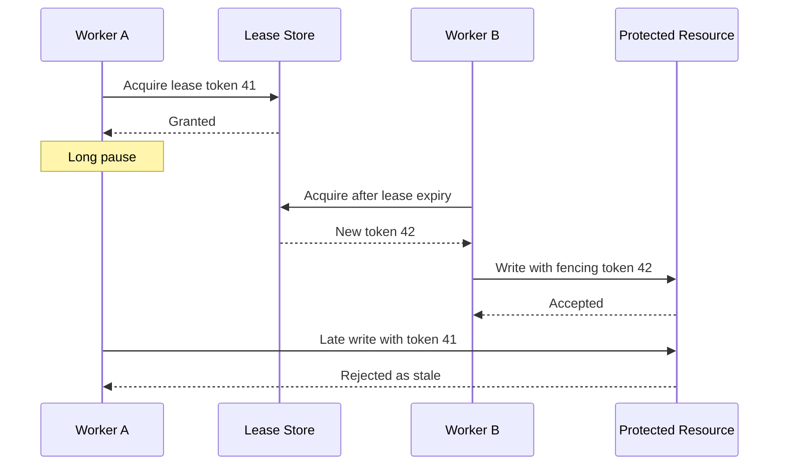

# Week 5 · Day 5 — Distributed Locks, Coordination and Consensus

**System Design and Backend Engineering:** Distributed Systems Fundamentals · Java / Spring Boot / PostgreSQL / Kafka

## Learning objectives
Explain this subject at beginner and interview depth, identify business invariants, and design safe handling for failure, duplication, timeouts and overload.

## Detailed study notes
### 1. Why coordination is necessary

Multiple service replicas may try to update shared state or perform the same scheduled task. Coordination defines who may perform a critical action and how ownership changes after failure. Sometimes the best design is to avoid a distributed lock entirely using a database unique constraint, atomic conditional UPDATE, or partition-owner model.

### 2. DB locks and leases

PostgreSQL row locks protect transactional updates inside a database; advisory locks can coordinate cooperating processes, but need careful connection/session lifetime policy. A distributed lease expires after a duration; if the lease holder is paused or partitioned and later resumes, it may still act after losing ownership.

### 3. Redis SET NX EX limitations

SET resource token NX EX seconds atomically acquires a lease when key absent. Release with a compare-token-and-delete atomic script rather than DEL by any client. This still does not guarantee correctness after pauses or partitions; expiry can allow concurrent actors. Use fencing tokens/version numbers at the *resource being protected* when stale owners could corrupt state.

### 4. Leader election

Leader election selects one coordinator among peers for a period. Kubernetes leases, ZooKeeper, etcd and Consul expose coordination mechanisms with specific semantics. A leader may crash or become partitioned; followers need a safe takeover policy. Leadership does not make data writes automatically idempotent.

### 5. Consensus fundamentals

Consensus algorithms such as Raft help replicas agree on ordered state changes despite failures under defined timing/quorum assumptions. A quorum is a majority or configured intersection requirement; losing quorum can prevent coordinated writes. Understand term/epoch, leader, replicated log and committed index at conceptual level before attempting implementation.

### 6. Split brain and fencing

Split brain occurs when two actors believe they are authoritative. Fencing uses increasing epochs/tokens so stale actors are rejected by the protected resource. Example: storage accepts write only if fencing number is at least the recorded latest token. A Redis lease alone with no fencing cannot prevent a paused stale client from writing after expiry.

### 7. Distributed scheduling

A periodic billing job deployed across five replicas must not execute five times. You could use a DB claim table with unique task key and transactional state transitions, a queue with idempotent consumer, or election/lease. Even elected workers can crash mid-job; checkpoint and idempotent outcomes still matter.

### 8. Interview trade-offs

Use a local DB transaction for single-DB invariants; choose a lease for coordination with tolerable duplicate attempts; consensus-backed tools for control-plane state requiring quorum semantics. Do not introduce etcd/ZooKeeper solely to reserve one product row.

## Architecture or sequence diagram


Discuss each arrow, where a request may be lost or delayed, and which component owns the authoritative state.

## Java / Spring Boot design
```java
// Use DB as authority where practical:
@Transactional
public boolean reserve(long productId, int qty) {
    int updated = inventoryRepository.decrementIfAvailable(productId, qty);
    return updated == 1;
}
// UPDATE inventory SET available = available - :qty
// WHERE id = :id AND available >= :qty
// A uniqueness/idempotency rule is also needed to avoid duplicate reserve.
```

**Note:** The code is an educational excerpt, not a complete compiled or tested application. Provide imports, compatible dependencies, configuration, persistence rules, service behavior and automated tests in a real implementation.

## Hands-on assignment
Compare three strategies for exactly one scheduled invoice job: a shared DB claim row, a Redis lease, and a consensus-backed leader. Draw the stale lease-holder timeline and explain fencing. Test two concurrent workers trying the last inventory unit.

### Verification
- [ ] List business invariants and partial-failure cases
- [ ] Document maximum timeouts, retries and concurrency where relevant
- [ ] Explain how duplicate and reordered events are handled
- [ ] Describe a reproducible fault-injection or integration test
- [ ] Explain why the chosen trade-off fits the stated requirements

## Interview questions
1. What does a lease guarantee, and what does it not?
2. Why must release verify ownership token?
3. What is a fencing token?
4. Explain quorum and leader election.
5. When can a database unique constraint replace a distributed lock?

## Five-question self-check
1. What problem is this design solving?
2. What is the authoritative source of truth?
3. What happens when an operation succeeds but its response is lost?
4. How would you monitor the worst failure scenario?
5. What simpler design might be sufficient at lower scale?

## Completion checklist
- [ ] Notes understood
- [ ] Diagram reconstructed
- [ ] Assignment completed
- [ ] Interview questions answered
- [ ] Failure mitigation reviewed
