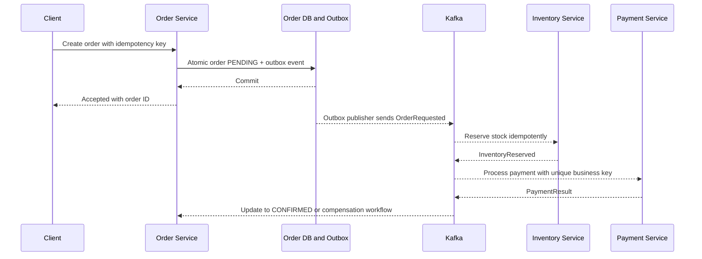

# Week 5 · Day 6 — Designing Reliable Distributed Workflows

**System Design and Backend Engineering:** Distributed Systems Fundamentals · Java / Spring Boot / PostgreSQL / Kafka

## Learning objectives
Explain this subject at beginner and interview depth, identify business invariants, and design safe handling for failure, duplication, timeouts and overload.

## Detailed study notes
### 1. Cross-service business process

An order can involve inventory reservation, payment authorization, shipment and notification. Since separate services have independent databases, the workflow needs explicit states and recovery, rather than treating the entire business process as one atomic database transaction.

### 2. Saga orchestration versus choreography

In orchestration, a coordinator directs steps and compensations, giving a central workflow view. In choreography, services react to domain events with less central coupling but can become difficult to trace as flows expand. Both need idempotency, timeouts, retries and handling for messages that arrive late or out of order.

### 3. Compensation semantics

A compensation is a new business action attempting to offset a completed step: refund authorized payment, release reserved stock. Compensation may fail; it is not a true database rollback of the past. Define retries, manual escalation and audit trails. Never delete evidence of earlier successful charges.

### 4. Transactional outbox

Within one PostgreSQL transaction, update order state and append a row to outbox_events. After commit, a background dispatcher or CDC process publishes to Kafka. This closes the 'DB commit succeeded but event publish failed' gap. Delivery may be duplicated, so consumers need stable event IDs and idempotent processing.

### 5. Inbox/idempotent consumer

Consumer transaction should check a processed-event key in a unique table or record business operation ID, apply side effect, and commit together where possible. Offset acknowledgment comes after successful durable processing. Offsets alone cannot guarantee exactly-once external effects.

### 6. Ordering and versioning

Events can arrive reordered across partitions, especially for different keys. Partition by business aggregate where useful and include event IDs, aggregate IDs, versions and schema versions. Consumers should reject stale versions or reconcile gaps. Define evolution and replay procedures.

### 7. Failures and reconciliation

Payment succeeded but network response lost: query provider by idempotency/payment ID, don't charge twice. Notification failed: retry with backoff or DLT and keep order confirmed. Inventory reserve failed: compensate/release or mark FAILED. Stuck PENDING states need scheduled reconciliation and operational dashboards.

### 8. Observability and testing

Trace an order across HTTP and Kafka using correlation IDs. Monitor pending-duration distributions, outbox lag, consumer lag, DLT count and compensation failures. Inject Kafka down, consumer crash after DB commit, duplicate events, delayed confirmations and payment timeout; verify no duplicate business charge and eventual terminal state.

## Architecture or sequence diagram


Discuss each arrow, where a request may be lost or delayed, and which component owns the authoritative state.

## Java / Spring Boot design
```java
@Transactional
public Order accept(CreateOrder cmd, String key) {
    Order order = orderRepository.save(newPendingOrder(cmd, key));
    outboxRepository.save(new OutboxEvent(
        UUID.randomUUID(), order.getId(), "OrderRequested"));
    return order;
}
// A dispatcher sends pending outbox rows to Kafka.
// Consumers deduplicate using stable event IDs.
// A payment processor must use its own idempotency contract.
```

**Note:** The code is an educational excerpt, not a complete compiled or tested application. Provide imports, compatible dependencies, configuration, persistence rules, service behavior and automated tests in a real implementation.

## Hands-on assignment
Design a Saga for Create Order → Reserve Inventory → Authorize Payment → Notify. Enumerate success, insufficient stock, payment timeout, duplicate Kafka message, failure to release stock, and delayed events. Include a recovery state diagram and reconciliation task.

### Verification
- [ ] List business invariants and partial-failure cases
- [ ] Document maximum timeouts, retries and concurrency where relevant
- [ ] Explain how duplicate and reordered events are handled
- [ ] Describe a reproducible fault-injection or integration test
- [ ] Explain why the chosen trade-off fits the stated requirements

## Interview questions
1. Why can't a DB transaction include a remote payment provider atomically?
2. What is the outbox guarantee and its limit?
3. Choreography vs orchestration?
4. Why are compensations not rollbacks?
5. How would you detect and repair stuck orders?

## Five-question self-check
1. What problem is this design solving?
2. What is the authoritative source of truth?
3. What happens when an operation succeeds but its response is lost?
4. How would you monitor the worst failure scenario?
5. What simpler design might be sufficient at lower scale?

## Completion checklist
- [ ] Notes understood
- [ ] Diagram reconstructed
- [ ] Assignment completed
- [ ] Interview questions answered
- [ ] Failure mitigation reviewed
