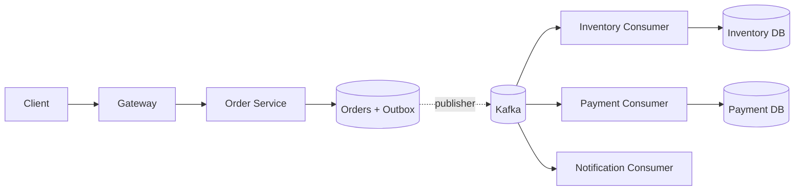

# Week 5 · Day 7 — Week 5 Revision and Reliable Order-System Mock Interview

**System Design and Backend Engineering:** Distributed Systems Fundamentals · Java / Spring Boot / PostgreSQL / Kafka

## Learning objectives
Explain this subject at beginner and interview depth, identify business invariants, and design safe handling for failure, duplication, timeouts and overload.

## Detailed study notes
### 1. Revision map

Review Day 1 network failure modes, Day 2 consistency/CAP, Day 3 retries and idempotency, Day 4 circuit breakers/bulkheads/rate limits, Day 5 coordination/consensus, and Day 6 Saga/outbox/compensations. Be able to explain each with one business invariant and one failure story.

### 2. Design problem

Design a reliable e-commerce order workflow with 10k concurrent checkout attempts at peak, payment timeout ambiguity, inventory reservation and customer notification. Assume requirements explicitly: no duplicate business charges per order intent, no overselling authoritative stock, recoverable pending orders, and appropriate latency/availability targets. These are hypothetical interview constraints.

### 3. Proposed minimum viable architecture

Client → Gateway → Order Service with Postgres state/outbox → Kafka → Inventory/Payment workers; notification consumers subscribe to terminal state events. Keep business state machine and idempotency keys explicit. Start with simpler synchronous orchestrator if the workload doesn't justify Kafka; explain your choice.

### 4. Capacity and timeout math

If 1M requests/day, average ≈11.6 RPS; actual 10k simultaneous arrivals are a distinct burst constraint. Specify per-layer capacity and queue limits. Budget a 2-second synchronous request as e.g. 200ms edge/auth, 300ms DB, 800ms downstream, 700ms safety/serialization—not blindly stacking several 2s calls.

### 5. Failure-mode analysis

List lost response after payment success, Kafka unavailable after order commit, duplicate event, Inventory crash after reserving stock, Redis eviction, database failover, circuit open, lost leader lease, and compensation failure. For each track the durable record, API response, retry safety and reconciliation.

### 6. Interview trade-offs

CAP is not a database product label; describe expected behavior during partitions. Retry is not a guarantee of success; idempotency is essential. Redis locks are not automatically safe for monetary correctness. Eventual consistency is suitable for notification counts but not for the authoritative debit/reservation invariant.

### 7. Hands-on mock interview

Timebox 40 minutes: 5 clarify requirements, 5 capacity, 10 HLD/data model, 8 event flows and transactions, 7 failures, 5 trade-offs. Produce diagrams for successful order and failure compensation, a durable state schema, event contracts and a test matrix.

### 8. Readiness rubric

Score 0–4 for requirements, data consistency, failure safety, operability, communication (20 total). ≥16 is strong; 12–15 merits revision, below 12 means replay the failures with a small implementation. Record specific weak topics and a daily correction plan.

## Architecture or sequence diagram


Discuss each arrow, where a request may be lost or delayed, and which component owns the authoritative state.

## Java / Spring Boot design
```java
// Interview-state invariants:
// 1. One idempotency key corresponds to one logical order intent.
// 2. Stock reserve is atomic in its authoritative database.
// 3. Payment requests carry provider idempotency identifiers.
// 4. Order states: PENDING -> CONFIRMED / FAILED / COMPENSATING.
// 5. Outbox publication and consumer processing are retryable.
```

**Note:** The code is an educational excerpt, not a complete compiled or tested application. Provide imports, compatible dependencies, configuration, persistence rules, service behavior and automated tests in a real implementation.

## Hands-on assignment
Complete a written 40-minute design of a reliable Order Processing System. Include APIs, Postgres schema, idempotency flow, state transitions, outbox dispatcher, Kafka topic/event keys, DLQ/replay, compensation table, observability, fault injection matrix and review rubric.

### Verification
- [ ] List business invariants and partial-failure cases
- [ ] Document maximum timeouts, retries and concurrency where relevant
- [ ] Explain how duplicate and reordered events are handled
- [ ] Describe a reproducible fault-injection or integration test
- [ ] Explain why the chosen trade-off fits the stated requirements

## Interview questions
1. Why choose orchestration or choreography?
2. Where are strong consistency guarantees necessary?
3. What happens if the outbox publisher crashes after send?
4. What is the impact of network partition on order availability?
5. How do you recover a payment success with lost HTTP response?

## Five-question self-check
1. What problem is this design solving?
2. What is the authoritative source of truth?
3. What happens when an operation succeeds but its response is lost?
4. How would you monitor the worst failure scenario?
5. What simpler design might be sufficient at lower scale?

## Completion checklist
- [ ] Notes understood
- [ ] Diagram reconstructed
- [ ] Assignment completed
- [ ] Interview questions answered
- [ ] Failure mitigation reviewed
