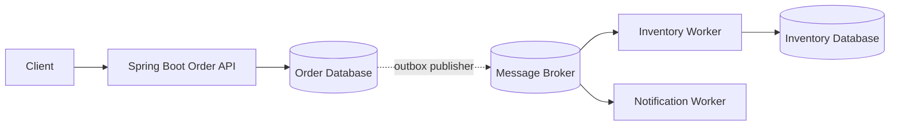

# Week 6 · Day 1 — Messaging Fundamentals and Asynchronous Communication

**12-Week System Design & Backend Engineering** · Java 21 · Spring Boot · PostgreSQL · Apache Kafka

## Objectives
Learn the topic from first principles, understand production trade-offs, build a correct mental model of asynchronous workflows, and practice explaining design decisions during an engineering interview.

## Detailed concepts
### 1. Why asynchronous messaging exists

In a synchronous REST call the caller waits for a response; each additional dependency adds latency and a failure path. In asynchronous messaging, a producer submits a message to a broker and continues according to an explicit acknowledgment contract while a consumer handles work later. This is useful for email, image processing, notifications and order follow-up actions. It does **not** make a business transaction magically complete when the API returns: clients must understand PENDING versus COMPLETED states.

### 2. Queue, topic, producer and consumer

A producer creates a message containing an event or command and sends it to a broker. A queue generally distributes work among workers; a topic can enable publication to multiple independently consuming groups. RabbitMQ and Kafka offer different designs and guarantees. Kafka retains ordered logs by partition and consumer groups track offsets; classical queue systems often remove or acknowledge work in a different manner. Do not treat all brokers as interchangeable.

### 3. Synchronous versus asynchronous trade-offs

REST is suitable when the request needs an immediate decision (e.g. eligibility validation). A queue helps decouple delivery time, absorb traffic spikes and reduce critical-path latency when eventual completion is acceptable. But queues add eventual consistency, queue lag, retries, duplication, operational monitoring and failure handling. For core payment correctness, returning HTTP 202 Accepted means processing has started or been scheduled, not that funds moved.

### 4. Commands versus events

A command expresses an instruction or intent addressed to a specific owner, such as `SendOrderEmail`. An event records something that happened, such as `OrderCreated`. Events should be named in past tense and include stable identifiers and a clear schema. Producers should not depend on a particular consumer being online, but should define what happens if a necessary consumer never succeeds.

### 5. At-most-once, at-least-once, exactly-once terminology

At-most-once may lose messages but avoids repeated delivery attempts. At-least-once prioritizes delivery and can repeat work; consumers should be idempotent. Exactly-once claims depend on the specific scope of a broker/transaction and do not automatically extend to PostgreSQL or external HTTP APIs. Distinguish transport delivery, consumer execution and **business effects** such as charging a card.

### 6. Message shape and schema evolution

Recommended envelope fields: `eventId`, `eventType`, `aggregateId`, `occurredAt`, `schemaVersion`, `correlationId`, and a business payload. Use an explicit serialization contract (JSON/Avro/Protobuf) and versioned compatible changes. Avoid including secrets, full payment card data or unnecessary personal information. Consumer contracts should tolerate compatible fields and reject malformed messages deliberately.

### 7. Operational realities

A message may wait because consumers are slow or down. Observe queue depth/consumer lag, failures, reprocessing count, retry counts, oldest-message age, delivery latency and capacity. Use backpressure, quotas and workload limits to prevent unbounded processing. Ensure the broker itself is configured for appropriate replication and persistence.

### 8. Worked e-commerce example

A client POSTs an order. Order Service validates and durably creates a PENDING order plus an outbox record; a publisher eventually emits an `OrderRequested` event; Inventory and Payment workflows process according to a designed state machine. Notification work can follow later. This is a distributed workflow, not an atomic transaction across services.

## System design diagram


Explain every component, partition/network boundary, persistent store, potential duplicate/retry, and the outcome if one node crashes.

## Implementation sketch
```java
public record OrderRequested(
    UUID eventId,
    long orderId,
    String customerId,
    Instant occurredAt,
    int schemaVersion
) {}

// Publishing only after saving an order can lose a message if
// the process crashes between database commit and broker send.
// Day 6 introduces the transactional outbox solution.
```

**How to use this example:** Add correct imports, dependency versions, serializers, persistence/error handling, configurations and tests before considering it runnable. These are design notes, not tested production code.

## Hands-on assignment
Draw synchronous and asynchronous implementations of order creation. Define the API response, status endpoint, event envelope, success and failed outcomes. Describe what happens when the broker, notification service or DB is unavailable.

### Acceptance criteria
- [ ] Explain one key functional requirement and three reliability constraints.
- [ ] Describe message ordering and duplication in this workflow.
- [ ] State what is persisted before acknowledgment.
- [ ] Explain at least two recoverable failures.
- [ ] Sketch tests or local verification commands.
- [ ] Document a rejected alternative and why.

## Interview questions
1. What does asynchronous mean from the client's perspective?
2. Compare queue and topic semantics.
3. Command versus event?
4. Why can at-least-once delivery duplicate business work?
5. What does HTTP 202 guarantee and not guarantee?

## Five-question knowledge check
1. What is the source of truth?
2. Where can a network partition or partial failure occur?
3. Can an event be delivered more than once, and what prevents duplicate effects?
4. How will you measure lag and retries?
5. When would a synchronous design be simpler?

## Daily progress
- [ ] Concepts understood
- [ ] Architecture redrawn
- [ ] Code/design reviewed
- [ ] Practical assignment done
- [ ] Interview questions attempted
