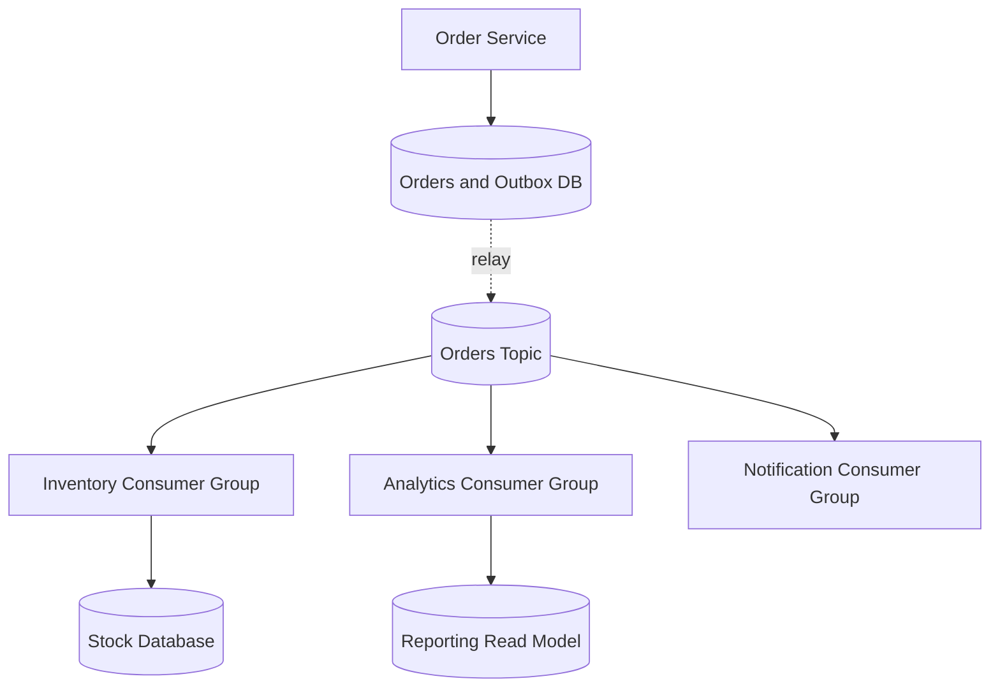

# Week 6 · Day 2 — Event-Driven Architecture, Pub/Sub, CQRS and Saga Patterns

**12-Week System Design & Backend Engineering** · Java 21 · Spring Boot · PostgreSQL · Apache Kafka

## Objectives
Learn the topic from first principles, understand production trade-offs, build a correct mental model of asynchronous workflows, and practice explaining design decisions during an engineering interview.

## Detailed concepts
### 1. Event-driven architecture in practice

Event-driven architecture lets components react to domain events representing completed or important state changes. A producer publishes an event without directly invoking every downstream feature. Consumers subscribe by their own responsibilities. Benefits include decoupled timing, extensibility and fan-out; drawbacks include eventual consistency, hidden dependencies, schema compatibility and harder end-to-end debugging.

### 2. Pub/sub versus competing consumers

Pub/sub allows multiple logical subscribers to independently receive relevant events. Competing consumers within the **same group** share work, each partition assigned to at most one member at a time for a normal Kafka consumer group. Adding consumers above partition count generally does not increase parallelism for that topic/group. Distinguish broadcast across groups from load balancing within a group.

### 3. Event notification versus event-carried state transfer

A small `ProductPriceChanged` notification with product ID asks consumers to fetch current state; this can increase coupling and remote calls. An event containing selected new price/details enables local read models but carries schema, privacy and freshness risks. Choose payload size and coupling deliberately; do not mirror entire DB rows in events without need.

### 4. Choreography versus orchestration

A Saga orchestrator commands steps and handles compensations centrally, making the overall state clearer. Choreography relies on services reacting to one another's events, sometimes improving local autonomy but risking hard-to-follow cyclic workflows. Both approaches require retries, idempotency, correlation IDs, explicit state transitions and operator recovery.

### 5. CQRS fundamentals

Command Query Responsibility Segregation separates models optimized for writes from models optimized for reads. It can be used without separate databases or event sourcing. An order-write service may emit events used to build a denormalized order-search read model. Read models may lag; clients must not assume a new order instantly appears in an eventually consistent view.

### 6. Event sourcing is not a synonym for events

Event sourcing stores state changes as an append-only sequence of domain events from which current state can be reconstructed. It supports audit/history and replay but adds event versioning, snapshots, migration, storage cost and complex invariants. Publishing Kafka events from a normal relational service does not automatically make it event sourced.

### 7. Avoid dual writes

Writing PostgreSQL and then Kafka separately creates a lost-event window; publishing before DB commit creates phantom events if DB rolls back. Use transactional outbox (or other transactionally coordinated mechanisms) when reliable publication is necessary. Retrying bare publish calls after uncertainty can duplicate events; use stable IDs.

### 8. Event flow documentation

Each event contract should state producer, topic, aggregate key, event envelope, schema version, intended consumers, allowed reordering, retention, failure behavior and data-protection rules. Trace from one incoming API request through published events and consumer side effects. Document which steps are eventually consistent versus immediately authoritative.

## System design diagram


Explain every component, partition/network boundary, persistent store, potential duplicate/retry, and the outcome if one node crashes.

## Implementation sketch
```java
public record OrderCreated(
    UUID eventId,
    UUID orderId,
    String status,
    Instant occurredAt,
    int schemaVersion
) {}

// Event consumers should use eventId for deduplication.
// Consumers in distinct Kafka groups each receive the event.
// Consumers sharing one group divide assigned partitions.
```

**How to use this example:** Add correct imports, dependency versions, serializers, persistence/error handling, configurations and tests before considering it runnable. These are design notes, not tested production code.

## Hands-on assignment
For an order system, choose event notification or event-carried state for three events and justify the payload. Draw an orchestration and choreography version of order→inventory→payment. Decide whether CQRS is actually needed for an admin search dashboard.

### Acceptance criteria
- [ ] Explain one key functional requirement and three reliability constraints.
- [ ] Describe message ordering and duplication in this workflow.
- [ ] State what is persisted before acknowledgment.
- [ ] Explain at least two recoverable failures.
- [ ] Sketch tests or local verification commands.
- [ ] Document a rejected alternative and why.

## Interview questions
1. How does one Kafka event reach multiple independent services?
2. What's the difference between choreography and orchestration?
3. Can CQRS exist without event sourcing?
4. What is a dual-write failure?
5. Why is a business event schema a long-lived API contract?

## Five-question knowledge check
1. What is the source of truth?
2. Where can a network partition or partial failure occur?
3. Can an event be delivered more than once, and what prevents duplicate effects?
4. How will you measure lag and retries?
5. When would a synchronous design be simpler?

## Daily progress
- [ ] Concepts understood
- [ ] Architecture redrawn
- [ ] Code/design reviewed
- [ ] Practical assignment done
- [ ] Interview questions attempted
