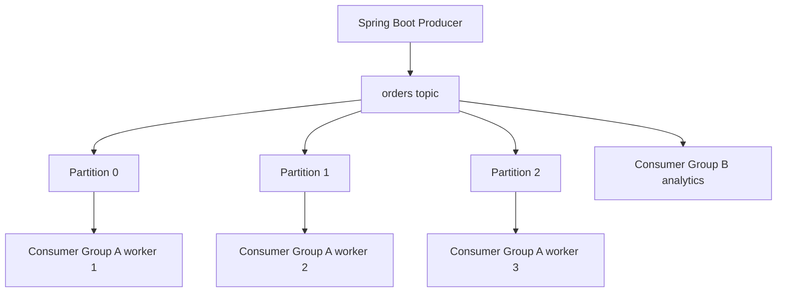

# Week 6 · Day 3 — Kafka Brokers, Topics, Partitions, Replication and Consumer Groups

**12-Week System Design & Backend Engineering** · Java 21 · Spring Boot · PostgreSQL · Apache Kafka

## Objectives
Learn the topic from first principles, understand production trade-offs, build a correct mental model of asynchronous workflows, and practice explaining design decisions during an engineering interview.

## Detailed concepts
### 1. Kafka mental model

Kafka is a distributed append-only event-log platform. Producers append records to topic partitions; consumers read records by offset and track their own progress. Unlike a traditional destructive queue, consuming does not normally delete a record; retention controls how long records remain. Kafka can support high-throughput event streaming, durable publication and replay, but requires explicit operational choices.

### 2. Topics and partitions

A topic is a named stream divided into partitions. Each partition has an ordered sequence of offsets. Ordering is guaranteed **within a partition**, not globally across the whole topic. Producer-record keys determine partition selection through the partitioner; using `orderId` as key keeps events for one order together under a stable partitioning scheme. Repartitioning or increasing partition count can change key-to-partition mapping for future events.

### 3. Offsets and commits

Offset identifies a record position within one partition. A consumer-group committed offset represents progress/restart position; it is not proof that an external side effect completed. If offsets are committed before durable processing, work can be lost. If DB side effects commit before offset, redelivery may duplicate execution; idempotency resolves this ambiguity.

### 4. Consumer groups and rebalancing

Within one consumer group, each partition is owned by at most one active consumer at a time under normal assignment. If there are 6 partitions and 3 consumers, each can process roughly 2 partitions; with 8 consumers, at least 2 will have no partition assignment. Rebalances happen when membership or partition layout changes, potentially interrupting processing; design for reassignment and replay.

### 5. Brokers, leaders and replicas

Kafka topic partitions have leader replicas responsible for reads/writes and follower replicas replicating data. Replication factor measures stored copies across eligible brokers. For durability, combine appropriately sized replication factor, producer acks, and `min.insync.replicas`; none alone guarantees data survives every correlated failure. Avoid placing all replicas in one failure domain.

### 6. Producer acknowledgments

`acks=0` does not wait for broker acknowledgment; `acks=1` waits for leader acknowledgment; `acks=all` waits for required in-sync replica acknowledgments. Enable idempotent producer when appropriate to reduce duplicates from producer retries for a given partition and producer session. Producer idempotence does not prevent a user from submitting two separate order commands.

### 7. Retention, compaction and replay

Time/size retention controls removal of old log segments. Log compaction retains records by key according to cleanup rules; it isn't a transactional primary DB. Replay uses new or reset consumer offsets as long as data remains available. Reprocessing must be safe and schema-version compatible.

### 8. Kafka cluster operations

Current Kafka deployments use KRaft-based metadata quorum; old ZooKeeper-based deployment instructions are legacy. Observe partition under-replication, in-sync replicas, disk/memory pressure, producer delivery failures, consumer group lag, rebalance frequency and broker availability. Know why adding partitions increases potential group parallelism but adds cost and ordering implications.

## System design diagram


Explain every component, partition/network boundary, persistent store, potential duplicate/retry, and the outcome if one node crashes.

## Implementation sketch
```java
// Producer-side Kafka topic config illustration
@Bean
NewTopic ordersTopic() {
    return TopicBuilder.name("orders.events.v1")
        .partitions(3)
        .replicas(3) // Needs at least 3 eligible brokers
        .build();
}
// For a one-broker local development cluster use replicas(1).
// Do not copy production replication assumptions into local dev.
```

**How to use this example:** Add correct imports, dependency versions, serializers, persistence/error handling, configurations and tests before considering it runnable. These are design notes, not tested production code.

## Hands-on assignment
Design an orders topic with three partitions and keyed events. Explain distribution when using two versus five consumers in the same group. Define an appropriate acks/min.insync.replicas policy for a hypothetical 3-broker cluster and a separate 1-broker development configuration.

### Acceptance criteria
- [ ] Explain one key functional requirement and three reliability constraints.
- [ ] Describe message ordering and duplication in this workflow.
- [ ] State what is persisted before acknowledgment.
- [ ] Explain at least two recoverable failures.
- [ ] Sketch tests or local verification commands.
- [ ] Document a rejected alternative and why.

## Interview questions
1. Is ordering guaranteed across a Kafka topic?
2. What does a committed offset represent?
3. How does consumer group parallelism relate to partition count?
4. Why do acks and ISR settings both matter?
5. What does log compaction do, and what doesn't it do?

## Five-question knowledge check
1. What is the source of truth?
2. Where can a network partition or partial failure occur?
3. Can an event be delivered more than once, and what prevents duplicate effects?
4. How will you measure lag and retries?
5. When would a synchronous design be simpler?

## Daily progress
- [ ] Concepts understood
- [ ] Architecture redrawn
- [ ] Code/design reviewed
- [ ] Practical assignment done
- [ ] Interview questions attempted
