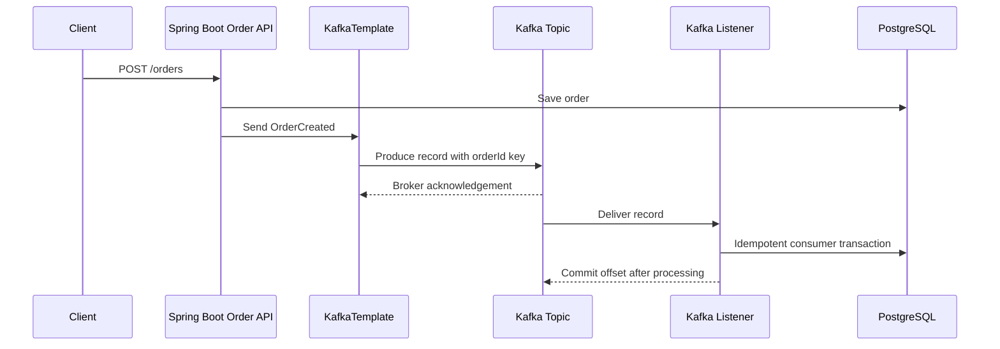

# Week 6 · Day 4 — Kafka Producers and Consumers with Spring Boot

**12-Week System Design & Backend Engineering** · Java / Spring Boot / PostgreSQL / Apache Kafka

## Learning objectives
Understand the topic deeply enough to explain mechanisms, compare alternatives, implement a safe backend workflow, and answer production failure questions in an interview.

## Detailed explanations
### 1. Project setup and dependencies

Create a Spring Boot application with spring-kafka, spring-boot-starter-web, validation, PostgreSQL/JPA if persisting orders, spring-kafka-test, JUnit and Testcontainers for integration tests. A single-broker Kafka instance is fine for local learning but not a demonstration of HA. Prefer supported Spring Boot/Spring Kafka dependency alignment instead of pinning incompatible versions. Use environment variables for connection properties rather than credentials embedded in source.

### 2. Producer responsibilities

A producer serializes an event, selects topic and key, and sends asynchronously with KafkaTemplate. Choose key as stable aggregate identity (e.g., order ID) when per-order partition ordering is needed. Handle future callbacks or blocking acknowledgment intentionally; `send()` returning a future does not imply the broker durably accepted the record. Configure delivery timeout, retries, acknowledgments and idempotence for the stated durability policy.

### 3. Consumer responsibilities

An `@KafkaListener` joins a configured group, receives records and applies business work. Deserializers must handle malformed payloads; consumers must not blindly cast untrusted data. Separate transport DTOs from domain logic. Avoid acknowledging offsets before a database transaction is committed. Spring listener acknowledgment/error-handler setup depends on container factory and Spring Kafka version.

### 4. Event key, headers and schema

Define stable schema: `eventId`, `orderId`, `eventType`, `schemaVersion`, timestamp, correlationId. Keys affect partition assignment. Include tracing identifiers as Kafka headers as appropriate. Schema changes should be backward compatible or versioned: optional fields, defaults and explicit consumer handling. JSON is straightforward to inspect locally, while Avro/Protobuf with registry can enforce richer contracts.

### 5. Serialization and type safety

A JSON serializer writes a DTO; consumer deserializer can map to a trusted class with explicit package/type configuration. Do not globally trust arbitrary types from Kafka headers. Alternatively receive raw `String`/bytes and validate with Jackson against a known schema. Poison records should not block a partition forever—route unrecoverable deserialization errors through configured recovery handling.

### 6. Local run and test walkthrough

Start Kafka using Docker Compose or Testcontainers, create a topic, run producer and consumer. POST a sample order and inspect broker records with CLI tools; restart the consumer and observe offset behavior. Test duplicate events and consumer crashes. In a production-style order service, coordinate DB commit and Kafka publish via transactional outbox rather than assuming sequential calls are atomic.

### 7. Kafka consumer concurrency

If topic has three partitions, configured listener concurrency above three cannot increase active processing parallelism within one group for that topic. Consumer processing order is preserved within an assigned partition if processing is synchronous and ordered; handing work to unrelated threads can break completion order and offset safety. Slow consumer processing causes lag; monitor and scale only where partitioning and downstream capacity allow.

### 8. Failure handling and observability

Record publishing errors, retryable consumer exceptions, deserialization failures, processing time, offset commits and lag. Use a stable `eventId` for deduplication. Ensure shutdown closes producer resources and consumers stop accepting new work cleanly. Logs should include correlation and order IDs, but not credentials, payment card data or complete sensitive payloads.

## Architecture / sequence diagram


Draw this again without notes; explain data ownership, offsets and acknowledgment boundaries, service failures and potential duplicate processing.

## Java, Spring Boot, and SQL practice
```text
// Produce a typed event using Spring Kafka.
@Service
class OrderEventPublisher {
    private final KafkaTemplate<String, OrderCreated> kafka;
    OrderEventPublisher(KafkaTemplate<String, OrderCreated> kafka) {
        this.kafka = kafka;
    }
    CompletableFuture<SendResult<String, OrderCreated>> publish(
            OrderCreated event) {
        return kafka.send("orders.events.v1",
                          event.orderId().toString(), event);
    }
}

// Consumer: durable idempotency is a service/database responsibility.
@KafkaListener(topics = "orders.events.v1",
               groupId = "notification-service")
public void onOrderCreated(OrderCreated event) {
    notificationService.handleIdempotently(event);
}
// IMPORTANT: Direct DB save followed by send above is a dual write.
// Day 6 replaces this with a transactional outbox design.
```

**Implementation reminder:** This is a learning example, not a compiled production artifact. When implementing, add version-compatible Spring Kafka, database migrations, configuration, tests and operational monitoring.

## Hands-on assignment
Implement a producer endpoint and a notification consumer in separate Spring Boot applications or modules, using a local Kafka broker. Configure explicit serialization; inspect records with Kafka CLI; write a Testcontainers integration test for delivery and redelivery; document how offsets and consumer groups affect behavior.

### Acceptance criteria
- [ ] Define the authoritative data store and at least two invariants.
- [ ] Explain what occurs when the consumer or producer crashes.
- [ ] State whether delivery and business effects can duplicate.
- [ ] Verify a controlled retry/acknowledgment behavior.
- [ ] Document metrics and safe operator recovery.
- [ ] Explain at least one alternative with trade-offs.

## Interview questions
1. Does KafkaTemplate.send guarantee success immediately?
2. Why use orderId as record key?
3. How does @KafkaListener groupId affect delivery?
4. How do you handle poison/deserialization records?
5. What consistency gap remains between DB save and direct publish?

## Daily revision test
1. What is the exact durability guarantee of the design?
2. Which message operations are idempotent and how?
3. Which operation has to be transactional?
4. How would you replay after a process crash?
5. What failure would you inject first to verify correctness?

## Progress checklist
- [ ] Core concepts
- [ ] Diagram
- [ ] Implementation exercise
- [ ] Failure cases
- [ ] Interview revision
