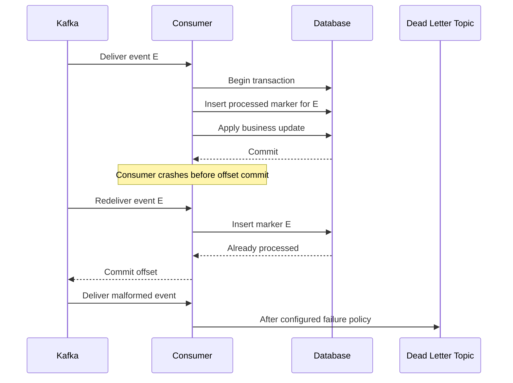

# Week 6 · Day 5 — Delivery Semantics, Retries, Idempotency, and Dead-Letter Topics

**12-Week System Design & Backend Engineering** · Java / Spring Boot / PostgreSQL / Apache Kafka

## Learning objectives
Understand the topic deeply enough to explain mechanisms, compare alternatives, implement a safe backend workflow, and answer production failure questions in an interview.

## Detailed explanations
### 1. Transport semantics versus business outcomes

At-most-once can lose processing if offset is advanced before work. At-least-once retries/replays and can execute the same effect more than once without idempotency. Kafka transactions and idempotent producers support exactly-once semantics within configured Kafka processing contexts, but not arbitrary PostgreSQL writes or external email/payment APIs. Define guarantees per boundary rather than saying “our system is exactly once.”

### 2. Offset commit timing

A consumer polls records and processes them before committing progress. If the process crashes after DB commit but before offset commit, Kafka may redeliver; if offset commits before DB work, the work might be lost. Store a processed-event marker and corresponding business update atomically in the DB where possible. Commit offsets only after durable completion; this yields safe repeated execution under at-least-once transport.

### 3. Idempotent consumer design

Create a `processed_messages(consumer_name,event_id)` table with unique key. In one transaction insert marker and apply business changes; on unique conflict treat as already processed, not as new work. When external side effects (email) cannot participate in the DB transaction, use an outbox-like local durable send intent or provider idempotency and reconciliation. A database marker inserted before an untracked external action can lose that action.

### 4. Retries: transient versus permanent

Retriable: temporary DB unavailability, network glitch, broker overload. Usually permanent: invalid schema, unsupported event version, missing required field, unauthorized/illogical state transition. Use bounded attempts with backoff and jitter. Delay retries appropriately so a poison record doesn't spin forever and starve all other partitions. Consider blocking retries versus nonblocking retry topics and their ordering implications.

### 5. Dead-letter topic (DLT)

After configured retries, send failed records to a DLT with error classification, source topic/partition/offset, event ID and safe diagnostic headers. A DLT is not a black hole: monitor rate and age, alert, repair consumer/data, define controlled replay. Never print full sensitive payloads in error logs. Some failures should go straight to DLT rather than retrying.

### 6. Ordering during retries

Kafka preserves record order within a partition in log storage, but nonblocking retry topics can allow later events to be processed before an earlier failed event. If order-state transitions require strict sequencing, use aggregate versions and order-aware processing or choose retry handling that protects the needed ordering guarantee.

### 7. Producer deduplication versus consumer deduplication

Producer idempotence limits certain duplicate broker append effects from retries for a producer session; it does not deduplicate two independent calls to create the same order. Consumer deduplication guards repeated event delivery. Business idempotency keys guard repeated client intent. These mechanisms protect different boundaries and may all be needed.

### 8. Fault-injection test matrix

Test: duplicate event IDs, crash after DB commit before ack, poison JSON, transient DB outage, consumer group rebalance, long retry delay, and DLT replay. Assert final domain state, number of side effects, commit positions and monitored failure counts. The system must remain observable during failures and maintain source-of-truth invariants.

## Architecture / sequence diagram


Draw this again without notes; explain data ownership, offsets and acknowledgment boundaries, service failures and potential duplicate processing.

## Java, Spring Boot, and SQL practice
```text
CREATE TABLE processed_events (
    consumer_name TEXT NOT NULL,
    event_id UUID NOT NULL,
    processed_at TIMESTAMPTZ NOT NULL DEFAULT now(),
    PRIMARY KEY (consumer_name, event_id)
);

// Conceptual service transaction:
@Transactional
public void consume(OrderCreated event) {
    // INSERT ... ON CONFLICT DO NOTHING; check whether inserted.
    // If already present, return successful no-op.
    // Apply domain changes only once with the marker transaction.
}
// Spring Kafka DLT/retry setup depends on compatible framework version.
// A DLT needs operator alerting and safe replay tooling.
```

**Implementation reminder:** This is a learning example, not a compiled production artifact. When implementing, add version-compatible Spring Kafka, database migrations, configuration, tests and operational monitoring.

## Hands-on assignment
Implement unique-event processing with PostgreSQL and a notification consumer. Force a crash after the DB transaction and before Kafka offset commit; verify redelivery does not duplicate the DB-side effect. Configure bounded retries and DLT handling for malformed messages and document a replay runbook.

### Acceptance criteria
- [ ] Define the authoritative data store and at least two invariants.
- [ ] Explain what occurs when the consumer or producer crashes.
- [ ] State whether delivery and business effects can duplicate.
- [ ] Verify a controlled retry/acknowledgment behavior.
- [ ] Document metrics and safe operator recovery.
- [ ] Explain at least one alternative with trade-offs.

## Interview questions
1. Why can a record be delivered twice even after DB commit?
2. Where is the best place for a processed-event marker?
3. What does a DLT solve and what doesn't it solve?
4. How can retry topics change record ordering?
5. Why is producer idempotence not enough for payment safety?

## Daily revision test
1. What is the exact durability guarantee of the design?
2. Which message operations are idempotent and how?
3. Which operation has to be transactional?
4. How would you replay after a process crash?
5. What failure would you inject first to verify correctness?

## Progress checklist
- [ ] Core concepts
- [ ] Diagram
- [ ] Implementation exercise
- [ ] Failure cases
- [ ] Interview revision
