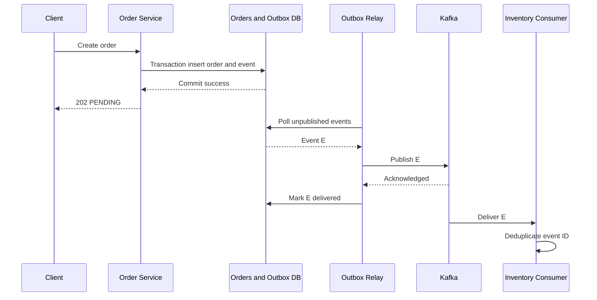

# Week 6 · Day 6 — Transactional Outbox, Sagas, CDC, Performance and Reliable Workflows

**12-Week System Design & Backend Engineering** · Java / Spring Boot / PostgreSQL / Apache Kafka

## Learning objectives
Understand the topic deeply enough to explain mechanisms, compare alternatives, implement a safe backend workflow, and answer production failure questions in an interview.

## Detailed explanations
### 1. The dual-write problem

An Order Service wants to persist an order and publish an `OrderCreated` event. If DB commits and process crashes before broker publication, consumers never hear about the order. If broker publication succeeds but DB rollback occurs, consumers receive an event describing non-existent committed state. Neither direct call ordering solves atomicity across PostgreSQL and Kafka.

### 2. Transactional outbox pattern

Insert the business row and outgoing event into `outbox_events` in **one local DB transaction**. A separate relay publishes committed outbox rows. This protects the **intent to publish** from being lost across local crashes. The relay can crash after publishing but before marking delivered, so it may publish duplicates; consumers must be idempotent. The outbox is not exactly-once external delivery.

### 3. Polling relay versus CDC

Polling dispatcher SELECTs unpublished outbox rows, publishes them and marks status. Coordinate multiple dispatchers using row locking/claiming and bounded batch sizes; handle crashes and retries. Change Data Capture reads database changes (e.g., PostgreSQL WAL with Debezium) and streams outbox records. CDC reduces some polling overhead but adds connector operation, schema/deployment and recovery concerns. Both require monitoring and consumer deduplication.

### 4. Saga and cross-service workflow

A saga coordinates locally transactional steps such as reserve inventory → authorize payment → confirm order. If payment fails, compensate by releasing reserved inventory; if charge succeeds but order confirmation fails, reconcile and possibly refund under an explicit policy. Compensation is a **new business action**, not an ACID rollback of remote work. Record PENDING, RESERVED, PAID, CONFIRMED, COMPENSATING, FAILED states as needed.

### 5. Orchestration versus choreography

An orchestrator persists workflow state and issues step commands while listening for results; recovery and visibility are centralized but the coordinator becomes an operational component. Choreography lets participants respond to events, which can avoid direct coordinator coupling but become hard to reason about across many steps. Whichever approach, include timeout handling, duplicate messages, event versioning and terminal failure escalation.

### 6. Consumer lag and throughput tuning

For heavy processing, choose an appropriate partition count and aggregate key. Consumers in one group scale at most to assigned partitions. Increase parallelism only when DB/other dependencies can sustain it. Measure producer request latency, batch size, compression, broker disk throughput, consumer lag, group rebalances and downstream p99. Tuning `linger.ms`/batching trades latency for throughput.

### 7. Outbox design operational details

Define a stable unique `event_id`, aggregate ID, event type, payload schema version, created timestamp, relay status/attempts, and a cleanup/retention plan. Use bounded retry/backoff when Kafka is unavailable. Ensure relay claim strategy prevents two dispatchers from needlessly hammering the same rows. Do not delete undelivered outbox entries prematurely.

### 8. Testing reliable workflow failure modes

Inject crash after order commit, broker outage, publisher crash after send, duplicate event delivery, inventory reservation timeout, payment provider ambiguous result and stuck compensations. Verify orders can be reconciled, no duplicate charge under a stable payment idempotency key, and operator dashboards expose outbox/consumer lag and pending-age. Record trace/correlation IDs and security restrictions on event data.

## Architecture / sequence diagram


Draw this again without notes; explain data ownership, offsets and acknowledgment boundaries, service failures and potential duplicate processing.

## Java, Spring Boot, and SQL practice
```text
CREATE TABLE outbox_events (
    event_id UUID PRIMARY KEY,
    aggregate_id UUID NOT NULL,
    event_type TEXT NOT NULL,
    payload JSONB NOT NULL,
    schema_version INT NOT NULL,
    created_at TIMESTAMPTZ NOT NULL DEFAULT now(),
    published_at TIMESTAMPTZ
);

// Spring service pseudo-implementation
@Transactional
public Order acceptOrder(CreateOrder command) {
    Order order = orderRepository.save(newPendingOrder(command));
    outboxRepository.save(newOutboxEvent(order));
    return order;
}
// Relay publishes after commit and marks published.
// Relay may publish twice: stable eventId + idempotent consumers required.
```

**Implementation reminder:** This is a learning example, not a compiled production artifact. When implementing, add version-compatible Spring Kafka, database migrations, configuration, tests and operational monitoring.

## Hands-on assignment
Implement the transactional outbox in Order Service, a scheduled polling relay (or document a CDC-based alternative), and a deduplicating Inventory consumer. Test Kafka-down-after-order-commit and publisher-crash-after-send. Sketch a Saga compensation path for payment rejection and document a recovery dashboard.

### Acceptance criteria
- [ ] Define the authoritative data store and at least two invariants.
- [ ] Explain what occurs when the consumer or producer crashes.
- [ ] State whether delivery and business effects can duplicate.
- [ ] Verify a controlled retry/acknowledgment behavior.
- [ ] Document metrics and safe operator recovery.
- [ ] Explain at least one alternative with trade-offs.

## Interview questions
1. What failure does the outbox prevent?
2. Why can an outbox relay still produce duplicates?
3. Polling relay versus CDC?
4. Why are compensating transactions not rollbacks?
5. What metrics reveal a stuck Saga or publisher?

## Daily revision test
1. What is the exact durability guarantee of the design?
2. Which message operations are idempotent and how?
3. Which operation has to be transactional?
4. How would you replay after a process crash?
5. What failure would you inject first to verify correctness?

## Progress checklist
- [ ] Core concepts
- [ ] Diagram
- [ ] Implementation exercise
- [ ] Failure cases
- [ ] Interview revision
