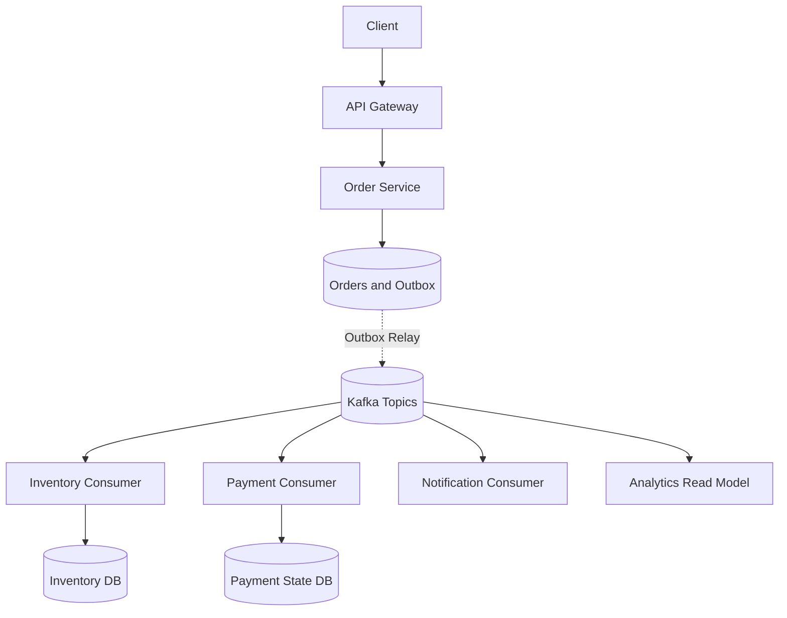

# Week 6 · Day 7 — Week 6 Revision and Event-Driven Order Processing Mock Interview

**12-Week System Design & Backend Engineering** · Java / Spring Boot / PostgreSQL / Apache Kafka

## Learning objectives
Understand the topic deeply enough to explain mechanisms, compare alternatives, implement a safe backend workflow, and answer production failure questions in an interview.

## Detailed explanations
### 1. What you should now explain without notes

Day 1: Why asynchronous messaging, queues/topics and delivery guarantees. Day 2: pub/sub, event choreography, Saga and CQRS. Day 3: Kafka partitions, offsets, keys, producer acknowledgments, replicas and group assignment. Day 4: Spring Boot producer/consumer and serialization. Day 5: retries, idempotent effects and DLT. Day 6: transactional outbox, CDC, Saga, lag and recovery.

### 2. Mock interview problem

Design an order platform serving a hypothetical peak of 5,000 order requests/second. Accept and persist orders, reserve inventory, process payment, send notifications and expose order status. Requirements: no duplicate business charge for one order intent, prevent overselling on authoritative inventory rows, bounded initial API latency, recover after Kafka outage and tolerate consumer redelivery. State what can be eventual.

### 3. Capacity estimation and event keys

If peak is 5,000 orders/sec and each produces 3 domain events on average, estimate 15,000 events/sec before retries/replays. For 1KB serialized events, raw payload throughput ~15MB/sec excluding replication, protocol and index overhead; 1 day ≈1.296TB raw at constant peak (which is usually unrealistic as a daily average). Choose partition count only after testing per-partition throughput and the number of consumers. Use order ID as partition key when ordering per order is required.

### 4. Minimum viable architecture

API Gateway → Order Service → Orders/Postgres + Outbox; relay → Kafka orders topic; Inventory/Payment/Notification consumers with their own data ownership and idempotency. A workflow orchestrator may simplify multi-step state transitions. Make topic/producer/group schemas explicit and distinguish a persisted PENDING response from finished fulfillment.

### 5. Storage and idempotency contracts

Order has ID, request idempotency key, status, version and timestamps. Outbox has event ID/aggregate ID/schema/publish status. Consumer inbox/processed_events stores unique (consumer, eventId) with domain change in a transaction. Payment provider requests use stable idempotency IDs and reconciliation when the response is ambiguous. Do not assume Kafka offset commit guarantees exactly-once external effects.

### 6. Failure and compensation walkthrough

If Kafka is unavailable after DB commit, outbox retains events for later replay. If producer publishes then crashes before marking outbox delivered, relay republishes and dedup consumers accept one effect. If Inventory cannot reserve, order transitions to FAILED; if payment succeeded previously, orchestrate compensating refund as a new tracked business transaction. If notification fails, avoid rolling back an otherwise valid paid order; retry safely and surface operator alerts.

### 7. Operating and monitoring

Track HTTP p95/p99, order pending age, outbox backlog, publish retry count, topic under-replication, producer errors, consumer group lag, DLT volume, rebalances, DB conflicts, payment reconciliation backlog and compensation age. Explain trace propagation via headers, deployment strategy and schema compatibility checks. Alert based on customer-visible failure and stuck state, not only process liveness.

### 8. Interview scoring and exercise

Suggested 40-minute structure: requirements (5), capacity (5), HLD/schema (10), event flow and code interfaces (10), failures (7), trade-offs (3). Score 0–4 each: correctness, Kafka semantics, reliability, observability, communication. Review your weakest category and rerun the interview with one dependency outage introduced mid-design.

## Architecture / sequence diagram


Draw this again without notes; explain data ownership, offsets and acknowledgment boundaries, service failures and potential duplicate processing.

## Java, Spring Boot, and SQL practice
```text
// Order event processing invariants to defend in an interview:
//
// 1. Client idempotency key maps to one logical order intent.
// 2. Orders and outbox event commit in one DB transaction.
// 3. Kafka eventId stays stable across relay retry.
// 4. Consumer applies an event at most once to its business DB.
// 5. Payment provider interaction uses a stable request identity.
// 6. Stuck PENDING and COMPENSATING states are reconcilable.
// 7. A Kafka broker ack does not mean all consumers finished.
```

**Implementation reminder:** This is a learning example, not a compiled production artifact. When implementing, add version-compatible Spring Kafka, database migrations, configuration, tests and operational monitoring.

## Hands-on assignment
Complete a 40-minute whiteboard mock interview for an event-driven order platform. Produce HLD, APIs, events, topic/partition keys, database tables, producer/consumer config, idempotency scheme, retry and DLT policy, six injected failure scenarios, metrics dashboard outline and a one-page architecture decision log.

### Acceptance criteria
- [ ] Define the authoritative data store and at least two invariants.
- [ ] Explain what occurs when the consumer or producer crashes.
- [ ] State whether delivery and business effects can duplicate.
- [ ] Verify a controlled retry/acknowledgment behavior.
- [ ] Document metrics and safe operator recovery.
- [ ] Explain at least one alternative with trade-offs.

## Interview questions
1. Explain Kafka ordering and consumer groups.
2. Why does transactional outbox matter?
3. What happens after consumer DB commit but before offset commit?
4. When is a Saga compensation required?
5. How would you diagnose a rapidly increasing Kafka consumer lag?

## Daily revision test
1. What is the exact durability guarantee of the design?
2. Which message operations are idempotent and how?
3. Which operation has to be transactional?
4. How would you replay after a process crash?
5. What failure would you inject first to verify correctness?

## Progress checklist
- [ ] Core concepts
- [ ] Diagram
- [ ] Implementation exercise
- [ ] Failure cases
- [ ] Interview revision
