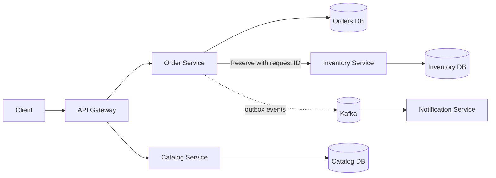

# Week 7 · Day 1 — Microservices Architecture Fundamentals and Service Boundaries

**System Design and Backend Engineering** · Java 21 / Spring Boot / Cloud-Native Microservices

## Learning objectives
Understand the topic from first principles, relate it to production backend architecture, compare alternatives, and explain failure modes and security implications in a system-design interview.

## Detailed study notes
### 1. From a monolith to microservices

A monolith packages modules into one deployable application. A **modular monolith** retains one deployment but enforces domain boundaries through interfaces and modules. A microservices architecture distributes independently deployable business capabilities across processes communicating over a network. Splitting services does not automatically improve throughput, reliability or development speed. It trades in-process calls and simple transactions for remote latency, partial failures, eventual consistency and operational overhead.

### 2. Why and when to split

Consider splitting when different capabilities require independent release cycles, separate teams, different scaling needs or clearly distinct domain ownership. Avoid “one microservice per table” and splitting while the business model is changing daily. A five-person team building a ticketing platform may be more productive with a modular Spring Boot monolith. A mature commerce organization may benefit from independently owned Catalog, Checkout, Inventory and Fulfillment boundaries.

### 3. Bounded contexts and ownership

A bounded context is a domain boundary with a consistent language and rules. An Order is an immutable commercial intent in checkout but may mean a delivery work item in fulfillment. Within a context, own validation, state transitions, schema and API contracts. Prefer **high cohesion** inside a service, **low coupling** between services, and avoid direct modification of another service’s tables. Logical database ownership does not strictly require a physically separate DB server on day one.

### 4. Microservices versus a distributed monolith

A distributed monolith has multiple deployables but remains tightly coupled: every release requires synchronized deployment, services share mutable tables, and deep synchronous call chains propagate failures. Symptoms include cross-service joins, version mismatches and shared internal model jars treated as public contracts. Fix by aligning domain boundaries, defining explicit APIs, introducing independent tests and minimizing unnecessary synchronous dependencies.

### 5. Service decomposition walkthrough

For e-commerce, Catalog manages product descriptions; Inventory owns available-to-promise/reservation state; Order owns customer intent and order lifecycle; Payment owns payment attempts/receipts. Notifications are asynchronously derived from durable business events. Order should not edit Inventory DB rows directly; it invokes a reservation contract and tracks an explicit response/state. Cross-service correctness uses business workflows rather than one relational transaction spanning services.

### 6. Failure and consistency consequences

Each network hop can time out or return an ambiguous result. If Inventory successfully reserves stock but Order times out, retrying blindly may double-reserve. Use stable reservation IDs, idempotent APIs, bounded deadlines and reconciliation. If a business flow spans multiple databases, consider a saga with explicit compensation or a simpler consolidated transaction boundary where appropriate.

### 7. Production infrastructure

Typical components are edge gateway, service discovery/load balancing, API services, databases, event broker, centralized configuration, secrets manager, CI/CD and observability. Each adds operations and failure modes. Kubernetes can provide DNS names, readiness probes and deployment primitives; it does not solve domain consistency or idempotency. Select only components justified by capacity, deployment, security and maintainability constraints.

### 8. Interview trade-off discussion

Answer in this order: requirements and constraints; candidate service boundaries; authoritative data per service; synchronous versus asynchronous interactions; failure handling; deployment and monitoring. Explicitly justify why the first version might remain a modular monolith, and identify observable triggers for extracting a service.

## Architecture diagram


Explain all components, which owns the source of truth, the network boundaries, timeouts, security/trust boundaries and how the design behaves when an instance dies.

## Java / Spring Boot example
```java
// Domain boundary, usable in a modular monolith or remote adapter.
public interface InventoryPort {
    ReservationResult reserve(String sku, int quantity, String requestId);
}
public record ReservationResult(
    String reservationId, boolean accepted, String reason
) {}

@Service
class CheckoutService {
    private final InventoryPort inventory;
    CheckoutService(InventoryPort inventory) { this.inventory = inventory; }
    ReservationResult tryReserve(String sku, int qty, String key) {
        return inventory.reserve(sku, qty, key);
    }
}
// The port may be local now, HTTP/gRPC later.
// Remote adapters need deadlines, authentication and idempotency.
```

**Implementation note:** This is an educational example and has not been compiled or deployed. Add compatible dependencies, imports, configuration, validation, monitoring and tests before using it in a real system.

## Hands-on assignment
Decompose an order-management domain into Catalog, Order, Inventory, Payment and Notification. Draw a modular monolith and a microservices version. Define owner, DB, APIs, events, failure outcomes and why each split is worth the operational cost.

### Acceptance criteria
- [ ] Describe the requirements and why each component exists.
- [ ] Define a safe failure behavior for a network timeout and a node crash.
- [ ] Show appropriate service ownership and trust boundaries.
- [ ] Name at least two production metrics to monitor.
- [ ] Explain a simpler alternative and its trade-offs.
- [ ] Recreate the diagram and verify the practical exercise.

## Interview questions
1. When is a modular monolith a better choice?
2. What does a bounded context mean?
3. Why is service-per-table a poor default?
4. What turns microservices into a distributed monolith?
5. What is the risk of shared mutable databases?

## Revision prompts
1. Explain this mechanism in under two minutes.
2. What changes with ten times more traffic?
3. What breaks during an upstream deployment or network partition?
4. What data or evidence would prove the design works?
5. What would you explicitly avoid overengineering?

**Completion checklist:** [ ] Concepts [ ] Diagram [ ] Example [ ] Failure analysis [ ] Interview Q&A.
