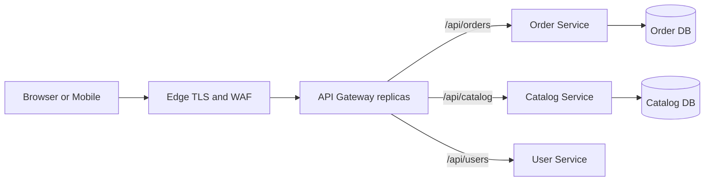

# Week 7 · Day 2 — API Gateway, Reverse Proxy, Edge Routing and Security

**System Design and Backend Engineering** · Java 21 / Spring Boot / Cloud-Native Microservices

## Learning objectives
Understand the topic from first principles, relate it to production backend architecture, compare alternatives, and explain failure modes and security implications in a system-design interview.

## Detailed study notes
### 1. What an API gateway does

An API gateway is an entry point that routes client requests to appropriate services and can implement cross-cutting edge policies: authentication of tokens, TLS termination, rate limiting, request size limits, logging, tracing, CORS and sometimes response aggregation. It should not absorb core order/payment domain logic. Gateway availability affects all routed traffic, so plan redundant deployment and health checks.

### 2. Gateway versus reverse proxy and load balancer

A reverse proxy forwards traffic to backend servers, while a load balancer distributes requests among healthy instances. API gateways are application-aware reverse proxies that usually add API policies, service routing and possibly transformation. The functions overlap, so deploying three separate products is not automatically necessary. L4 balancing uses transport addresses/ports; L7 routing can use HTTP host, path, method and headers.

### 3. Routing and API versioning

Routes might map `/api/orders/**` to Order Service and `/api/catalog/**` to Catalog. Avoid path collisions, unsafe rewrites and unbounded body buffering. Version public APIs deliberately and manage backward compatibility. Use route documentation and automated tests; gateway route changes can create cross-service outages even if applications deploy correctly.

### 4. Authentication and authorization

A gateway can verify signed JWT identity, issuer, audience and expiration and reject unauthorized edge requests. But a valid token does **not** authorize any order ID. The service must enforce object-level permissions, domain scopes and ownership. Gateway-to-service communication needs trusted identity propagation and protection against spoofed client-supplied headers. Treat internal traffic as untrusted unless explicitly authenticated and authorized.

### 5. TLS and CORS

TLS typically protects traffic to the public edge. When TLS terminates at the gateway, secure upstream communication with mTLS or appropriate network controls depending on threat model. Configure CORS only for approved origins, methods and credential policy; CORS is not server-side authentication. Configure forwarded header trust boundaries so the backend does not use attacker-controlled `X-Forwarded-For` as user identity or for arbitrary rate limit bypass.

### 6. Rate limiting and quotas

A token bucket can enforce burst allowance and steady refill rate per user, tenant or API key. Return 429 and optional Retry-After rather than waiting indefinitely. Global limits and per-tenant limits solve different problems. On multi-node gateways, distributed counters or consistent sharding are needed for coherent limits; exact strictness and failure behavior should be documented.

### 7. Timeouts, retries and request budgets

Set connection and response timeouts and an end-to-end deadline. Gateways should not indiscriminately retry non-idempotent POST requests—Order might already have committed. Coordinate retry ownership with downstream services and enforce request IDs/idempotency keys. A gateway circuit breaker or load shedding can prevent slow downstreams from exhausting edge resources.

### 8. Gateway failure and deployment pitfalls

If the gateway becomes unavailable, all public services may become unreachable despite healthy service instances. Deploy redundant gateways across failure domains with monitored routing. Watch 502 (bad upstream response), 503 (service unavailable), 504 (gateway timeout), connection pool saturation, JWT key rotation failures, misconfigured CORS, route precedence and unexpectedly large request payloads.

## Architecture diagram


Explain all components, which owns the source of truth, the network boundaries, timeouts, security/trust boundaries and how the design behaves when an instance dies.

## Configuration example
```yaml
# Spring Cloud Gateway sample (illustrative, verify framework version)
spring:
  cloud:
    gateway:
      routes:
        - id: orders
          uri: http://order-service:8080
          predicates:
            - Path=/api/orders/**
        - id: catalog
          uri: http://catalog-service:8080
          predicates:
            - Path=/api/catalog/**
# In production configure trusted proxy headers, issuer/audience
# validation, deadlines, rate limits and upstream TLS as needed.
```

**Implementation note:** This is an educational example and has not been compiled or deployed. Add compatible dependencies, imports, configuration, validation, monitoring and tests before using it in a real system.

## Hands-on assignment
Design an API gateway for Order, Catalog and User services. Provide routes and access rules, two tenant-level rate-limit scenarios, 502/503/504 troubleshooting flow, JWT validation plan and fallback policy. Explain why object ownership must remain a service responsibility.

### Acceptance criteria
- [ ] Describe the requirements and why each component exists.
- [ ] Define a safe failure behavior for a network timeout and a node crash.
- [ ] Show appropriate service ownership and trust boundaries.
- [ ] Name at least two production metrics to monitor.
- [ ] Explain a simpler alternative and its trade-offs.
- [ ] Recreate the diagram and verify the practical exercise.

## Interview questions
1. Gateway versus reverse proxy?
2. Why can't a gateway handle all authorization?
3. What does 504 mean?
4. When should a gateway retry POST?
5. What risks arise from blindly trusting forwarded headers?

## Revision prompts
1. Explain this mechanism in under two minutes.
2. What changes with ten times more traffic?
3. What breaks during an upstream deployment or network partition?
4. What data or evidence would prove the design works?
5. What would you explicitly avoid overengineering?

**Completion checklist:** [ ] Concepts [ ] Diagram [ ] Example [ ] Failure analysis [ ] Interview Q&A.
