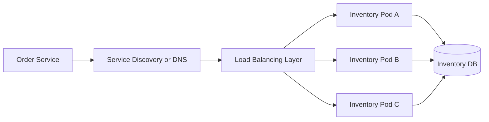

# Week 7 · Day 3 — Service Discovery, Client-side and Server-side Load Balancing

**System Design and Backend Engineering** · Java 21 / Spring Boot / Cloud-Native Microservices

## Learning objectives
Understand the topic from first principles, relate it to production backend architecture, compare alternatives, and explain failure modes and security implications in a system-design interview.

## Detailed study notes
### 1. Why service discovery exists

In dynamically scheduled systems, service instances start, stop and change IPs and ports. Hard-coding `http://10.0.0.5:8080` is brittle. Service discovery resolves a **logical service name** to one or more live endpoints; examples are Kubernetes Service DNS, a platform load balancer, and registry systems such as Eureka/Consul. A registry stores reachability metadata, not business truth.

### 2. Client-side versus server-side balancing

In client-side load balancing, a client or library discovers an endpoint set and chooses one instance. In server-side balancing, a reverse proxy/load balancer receives the request and selects a target. Both can be effective. Client-side discovery introduces libraries/caches and cross-language differences; server-side routing centralizes policy but creates an infrastructure dependency.

### 3. Health checks and readiness

Liveness indicates whether a process may need restarting; readiness means it can accept requests. Discovery should avoid routing new traffic to instances failing readiness. A service can be process-alive but unable to reach its DB; make probe policy reflect true serving state without causing cascading restarts. During deployment, drain traffic and allow bounded in-flight work to finish.

### 4. Load-balancing strategies

Round robin rotates across healthy instances. Weighted round robin accounts for different capacity. Least-connections chooses currently less-used instances but may not reflect real work. Consistent-hash routing preserves affinity for keys and can be useful for stateful partition ownership. No algorithm fixes an overloaded shared DB or broken service contract. Apply circuit breaking and deadlines.

### 5. DNS caching and TTL

Kubernetes DNS resolves Service names through cluster DNS; the Service normally supplies a stable virtual endpoint with dynamically changing backing Pods. DNS and client caches can hold stale endpoints, so respect TTL, connection lifetimes and platform conventions. A Kubernetes Service is not the same abstraction as an Eureka instance list; avoid running redundant discovery mechanisms without a reason.

### 6. Eureka fundamentals

With Spring Cloud Netflix Eureka, service instances register heartbeat/metadata to a registry and discovery clients query names. Registry consistency and stale entries influence routing, and clients need removal/refresh behavior. Eureka is one implementation, not an architectural prerequisite. Pair Spring Cloud and Spring Boot versions using their published compatibility matrix rather than mixing arbitrary release lines.

### 7. Discovery failures and deployment races

A registry outage may prevent new service resolution while cached endpoints remain usable; exact behavior depends on client. Old instances can be returned briefly after removal. During rolling deployments, ensure backward-compatible API contracts between old/new versions. Test discovery restart, instance crash, stale DNS, and partial zone outage. Record unhealthy endpoint routing and recovery time.

### 8. Observability and debugging

When a request fails, inspect logical destination, resolved address, connection errors, upstream HTTP status, timeout, health/readiness state and target version. Emit trace metadata with service and instance identity without leaking internal headers externally. Separate discovery failure from application 500 and database slowness.

## Architecture diagram


Explain all components, which owns the source of truth, the network boundaries, timeouts, security/trust boundaries and how the design behaves when an instance dies.

## Configuration example
```yaml
# Kubernetes service-based discovery example
apiVersion: v1
kind: Service
metadata:
  name: inventory-service
spec:
  selector:
    app: inventory
  ports:
    - port: 8080
      targetPort: 8080
# Other pods can call http://inventory-service:8080/
# Add readiness probes to Pod deployment separately.
# A Service alone is not an application health check.
```

**Implementation note:** This is an educational example and has not been compiled or deployed. Add compatible dependencies, imports, configuration, validation, monitoring and tests before using it in a real system.

## Hands-on assignment
Deploy or sketch three Inventory instances. Compare a gateway/load balancer versus client-selected endpoints. Explain discovery registration, readiness, rolling termination and behavior when one instance crashes. Test stale service addresses and recovery.

### Acceptance criteria
- [ ] Describe the requirements and why each component exists.
- [ ] Define a safe failure behavior for a network timeout and a node crash.
- [ ] Show appropriate service ownership and trust boundaries.
- [ ] Name at least two production metrics to monitor.
- [ ] Explain a simpler alternative and its trade-offs.
- [ ] Recreate the diagram and verify the practical exercise.

## Interview questions
1. Why do static IP addresses fail in dynamic deployments?
2. How do client-side and server-side balancing differ?
3. What is readiness versus liveness?
4. How does Kubernetes discovery differ from Eureka?
5. What happens if the discovery registry goes down?

## Revision prompts
1. Explain this mechanism in under two minutes.
2. What changes with ten times more traffic?
3. What breaks during an upstream deployment or network partition?
4. What data or evidence would prove the design works?
5. What would you explicitly avoid overengineering?

**Completion checklist:** [ ] Concepts [ ] Diagram [ ] Example [ ] Failure analysis [ ] Interview Q&A.
