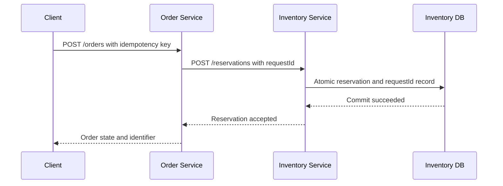

# Week 7 — Day 4: Inter-Service Communication — REST, HTTP Clients and gRPC

## Learning objectives
Design typed, secure, reliable communication between Spring Boot microservices. Compare synchronous REST and gRPC, establish request deadlines, protect write idempotency, and know when Kafka is preferable.

## 1. Communication boundaries
A local Java call executes in the same process. A call from Order to Inventory crosses a network, may fail partially, adds latency, needs authentication, serialization, discovery, timeouts and tracing. Synchronous request-response is appropriate when Order needs an immediate stock reservation decision. Asynchronous messaging is useful for later notifications and reporting.

## 2. REST conventions and contracts
Use explicitly versioned APIs and DTOs. Example: `POST /reservations` takes `{sku,quantity,requestId}` and returns `{reservationId,status}`. Reserve atomically in Inventory's database using a stable requestId unique constraint. Typical responses: 201 for created, 200 for existing idempotent result, 409 for incompatible duplicate, 422 for invalid business rule, 503 for unavailable. Document schema and status with OpenAPI; avoid exposing JPA entities directly.

## 3. Spring HTTP clients
Spring's `RestClient` is a fluent synchronous client. `WebClient` supports nonblocking reactive pipelines. OpenFeign is a declarative approach where compatible. Choose on runtime model and support needs; WebClient doesn't automatically make a blocking system efficient.

```java
@Configuration
class InventoryConfig {
    @Bean RestClient inventoryRestClient(RestClient.Builder builder) {
        return builder.baseUrl("http://inventory-service:8080").build();
    }
}
record ReserveRequest(String sku, int quantity, String requestId) {}
record ReserveResponse(String reservationId, String status) {}

@Service
class InventoryAdapter {
    private final RestClient client;
    InventoryAdapter(RestClient inventoryRestClient) { client = inventoryRestClient; }
    ReserveResponse reserve(ReserveRequest command) {
        return client.post().uri("/reservations").body(command)
            .retrieve().body(ReserveResponse.class);
    }
}
```
This is an illustrative excerpt; configure actual connection/read timeouts, authentication, error mapping and tests.

## 4. gRPC
gRPC uses Protocol Buffers to define typed RPC contracts and commonly HTTP/2 for transport. It supports unary and streaming calls. Useful for controlled internal communication where generated clients are valuable; browser consumers often need gRPC-Web/proxy. Evolve protobuf fields compatibly: do not reuse removed field numbers. Handle deadlines, status codes and authorization explicitly.

```protobuf
syntax = "proto3";
service InventoryService {
  rpc Reserve (ReserveRequest) returns (ReserveResponse);
}
message ReserveRequest {
  string sku = 1;
  int32 quantity = 2;
  string request_id = 3;
}
message ReserveResponse {
  string reservation_id = 1;
  bool accepted = 2;
}
```

## 5. Timeouts and ambiguous outcomes
A 1.5-second user request cannot safely make three sequential 2-second remote calls. Propagate budget and cancel unnecessary work. A timeout does NOT mean an Inventory reservation failed—server may have committed and response got lost. Retry only with stable request identity and bounded exponential backoff plus jitter.

## 6. Security
Authenticate service workload identities with mTLS or scoped service credentials according to threat model. Validate user context at domain boundary. A request coming from a private subnet is not necessarily authorized. Avoid allowing public clients to spoof trusted forwarding headers.

## 7. End-to-end flow


## 8. REST versus gRPC versus Kafka
| Concern | REST | gRPC | Kafka |
|---|---|---|---|
| Interaction | Request-response | Typed RPC, streaming | Asynchronous events |
| Best fit | Public and internal APIs | Controlled internal service APIs | Decoupled background/event workflows |
| Immediate result | Yes | Yes for unary | Usually no |
| Duplication after retry | Must handle | Must handle | Consumers must handle |
| Contract | HTTP/JSON/OpenAPI | Protobuf | Event schema/version |

## 9. Practice and interview
Build an Order→Inventory API with an idempotent reservation, configure RestClient deadlines and authentication, and simulate an HTTP response lost after DB commit. Write a matching .proto and argue when using it would be worthwhile.

Interview questions: How does REST differ from gRPC? Why does retrying a POST risk duplication? What makes a request idempotent? When would Kafka be preferable? What does a client timeout prove?

Checklist: [ ] API contract [ ] RestClient adapter [ ] gRPC comparison [ ] Ambiguous timeout test [ ] Authentication plan.
