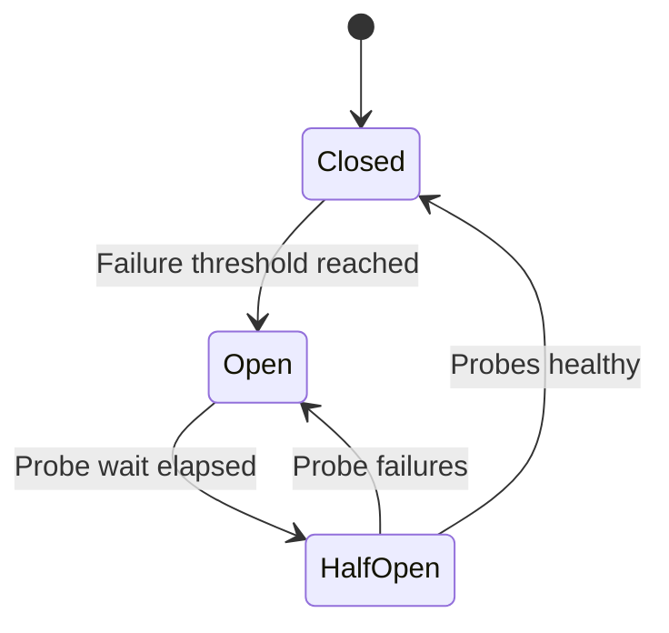

# Week 7 — Day 5: Resilience Patterns for Microservices

## Objectives
Understand and implement timeouts, retries, exponential backoff, circuit breakers, bulkheads, rate limits and graceful degradation without violating correctness.

## 1. Partial failures and cascading overload
An Inventory Service can become slow while Order Service remains alive. If every Order worker blocks waiting, request queues and DB connections saturate. Retries from gateway, Order and Inventory can amplify traffic during an outage. Resilience requires bounded demand and truthful error states, not “return 200 no matter what.”

## 2. Timeouts and deadlines
Distinguish connection timeout, read/response timeout and end-to-end deadline. Set an overall 1.5-second budget (illustrative) across gateway, application, Inventory and safety buffer. Propagate remaining deadline. A timed-out remote write might have already committed: reconcile with the stable idempotency key.

## 3. Retry with backoff and jitter
Only retry likely transient failures, e.g. short network issue or explicitly retryable 503. Never blindly retry validation, authorization and insufficient-stock errors. Example exponential backoff with base 100ms, capped 800ms: 100, 200, 400, 800ms before jitter. Add random jitter to prevent coordinated retry storms. Bound total attempts and elapsed time. If a gateway retries 3×, Order retries 3× and Inventory retries 3×, up to 27 attempts can arise from one logical call.

## 4. Circuit breaker state machine
CLOSED passes requests and observes failure/slow-call rates. OPEN rejects quickly after configured thresholds and minimum sample count. HALF_OPEN admits limited probes after wait; success closes, failure reopens. A circuit breaker protects the caller but cannot repair an unhealthy dependency.



## 5. Bulkheads and rate limiting
A bulkhead reserves independent concurrency budgets for separate dependencies—slow Recommendations should not consume all checkout threads. Semaphore bulkheads bound active calls; thread-pool bulkheads isolate blocking execution when appropriate. Rate limits protect fair usage and downstream capacity: token bucket allows controlled bursts with refill; return 429 when a caller exceeds limits. Load shedding rejects excess demand instead of queueing until timeouts.

## 6. Graceful degradation
Safe: omit recommended products or mark stale analytics unavailable. Unsafe: assume payment succeeded, invent remaining stock or authorize an order without checking ownership. During Inventory timeout, preserve durable PENDING state and reconciliation or return 503 as appropriate. A “fallback” must obey the same business invariants as the normal path.

## 7. Spring Boot Resilience4j example
```java
@Service
public class InventoryFacade {
    private final InventoryClient client;
    public InventoryFacade(InventoryClient client) { this.client = client; }

    @CircuitBreaker(name = "inventory", fallbackMethod = "unavailable")
    public ReservationResponse reserve(ReservationRequest request) {
        return client.reserve(request);
    }

    ReservationResponse unavailable(
            ReservationRequest request, Throwable error) {
        // A failed dependency call does not mean stock was reserved.
        throw new InventoryTemporarilyUnavailableException(error);
    }
}
```
Use matching Resilience4j starter/version, configured AOP/proxy, deadlines, retry policy and tests. Spring self-invocation of annotated methods can bypass the proxy. Configure window size, failure/slow thresholds, minimum calls, HALF_OPEN permits and bulkhead limit deliberately.

## 8. Load and failure testing
Inject 503, 429, lost TCP response, 3-second dependency latency, failed pod and half-open recovery. Verify checkout threads remain bounded, business errors are accurate, p95/p99 improves for protected calls, and no duplicate reservation occurs after retry. Observe circuit state, rejection count, active calls and retry volume.

## 9. Interview questions with answers
**Breaker versus retry?** Retry makes another attempt; breaker stops attempts likely to fail and protects resources.

**Why a bulkhead?** Isolates resources so one failing feature does not exhaust unrelated traffic.

**When should we return stale results?** Only if the use case explicitly tolerates staleness and data isolation is safe.

**What creates a retry storm?** Uncoordinated retries across clients/services, often synchronized without jitter.

**Does circuit OPEN indicate business operation failed?** It indicates the remote call was not attempted through this path; reconcile previously ambiguous attempts.

## 10. Practical assignment
Create an Inventory mock that returns 503 and delays responses. Enable timeouts, circuit breaker and bulkhead. Record behavior at normal load and outage. Add a noncritical Recommendation fallback and a critical Inventory error response. Draw the difference.

## Completion checklist
- [ ] Timeout budgets explained
- [ ] Retry/jitter strategy explained
- [ ] Circuit breaker states demonstrated
- [ ] Bulkhead/concurrency protected
- [ ] Fault injection and interview review completed
