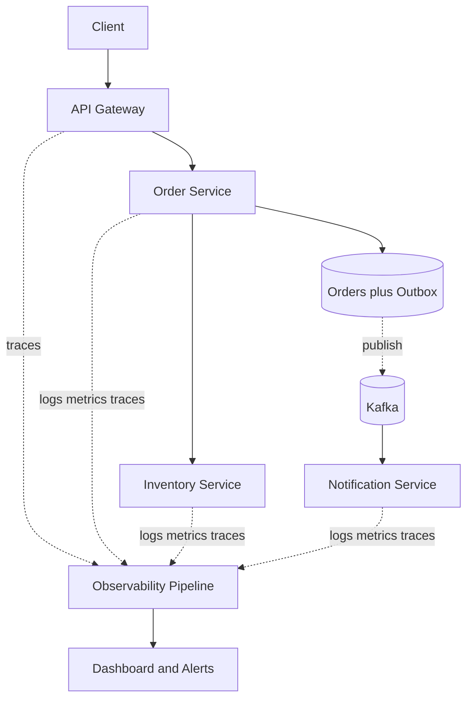

# Week 7 — Day 6: Configuration, Security, Observability and Reliable Workflows

## Learning objectives
Operate Spring Boot microservices with external configuration, reliable deployment, identity-based security, metrics, tracing, log correlation and durable distributed workflows.

## 1. Externalized configuration
Separate service binary from environment-specific settings. Use application properties, profiles, environment variables or a controlled configuration service. Kubernetes ConfigMaps are for nonsecret configuration, while credentials and signing keys belong in dedicated protected secret storage. Validate required config at startup, avoid checking secrets into Git, and audit changes. A feature flag rollout can be gradual, but inconsistent flag state across replicas may affect business behavior.

## 2. Service authentication and authorization
A gateway authenticating a bearer token is an edge defense, not blanket authorization. Order Service must verify that a caller can read or update **this exact order**. Inventory Service must authenticate Order Service requests and enforce permitted reservation operations. Use verified OAuth2/OIDC tokens or service workload identities, TLS/mTLS according to threat model, least privilege, token rotation and appropriate audience checks. Do not trust arbitrary user identity headers received directly from the internet.

## 3. Observability pillars
**Metrics:** rates and distributions across many operations—request volume, 5xx, p95/p99, CPU, saturation, retry counts, DB connection wait, Kafka lag.

**Logs:** structured events with timestamp, service, instance, severity, trace ID, sanitized business identifiers and actionable error classification. Don't log access tokens, passwords or payment details.

**Traces:** follow one customer request through Gateway → Order → Inventory → DB or Kafka. A trace contains spans showing request/dependency durations, failures and service boundaries. Propagate trace context over HTTP and message headers via OpenTelemetry-compatible instrumentation.



## 4. Spring Boot Actuator and Micrometer
Use health/readiness endpoints appropriately and expose metrics to a managed scraper. Liveness should not cause restart storms for momentary DB unavailability; readiness can signal inability to receive user traffic. Security matters: do not expose sensitive actuator operations to public clients.

```yaml
management:
  endpoints:
    web:
      exposure:
        include: health,info,prometheus
  endpoint:
    health:
      probes:
        enabled: true
```

Add Micrometer Prometheus registry dependency for Prometheus format. Avoid high-cardinality metric tags like raw order IDs or user IDs. Sample traces strategically as load grows.

## 5. Deployments, config and compatibility
Rolling deployments mean different versions coexist. Keep APIs backward-compatible and version events when fields evolve. Readiness probes remove new instances until ready; graceful shutdown drains old requests. A wrong issuer/audience or expired signing key can break every request despite healthy CPU metrics. Test key rotation and configuration rollbacks.

## 6. Reliable distributed business workflows
Order Service saves Order PENDING and an outbox event in one PostgreSQL transaction. A relay publishes an event to Kafka; Inventory and Payment consume with business idempotency keys, unique constraints and retryable states. Consumers can receive duplicates. A payment timeout can mean the charge succeeded; use provider idempotency and reconciliation rather than generating a new payment. Compensations are explicit new actions (refund, release stock), not magical distributed rollback.

## 7. Operator dashboards and SLOs
Define the customer journey and meaningful success: successful checkout ratio, order stuck in PENDING for too long, inventory reservation conflict rate, payment reconciliation backlog, outbox age, consumer lag, 5xx, p99 and breaker state. Alert on durable effects and sustained user impact, not a momentary single pod restart. Document a runbook with diagnosis, mitigation, reconciliation and escalation ownership.

## 8. Security and failure tests
Test unauthenticated direct access to internal services; correct JWT but wrong order owner; incorrect issuer/audience; mTLS failure; secret rotation; Kafka outage following DB commit; consumer restart during event processing; outbox stuck; stale event after schema deployment. Assert invariants, not merely an HTTP code.

## 9. Interview Q&A
1. **Why aren't gateway checks sufficient?** Each service must enforce its own domain ownership and authorization.
2. **Metrics vs logs vs traces?** Metrics summarize quantities, logs describe events, traces connect distributed work in time.
3. **How to propagate traces through Kafka?** Pass accepted trace-context metadata through message headers and continue spans at the consumer.
4. **What belongs in secret storage?** Credentials, private keys and tokens, not ordinary feature flags.
5. **How to diagnose stuck checkout?** Inspect durable state, trace, outbox backlog, consumer lag and payment reconciliation records.

## 10. Assignment and checklist
Create an operations blueprint for Gateway, Order, Inventory and Notification. Specify environment config, secrets, auth policies, readiness probes, API/event compatibility, metrics, trace propagation, alerts and one compensation runbook. Inject failure after database commit and show how outbox processing recovers.

- [ ] Configuration and secrets separation
- [ ] Service authorization explained
- [ ] Metrics, logs and traces instrumented conceptually
- [ ] Readiness and rolling upgrades understood
- [ ] Outbox and compensations reviewed
- [ ] Mock incident performed
