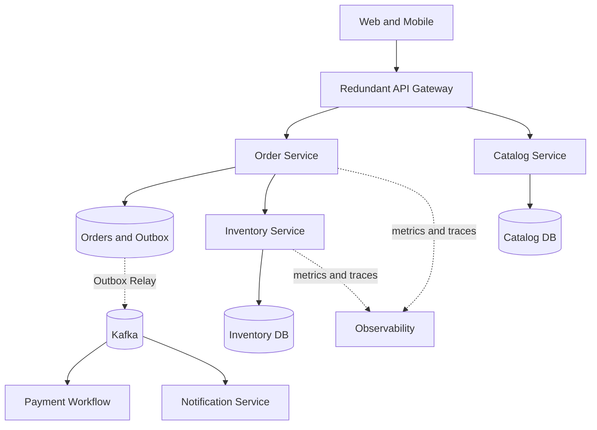

# Week 7 — Day 7: Revision and Microservices Order Platform Mock Interview

## Objectives
Bring together service boundaries, API gateway, discovery, REST/gRPC, resilience, configuration, security, observability and reliable distributed workflows. The final exercise is a 40-minute whiteboard interview for an omnichannel order platform.

## 1. Revision checklist by day
- Day 1: Microservices vs modular monolith, bounded contexts, domain ownership, database-per-service trade-offs.
- Day 2: API gateway, reverse proxy, edge routing, TLS, authentication, CORS, quotas and rate limits.
- Day 3: Eureka/Kubernetes service discovery, client-side/server-side load balancing, readiness and rolling deployments.
- Day 4: REST, RestClient/WebClient, gRPC/protobuf, deadlines, contracts and service identity.
- Day 5: Timeouts, bounded retries and jitter, Resilience4j circuit breaker, bulkhead, load shedding and safe fallback.
- Day 6: Externalized configuration, secrets, distributed tracing, metrics/logs, outbox, Saga and reconciliation.

## 2. Interview problem: Omnichannel Order Platform
Design a backend for mobile and web clients that browse catalog, reserve inventory, create orders, authorize payment, and notify customers. Assume peak 1,000 order creations/second, read-heavy catalog, multi-instance deployment and a team capable of operating microservices. These are **illustrative requirements**, not measured capacity. Ask about consistency, availability, latency targets, regional scope and payment guarantees first.

## 3. Functional requirements
1. List products and retrieve detail.
2. Create orders with an idempotency key.
3. Verify/reserve stock, preventing overselling.
4. Process payment without duplicate charge for one logical intent.
5. Read order state and limit it to the authorized owner.
6. Notify after terminal state changes.

Nonfunctional: define p95/p99 latency target, peak load, availability/error SLO, durable order and payment state, auditability, backpressure, security and recovery objectives.

## 4. Domain decomposition
**Catalog Service:** product descriptions, read-heavy; its DB is authoritative for catalog metadata.
**Inventory Service:** stock count, reservations and expiry; its DB enforces stock invariants.
**Order Service:** order status and customer intent; its DB and outbox are authoritative.
**Payment Service:** attempts and provider references; idempotent charge/reconcile.
**Notification Service:** email or message side effect; eventual delivery with retry.
**Gateway:** TLS, routing, client identity checks, rate limits. It does not own order rules.



## 5. APIs and service identity
```http
POST /api/orders
Idempotency-Key: <stable-logical-request-id>
Authorization: Bearer <valid-token>
Content-Type: application/json

{"items":[{"sku":"SKU-101","quantity":2}]}

HTTP/1.1 202 Accepted
{"orderId":"ord-123","status":"PENDING"}
```
```http
GET /api/orders/ord-123
Authorization: Bearer <valid-token>

HTTP/1.1 200 OK
{"orderId":"ord-123","status":"CONFIRMED"}
```
Return a real result status rather than claiming a pending payment is confirmed. Services should validate authorization on **the specific order** and authenticate one another using permitted workload identities.

## 6. Capacity and latency reasoning
At peak 1,000 orders/sec, if each order makes one inventory reservation attempt, Inventory may see 1,000 RPS before retries, confirmations and reads. Three serial 500-ms calls exceed a 1-second user budget even when each seems individually fast. Measure per-instance throughput and DB locks before deciding instance count. A queue smooths asynchronous bursts but cannot create unlimited downstream payment capacity.

## 7. Core workflow
1. Client creates order with idempotency key.
2. Order Service commits a PENDING order and event to its PostgreSQL DB.
3. Outbox relay publishes stable eventId to Kafka; duplicates are possible.
4. Inventory reserves with unique business requestId and DB atomic update.
5. Payment authorizes using stable provider idempotency identifier.
6. Order advances to CONFIRMED, FAILED, or COMPENSATING according to actual result.
7. Notification processes terminal event independently, with retries.
8. Reconciler inspects stale PENDING and compensating states.

A failure between remote business steps cannot be undone by rolling back the local Order DB transaction.

## 8. Failure matrix

| Failure | User-visible behavior | Durable/recovery requirement |
|---|---|---|
| Gateway instance dies | Load balancer routes healthy edge nodes | Redundant gateway and readiness |
| Inventory response lost after reservation | Order may remain PENDING | Query by same requestId, do not reserve twice |
| Payment success response lost | No second charge | Provider idempotency and reconciliation |
| Kafka unavailable | Accepted order remains pending | Outbox retains event and retries |
| Duplicate event | No duplicate business work | Consumer eventId/inbox deduplication |
| Redis unavailable | Potential slower catalog reads | Bounded DB fallback; inventory truth unchanged |
| Circuit open | Fast error or explicit pending state | Recovery probes and alert |
| Unauthorized order access | 403 or appropriate 404 policy | Per-object authorization |

## 9. Practical assessment
Conduct a 40-minute mock interview:
- 0–5 min: requirements and assumptions.
- 5–10 min: RPS, read/write ratio, SLO targets and budgets.
- 10–20 min: service boundaries, databases, gateway and request flow.
- 20–28 min: APIs, service communication, idempotency and outbox.
- 28–35 min: timeouts, circuit breakers, discovery and failure scenarios.
- 35–40 min: security, tracing, trade-offs and next steps.

### Scoring (20 points)
| Dimension | Maximum |
|---|---:|
| Requirements and capacity | 4 |
| Domain boundaries and contracts | 4 |
| Data correctness and workflows | 4 |
| Failure handling and resilience | 4 |
| Security and observability | 4 |

Score 16–20: strong foundation; 12–15: revise weak areas; below 12: repeat fundamentals and reconstruct design.

## 10. Interview question bank
1. When is a modular monolith better than microservices?
2. How are gateway, reverse proxy and service discovery different?
3. Client-side versus server-side load balancing?
4. Why can health checks cause restart storms?
5. REST versus gRPC versus Kafka?
6. Why must a reserve operation be idempotent?
7. How do you allocate request deadlines?
8. What are CLOSED, OPEN and HALF_OPEN circuit states?
9. What are safe and unsafe fallbacks?
10. Why must a service authorize its own resources?
11. How do metrics, logs and traces complement one another?
12. How does outbox solve part of the dual-write problem?
13. Why can Kafka consumers see duplicates?
14. How would you recover payment success with a lost response?
15. How would you deploy schema changes without breaking older service versions?

## Completion
- [ ] Revisit previous six days
- [ ] Draw system architecture from memory
- [ ] Write API contracts and domain states
- [ ] Explain five failure cases and correct business effects
- [ ] Complete mock interview
- [ ] Record weaknesses and future study tasks

**Next:** Week 8 — advanced scalability, capacity planning, high availability and system-design practice.
